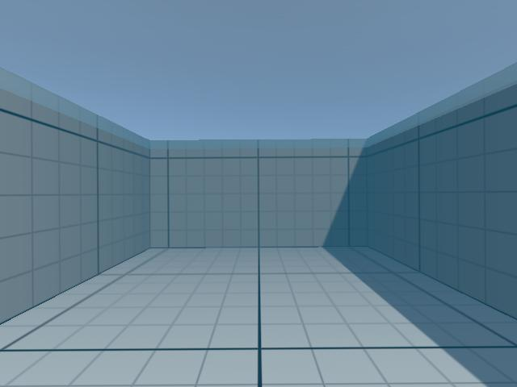

# AUV sensors

Simulated sensors of the robot fish (project slides 15 and 17), published to ROS 2 through the ROS-TCP-Connector.



*Image published on `/camera/compressed_image`, decoded on the ROS side.*

## 1. Overview

All sensors are children of the robot fish prefabs (`Assets/AUV/Prefabs/RobotFishDetailed.prefab`, used in the basin, and `RobotFish.prefab`), under `Sensors/`. Their scripts are in `Assets/AUV/Scripts/Sensors/`.

| Sensor | Object (mount) | Script | Topic | Message | Rate |
| --- | --- | --- | --- | --- | --- |
| RGB camera | `RGBCamera` (front dome) | `CameraPublisher` | `/camera/compressed_image` | `sensor_msgs/CompressedImage` (JPEG, 640×480) | 10 Hz |
| INS: gyroscope + accelerometer | `IMU` (center) | `ImuPublisher` | `/imu/data` | `sensor_msgs/Imu` | 50 Hz |
| INS: ground-truth velocity | `IMU` | `ImuPublisher` | `/ins/velocity` | `geometry_msgs/TwistStamped` | 50 Hz |
| INS: magnetometer | `IMU` | `MagnetometerPublisher` | `/imu/mag` | `sensor_msgs/MagneticField` | 20 Hz |
| Pressure (Bar30-like) | `PressureSensor` (rear cap) | `PressureSensor` | `/pressure`, `/depth` | `sensor_msgs/FluidPressure`, `std_msgs/Float64` | 20 Hz |
| GNSS | `GNSSAntenna` (top of the tube) | `GnssPublisher` | `/gnss/fix` (+ `/gnss/local`, `/gnss/ground_truth`) | `sensor_msgs/NavSatFix` | 5 Hz |

Topic names, rates and noise levels are fields of each component in the Inspector.

## 2. Frames

- **Sensor frame:** every sensor object is rotated so that its +Z axis points to the AUV forward direction (the AUV moves along its local −X axis). Measurements are converted to the ROS convention REP 103 "FLU" (x forward, y left, z up): `(x, y, z)_ROS = (Z, −X, Y)_Unity`. Angular velocities and quaternions also get the sign change of the left/right-handed flip (`SensorUtils`).
- **World frame:** Unity +Z = north, +X = east, +Y = up (used by the magnetometer and the GNSS).

## 3. Sensors

### RGB camera — `CameraPublisher`
- Unity camera rendering into a texture; the image is copied back from the GPU asynchronously (no frame stall) and encoded as JPEG (quality 75).
- Raw `sensor_msgs/Image` (`rgb8`) can also be enabled (`publishRaw`, topic `/camera/image`). Raw images at 640×480 and 10 Hz use about 9 MB/s.
- A picture-in-picture preview is drawn in the bottom-right corner of the Game view (`showPreview`).
- Field of view 70°, near plane 2 cm.

### Inertial sensor — `ImuPublisher`
- Gyroscope: angular velocity of the Rigidbody in the sensor frame.
- Accelerometer: specific force `f = dv/dt − g` of the sensor point, so it reads about +9.81 m/s² on z at rest.
- Orientation: sensor orientation in the world frame above.
- Gaussian noise (gyro 0.01 rad/s, accel 0.05 m/s²) and constant biases (zero by default); the covariances in the message match the noise.
- `/ins/velocity`: noise-free body velocity, useful to evaluate navigation.

### Magnetometer — `MagnetometerPublisher`
- Constant Earth field defined by intensity (47.9 µT), inclination (63.5°) and declination (1.0° W), approximate values for Brest (location of the ENSTA Air-Sea Test Basin) from the geomagnetic models for 2026.
- The field is expressed in the sensor frame, with an optional hard-iron bias and 0.3 µT noise.
- The Inspector shows the heading computed from the reading (0° = magnetic north, clockwise) for a level sensor.

### Pressure sensor — `PressureSensor`
- `p = p_atm + ρ·g·depth`, with the depth of the sensor below the basin water surface (read from `TestBasin`), 0 out of the water.
- Noise 20 Pa (about 2 mm of water, the Bar30 resolution) and optional bias.
- `/depth` is computed from the noisy pressure, as a driver would do: `depth = (p − p_atm) / (ρ·g)`.

### GNSS — `GnssPublisher`
- GNSS signals do not go through water: while the antenna is submerged (more than `maxAntennaDepth` = 5 cm), the receiver publishes `STATUS_NO_FIX` with NaN coordinates.
- At the surface: latitude/longitude/altitude around a reference point (ENSTA campus in Brest, where the Air-Sea Test Basin is: 48.4198° N, 4.4728° W, 110 m above the WGS84 ellipsoid at the basin bottom, estimate), using a local tangent-plane approximation of WGS84.
- Error: slowly drifting Gauss-Markov process (2 m horizontal, 4 m vertical, 30 s correlation) plus a little white noise.
- `/gnss/local` and `/gnss/ground_truth` give the measured and true positions in local ENU meters (simulation only).

## 4. Sensor positions

Positions in the local axes of the robot fish prefabs (forward = −X, up = +Y, right = +Z; origin = center of the hull tube). The physical model of the robot is described in [RobotFish_Model.md](RobotFish_Model.md).

| Sensor | Position [m] | Source |
| --- | --- | --- |
| RGB camera | (−0.215, 0, 0), inside the front dome; it does not render the `Robot` layer, so it does not see the robot itself | CAD |
| IMU + magnetometer | (−0.014, 0.015, 0), Navigator board | CAD |
| Pressure sensor | (0.21, 0.03, 0), rear cap | not in the CAD, estimate |
| GNSS antenna | (0, 0.07, 0), 15 mm above the top of the tube | not in the CAD, estimate |

## 5. Running with ROS 2

The Unity project uses the ROS-TCP-Connector v0.7.0 with the ROS 2 message format (scripting define `ROS2`). On the ROS 2 side, the ROS-TCP-Endpoint (branch `main-ros2`) relays the messages:

**Once: workspace with the endpoint**

```bash
source /opt/ros/jazzy/setup.bash
mkdir -p ~/ros2_ws/src && cd ~/ros2_ws/src
git clone -b main-ros2 https://github.com/Unity-Technologies/ROS-TCP-Endpoint.git
cd ~/ros2_ws && colcon build
```

**Terminal 1: ROS-TCP-Endpoint**

```bash
source /opt/ros/jazzy/setup.bash
export ROS_AUTOMATIC_DISCOVERY_RANGE=LOCALHOST   # keep the ROS graph on this machine (see the note below)
cd ~/ros2_ws && source install/setup.bash
ros2 run ros_tcp_endpoint default_server_endpoint --ros-args -p ROS_IP:=127.0.0.1
```

**Unity:** open `Assets/TestBasin/Scenes/Basin_Grid.unity`, press Play and click the Game view. The ROS indicator (top left) turns blue when connected. The Unity side connects to `127.0.0.1:10000` by default; another address can be set in **Robotics → ROS Settings**.

**Terminal 2: check the topics** (`hz` and `echo` run until Ctrl+C, so one at a time):

```bash
source /opt/ros/jazzy/setup.bash
export ROS_AUTOMATIC_DISCOVERY_RANGE=LOCALHOST
ros2 topic list                              # the sensor topics of section 1
ros2 topic hz /imu/data                      # about 50 Hz; Ctrl+C
ros2 topic echo /depth                       # about 2.47 m at the start; Ctrl+C
ros2 topic echo /gnss/fix --field status     # status -1 (no fix) under water, 0 at the surface; Ctrl+C
```

**Terminal 3: camera image** (needs `sudo apt install ros-jazzy-image-transport-plugins ros-jazzy-rqt-image-view` once). `rqt_image_view` expects the image_transport naming, so the JPEG topic is first converted to a raw image:

```bash
source /opt/ros/jazzy/setup.bash
export ROS_AUTOMATIC_DISCOVERY_RANGE=LOCALHOST
ros2 run image_transport republish --ros-args -p in_transport:=compressed -p out_transport:=raw \
  -r in/compressed:=/camera/compressed_image -r out:=/camera/image_raw &
ros2 run rqt_image_view rqt_image_view /camera/image_raw
```

**Note on shared networks (e.g. the lab network):** by default ROS 2 discovers every machine of the local network, so `ros2 topic list` also shows the topics of other robots, and topics with the same names could mix. `ROS_AUTOMATIC_DISCOVERY_RANGE=LOCALHOST` keeps the ROS graph on this machine, which is enough because Unity talks to the endpoint over TCP on 127.0.0.1. Set it in every terminal, including the endpoint one. After changing it, run `ros2 daemon stop` once so that the ROS 2 daemon forgets the robots it already discovered.

## 6. Verification

End-to-end test (Basin_Grid scene, ROS 2 Jazzy, ROS-TCP-Endpoint 0.7.0), made with the first AUV model (before the robot fish model; the sensors are the same). The AUV was driven by the test: 5 s at rest, 5 s at cruise speed, 2 s turning right, then minimum ballast so that it rises to the surface.

| Topic | Received | Check |
| --- | --- | --- |
| `/camera/compressed_image` | 10 Hz, 640×480 JPEG (~19 kB) | decoded image shows the basin ahead of the AUV |
| `/imu/data` | 50 Hz | at rest: acc ≈ (0, 0, +9.8) m/s²; during the right turn: gyro z ≈ −0.49 rad/s (0.5 rad/s applied) |
| `/imu/mag` | 20 Hz | \|B\| ≈ 47 µT; heading 0° facing north, 62° after the turn |
| `/pressure`, `/depth` | 20 Hz | 125 562 Pa / 2.47 m at y = 3.03 m (expected 2.47 m); 0.06 m at the surface |
| `/gnss/fix` | 5 Hz | `NO_FIX` while submerged; `FIX` once the antenna reached the surface, within a few meters of the reference |
| `/ins/velocity` | 50 Hz | — |

## 7. Limitations

- Sensor timestamps use the wall clock (UTC), not a simulation clock.
- The camera does not model lens distortion, motion blur or water turbidity beyond the scene fog.
- The magnetic field is uniform (no disturbance from the basin structure).
- The IMU orientation is perfect (no drift); a real INS estimates it from the sensors.
