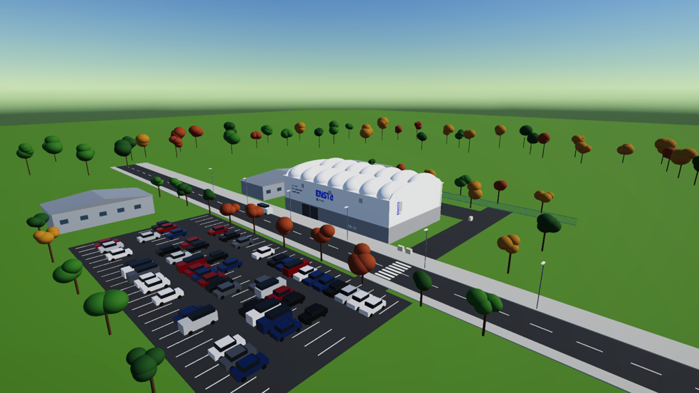
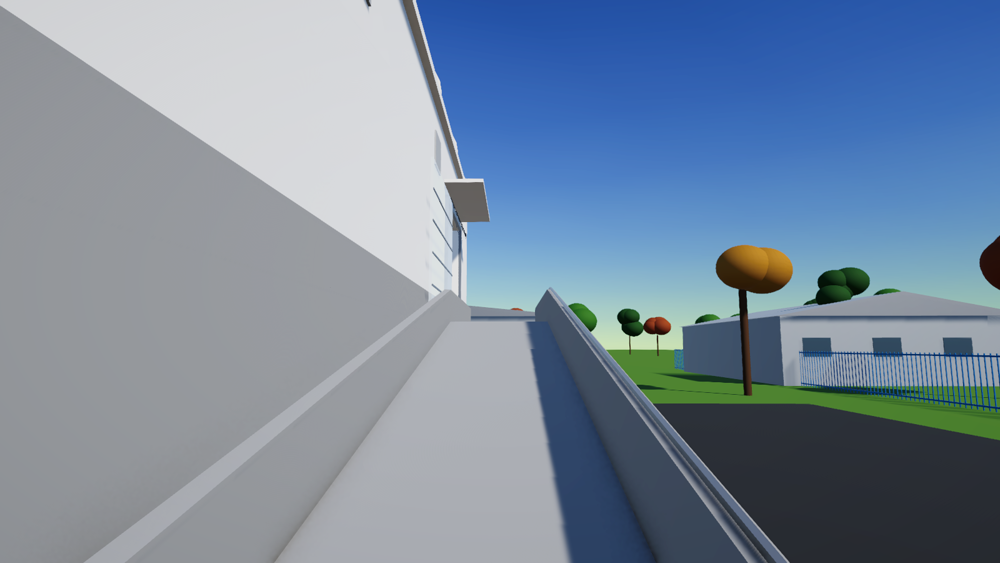
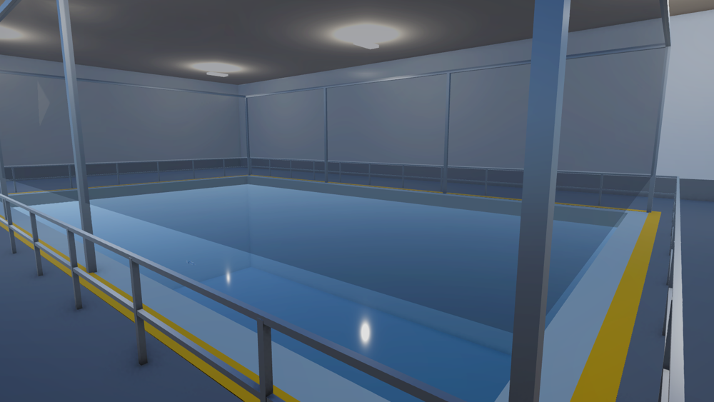

# Campus scene: the Air-Sea Test Basin building

Presentation scene of the simulation: the existing test basin and robot fish, inside a model of the ENSTA Air-Sea Test Basin building (Brest campus), with its surroundings (parking lot, road, trees, cars, neighbouring buildings), a sky and a camera tour from the parking lot down to the robot.



- **Scene:** `Assets/Environment/Scenes/AirSeaTestBasin_Campus.unity`
- **Built by:** `Assets/Environment/Editor/CampusSceneBuilder.cs` (menu **Tools → Campus → Build Campus Scene**)
- The basin, the robot fish, its sensors and the ROS 2 connection are the same as in `Basin_NoGrid`: everything in [AUV_Sensors.md](AUV_Sensors.md) and [GNC.md](GNC.md) works in this scene too.

## 1. Contents

| Group (under `Campus`) | Content |
| --- | --- |
| `AirSeaTestBasin` | building: grey concrete base, white walls, arched end walls, roof with two rows of inflated canvas domes, translucent sliding door, logos and signs |
| `HallInterior` | hall floor around the basin, yellow edge line, railing, netted aviary over the basin, workstation, ceiling lights |
| `EntranceRamp` | ramp climbing to the door (east side), parapets, handrail, road signs at its foot |
| `RoadsAndParking` | road with crosswalk on the west side, parking lot, service road and yard |
| `NeighbourBuildings`, `Fence`, `Trees`, `Cars`, `StreetFurniture` | surroundings (low-poly) |
| `Ground` | grass, 800 m × 800 m, with a ring of trees far away so that the edge of the world is not visible |

Lighting and image: sun, procedural sky (`Assets/Environment/Materials/Sky.mat`), URP post-processing volume (`Assets/Environment/Settings/CampusPostProcessing.asset`: ACES tonemapping, bloom, color adjustments, vignette), SMAA anti-aliasing.





## 2. Dimensions

The building is modelled from photos and from the ENSTA page on the inauguration of the basin (<https://www.ensta.fr/actualites/inauguration-du-bassin-dexperimentation-air-mer-unique-en-europe>). The page gives the basin size, the floor area, the aviary height and the roof (a canvas permeable to radio waves); the rest is estimated from the photos. All values are constants at the top of `CampusSceneBuilder.cs`.

| Item | Value | Source |
| --- | --- | --- |
| Basin | 20 m × 12 m × 6 m, fresh water | ENSTA page (existing `TestBasin` prefab) |
| Technical floor area | 900 m² | ENSTA page |
| Hall (outer size) | 36 m × 22 m = 792 m² on the ground floor | estimate, consistent with the 900 m² |
| Aviary over the basin | 5 m high | ENSTA page |
| Roof | canvas domes, 2 rows × 7, 2.8 m high | photos (count and shape), height estimated |
| Street level | 3 m below the hall floor (the ramp climbs 3 m) | photos, estimate |
| Concrete base | 3.8 m above the street | photos, estimate |
| White walls | top at 9.8 m above the street | photos, estimate |
| Entrance door | east wall, 5 m wide, 7.5 m high | photos, estimate |

Scene frame: the basin is centered on the origin, long axis along Z (north); its rim (y = 6 m) is the hall floor; the street is at y = 3 m.

## 3. Logos and signs

The textures in `Assets/Environment/Textures/` are generated by `Tools/scene_assets/make_textures.py` from the official ENSTA logo (not stored in the repository):

| File | Use |
| --- | --- |
| `ensta_logo_stacked.png` | ENSTA / IP Paris logo, long west wall and arched end walls |
| `ensta_slogan.png` | "L'école des grandes avancées", long west wall |
| `basin_sign.png` | "Bassin d'expérimentation Air-Mer / Air-Sea Test Basin" with pictograms, entrance |
| `sign_no_entry.png`, `sign_weight_limit.png`, `sign_restricted.png` | road signs at the foot of the ramp |

To generate them again (needs `python3-pil`, `python3-numpy` and the Lato fonts, `sudo apt install python3-pil python3-numpy fonts-lato`), from the repository root:

```bash
python3 Tools/scene_assets/make_textures.py <path to>/logo-ensta.jpg
```

## 4. Using the scene

**Open and play:** open `Assets/Environment/Scenes/AirSeaTestBasin_Campus.unity` and press Play. The camera tour starts by itself (about 41 s): aerial view of the campus, west facade, south end, entrance side, ramp, door, hall, over the basin, then down behind the robot. At the end the usual simulation camera takes over (follow mode) and the robot can be driven.

**Controls:**

| Key | Action |
| --- | --- |
| T | start / stop the camera tour |
| C | free camera (right mouse + WASD) / follow camera |
| Space | swim (tail flapping) |
| A / D | turn (while swimming) |
| W / S | pitch (moving mass) |
| Q / E | test ballast (simulation only) |

The tour is the `CameraTour` component of the main camera: its waypoints (position, look target, duration) can be edited in the Inspector, and `playOnStart` can be turned off.

**Moving mass:** in this scene the moving mass of the robot is set to 2.282 kg, the value that makes the robot neutral (see [RobotFish_Model.md](RobotFish_Model.md)), so that it stays at mid-depth for the presentation instead of floating at the surface with the 100 g starting weight.

**With ROS 2:** the scene publishes the same sensor topics and listens to the same commands as the basin scenes.

Terminal 1, ROS-TCP-Endpoint:

```bash
source /opt/ros/jazzy/setup.bash
export ROS_AUTOMATIC_DISCOVERY_RANGE=LOCALHOST
cd ~/ros2_ws && source install/setup.bash
ros2 run ros_tcp_endpoint default_server_endpoint --ros-args -p ROS_IP:=127.0.0.1
```

Unity: open `Assets/Environment/Scenes/AirSeaTestBasin_Campus.unity` and press Play.

Terminal 2, check the sensors and drive the robot:

```bash
source /opt/ros/jazzy/setup.bash
export ROS_AUTOMATIC_DISCOVERY_RANGE=LOCALHOST
ros2 topic list                                                   # sensor topics of AUV_Sensors.md
ros2 topic echo /gnss/fix --field status                          # -1 under water, 0 at the surface; Ctrl+C
ros2 topic pub -r 10 /cmd/thrust std_msgs/msg/Float64 "{data: 1.0}"   # robot swims forward; Ctrl+C
```

## 5. Rebuilding the scene

The scene is generated: to change it, edit `CampusSceneBuilder.cs` and run **Tools → Campus → Build Campus Scene**. The builder opens `Basin_NoGrid`, saves it as the campus scene and adds the campus around it, so changes made to `Basin_NoGrid` (basin, robot, sensors) also reach the campus scene at the next build. Hand edits of the campus scene are lost at each build. Materials go to `Assets/Environment/Materials/`, generated meshes to `Assets/Environment/Meshes/`. The random placement (trees, cars) uses a fixed seed, so every build gives the same scene.

## 6. Limitations

- Low-poly model: the building shape, colors and signs follow the photos, but details (doors, technical rooms, the movable floor of the basin, equipment) are simplified or missing.
- The hall ceiling is a flat deck under the domes.
- The surroundings (parking lot, road, neighbouring buildings) are illustrative, not the real layout of the campus.
