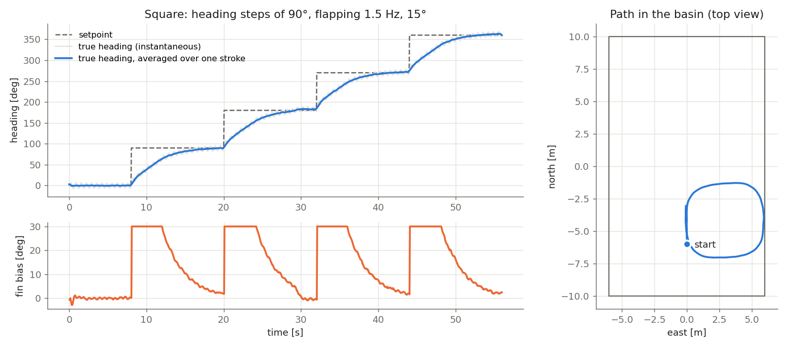
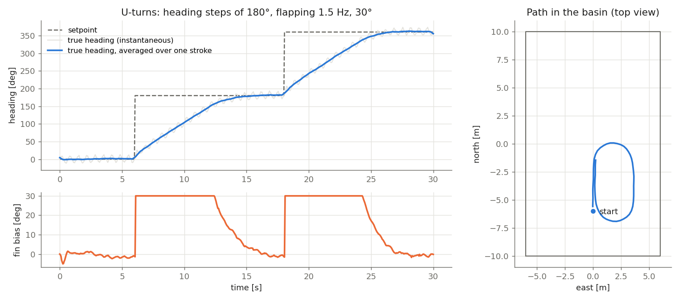

# Navigation, Guidance and Control (GNC)

High-level intelligence of the robot fish: heading following, depth regulation and, later, waypoint missions.
This document grows with each step of the GNC work; the current status is shown in section 2.

## 1. Architecture

```text
 sensors ──► NAVIGATION ──► estimated state ──► GUIDANCE ──► setpoints ──► CONTROL ──► actuator commands
 (Unity)     "where am I?"   depth, heading,     "where to     heading,      "how do I    /cmd/tail_frequency,
                             position, speed      go?"          depth, speed   get there?"  /cmd/tail_amplitude,
                                                                                            /cmd/tail_bias, /cmd/pitch
    ▲                                                                                              │
    └──────────────────────────────── Unity physics (RobotFishPhysics) ◄───────────────────────────┘
```

- **Navigation** estimates the state of the AUV from its sensors only (pressure, IMU, magnetometer, GNSS at the surface).
- **Guidance** turns the mission into setpoints (desired heading, depth and speed).
- **Control** computes the actuator commands that make the AUV follow the setpoints.

The simulation ground truth (`/ins/velocity`, `/gnss/ground_truth`, `GroundTruthLogger`) is never used by the GNC loop; it is only used to evaluate it.

Navigation, guidance and control run as ROS 2 nodes; the Unity simulation is the "plant" (physics + sensors + actuators).

**The real robot is a robot fish** ([RobotFish_Model.md](RobotFish_Model.md)): no propeller and no ballast. A single tail fin, moved side to side by a servo, gives propulsion (by flapping) and steering; it changes depth only by swimming forward with the nose tilted by the moving mass that slides along the tube axis (aft = nose up, forward = nose down), like a glider. The simulation keeps a ballast to set up tests, but the GNC never uses it. See section 4.

## 2. Status

| Step | Content | Status |
| --- | --- | --- |
| 1 | Actuator command interface (Unity side) | done |
| 1b | Robot fish model from the CAD: mass, buoyancy, water drag, moving mass, tail and dorsal fins ([RobotFish_Model.md](RobotFish_Model.md)) | done |
| 1c | Tail flapping propulsion and tail commands (frequency, amplitude, bias) ([RobotFish_Model.md](RobotFish_Model.md#35-tail-flapping-propulsion)) | done |
| 2 | Heading control: ROS 2 package `gnc_control`, node `heading_control` (section 5) | done |
| 2b | Tail oscillator of the real robot and common topics of the simulation and the robot (section 6) | done, not yet tested on the robot |
| 3a | Navigation: orientation, heading, depth and vertical speed; nodes `fusion` and `navigation` (section 7) | done, not yet tested on the robot |
| 3b | Navigation: position | planned |
| 4 | Depth control | planned |
| 5 | Guidance (setpoints, waypoints, mission) | planned |
| 6 | Launch file and evaluation | planned |

## 3. Actuator command interface

### 3.1 Topics

Each actuator has its own topic, type `std_msgs/Float64`, value normalized:

| Topic | Actuator | Range | Physical maximum (`RobotFishPhysics`) |
| --- | --- | --- | --- |
| `/cmd/tail_frequency` | flapping frequency of the tail fin | 0 … 1 | `maxTailFrequency` = 3 Hz |
| `/cmd/tail_amplitude` | flapping amplitude | 0 … 1 | `maxTailAngle` = 60° |
| `/cmd/tail_bias` | mean fin angle of the flapping: −1 full left turn, +1 full right turn | −1 … 1 | `maxTailAngle` = 60° |
| `/cmd/thrust` | shortcut: swim at cruise (flapping 1.5 Hz, amplitude thrust × 30°); negative values do nothing | 0 … 1 | `cruiseFrequency`, `cruiseAmplitude` |
| `/cmd/rudder` | shortcut: fin bias, −1 full left, +1 full right (turns only while swimming) | −1 … 1 | `rudderAngle` = 30° |
| `/cmd/pitch` | moving mass on the tube axis: −1 back end (nose up), +1 front end (nose down) | −1 … 1 | 0 = rest position (robot level); `movingMassTravel` = ±150 mm |
| `/cmd/ballast` | test ballast (speed), **simulation only**: −1 lighter (rises), +1 heavier (sinks) | −1 … 1 | `ballastRange` = ±25 % of the volume, `ballastRate` = 12.5 %/s |

Values outside the range are clamped; NaN is read as 0. The shortcuts `/cmd/thrust` and `/cmd/rudder` (also driven by the keyboard) are used only while the three tail commands are 0; the GNC controllers use the tail commands. With the `SimpleThrust` test model, `/cmd/thrust` is a forward force (0.3 N, ≈ 0.3 m/s, −1 = reverse) and `/cmd/rudder` a fixed fin angle (±30°).

**Why normalized commands:** the controllers do not depend on the actuator sizes. When the real actuators are measured, only the values in `RobotFishPhysics` change; the controllers keep working.

**Why one `Float64` topic per actuator:** no custom message to generate on the Unity and ROS sides, each actuator can be tested alone with `ros2 topic pub`, and each command can be plotted with `rqt_plot`.

**Ballast, simulation only:** the real robot has no ballast, so the GNC never publishes on `/cmd/ballast`. The topic only helps to set up tests in the simulation (e.g. bring the robot to a given depth before a test). The command is a pump speed; the buoyancy change is its integral.

### 3.2 Unity side

- `RobotFishPhysics` (`Assets/AUV/Scripts/RobotFishPhysics.cs`) reads public commands (`tailFrequencyCommand`, `tailAmplitudeCommand`, `tailBiasCommand`, `thrustCommand`, `rudderCommand`, `pitchCommand`, `ballastCommand`). With `externalControl` off, the keyboard writes the shortcuts and the others (Space, A/D, W/S, Q/E: 0 or ±1). With `externalControl` on, the keyboard is ignored.
- `ActuatorCommandSubscriber` (`Assets/AUV/Scripts/Control/ActuatorCommandSubscriber.cs`), on the robot fish prefabs, subscribes to the seven topics and hands the commands to `RobotFishPhysics` before each physics step. `RobotFishPhysics` itself has no dependency on ROS.

### 3.3 Watchdog

If no command arrives for `commandTimeout` = 0.5 s (controller stopped, endpoint down), the actuators go to a safe state (no flapping, fin centered, mass centered, pump stopped) and the keyboard takes over again. A controller must therefore publish continuously (typically 10–20 Hz), not only when the command changes.

### 3.4 Manual test

**Terminal 1: ROS-TCP-Endpoint** (workspace with the endpoint, see [AUV_Sensors.md](AUV_Sensors.md#5-running-with-ros-2) to create it once):

```bash
source /opt/ros/jazzy/setup.bash
export ROS_AUTOMATIC_DISCOVERY_RANGE=LOCALHOST   # see the note on shared networks below
cd ~/ros2_ws && source install/setup.bash
ros2 run ros_tcp_endpoint default_server_endpoint --ros-args -p ROS_IP:=127.0.0.1
```

**Unity:** open `Assets/TestBasin/Scenes/Basin_Grid.unity`, press Play and click the Game view. The ROS indicator (top left) turns blue when connected.

**Terminal 2: commands.** `ros2 topic pub` keeps publishing until Ctrl+C, so run one command at a time (or each one in its own terminal to combine them):

```bash
source /opt/ros/jazzy/setup.bash
export ROS_AUTOMATIC_DISCOVERY_RANGE=LOCALHOST   # see the note on shared networks below

# swims forward at cruise (flapping 1.5 Hz, 30°: about 0.7 m/s); Ctrl+C to stop
ros2 topic pub -r 10 /cmd/thrust std_msgs/msg/Float64 "{data: 1.0}"

# or set the flapping directly: 2 Hz (needs an amplitude too, in another terminal); Ctrl+C to stop
ros2 topic pub -r 10 /cmd/tail_frequency std_msgs/msg/Float64 "{data: 0.667}"

# amplitude 30° (0.5 × 60°), with the frequency of the previous command; Ctrl+C to stop
ros2 topic pub -r 10 /cmd/tail_amplitude std_msgs/msg/Float64 "{data: 0.5}"

# test ballast, simulation only: the robot gets lighter and rises; Ctrl+C to stop
ros2 topic pub -r 10 /cmd/ballast std_msgs/msg/Float64 "{data: -1.0}"
```

**Turning needs forward speed** (section 4): keep the thrust command of terminal 2 running and, in **terminal 3**, shift the flapping to one side:

```bash
source /opt/ros/jazzy/setup.bash
export ROS_AUTOMATIC_DISCOVERY_RANGE=LOCALHOST   # see the note on shared networks below

# turns left with a 15° bias, while terminal 2 publishes the thrust; Ctrl+C to stop
ros2 topic pub -r 10 /cmd/rudder std_msgs/msg/Float64 "{data: -0.5}"

# with the direct tail commands of terminal 2, use the bias instead: 10° to the left; Ctrl+C to stop
ros2 topic pub -r 10 /cmd/tail_bias std_msgs/msg/Float64 "{data: -0.17}"
```

After Ctrl+C the actuators return to neutral within 0.5 s and the keyboard works again (watchdog).

**Optional, terminal 4: watch the result** while a command is published:

```bash
source /opt/ros/jazzy/setup.bash
export ROS_AUTOMATIC_DISCOVERY_RANGE=LOCALHOST   # see the note on shared networks below
ros2 topic echo /depth                                     # depth decreases while the ballast is emptied
ros2 topic echo /imu/data --field angular_velocity.z       # yaw rate, positive while turning left
```

In the Unity Inspector, `RobotFishDetailed` → `Actuator Command Subscriber` shows `Ros In Control`, the last commands received and the message count.

**Note on shared networks (e.g. the lab network):** by default ROS 2 discovers every machine of the local network, so `ros2 topic list` also shows the topics of other robots, and commands such as `/cmd/thrust` could reach them (or theirs could reach the simulation). `ROS_AUTOMATIC_DISCOVERY_RANGE=LOCALHOST` keeps the ROS graph on this machine, which is enough because Unity talks to the endpoint over TCP on 127.0.0.1. Set it in every terminal, including the endpoint one. After changing it, run `ros2 daemon stop` once so that the ROS 2 daemon forgets the robots it already discovered.

### 3.5 Verification

Scripted test in `Basin_Grid`: a ROS 2 node published a command sequence at 20 Hz, Unity logged the AUV state. This test was made with the first AUV model (propeller and rudder torque); the robot fish model is verified in [RobotFish_Model.md](RobotFish_Model.md#5-verification).

| Commands | Result |
| --- | --- |
| none | AUV at rest at y = 3.00 m, keyboard control |
| thrust 1 | speed 0.38 m/s after ~1.5 s (≈ 6° nose-down trim, as with the keyboard) |
| thrust 1, rudder 0.5 | yaw rate 0.26 rad/s (≈ half of the full-rudder rate) |
| nothing for 2 s | watchdog after 0.5 s, back to keyboard, AUV stops |
| thrust -1 | moves backwards at 0.38 m/s |
| thrust 1, pitch 1 | nose down, the AUV dives (y 2.50 → 2.06 m in 2 s) |
| ballast -1 | ballast 0.50 → 0 in 2 s, the AUV rises to the surface (y = 5.41 m) |

## 4. What the GNC must take into account

The physics of the robot fish is described in [RobotFish_Model.md](RobotFish_Model.md). For the GNC, the main consequences are:

- **No ballast:** depth is controlled only through the pitch (moving mass) while swimming forward. Vertical speed ≈ forward speed × sin(pitch). With the moving mass heavy enough to be neutral (≈ 2.3 kg), a few centimetres of displacement tilt the robot by tens of degrees and its full travel (±150 mm) makes it vertical, so the depth controller must limit the displacement it commands. Depth control will be a cascade: depth error → desired pitch → moving-mass position.
- **Weak self-righting:** the center of mass is only about 10 mm below the center of buoyancy (simulation value, set by how low the battery is mounted), so the robot tilts and rolls easily and pitch oscillates slowly after a change; the pitch loop must damp it.
- **One fin for propulsion and steering:** speed is set by the flapping frequency and amplitude (about 0.7 m/s at 1.5 Hz and 30°, see [RobotFish_Model.md](RobotFish_Model.md#51-tail-flapping)), the heading by the bias of the oscillation (10° of bias: about 8°/s while swimming at cruise). The two are coupled: a large bias reduces the useful amplitude (the fin is limited to ±60°) and the speed.
- **Turning needs speed:** the bias only steers while the robot swims.
- **The heading oscillates with each stroke** (±3° to ±10° depending on the amplitude): the heading controller must not try to cancel this oscillation, it should act on the heading averaged over a flapping period (low-pass filter or averaging on the magnetometer/IMU heading).
- **Servo limits:** above about 2 Hz at 30° the servo can no longer follow the commanded amplitude, and beyond 2.5 Hz the water moment exceeds its stall torque. The controllers should stay within this range.
- **Roll and depth with flapping:** the flapping makes the robot roll a little (±1.6° at cruise). The simulated robot also sinks slowly during long runs, which still has to be understood before the depth control.
- **Unknown buoyancy:** it depends on the real masses and on the weight added to the moving mass (the simulation uses the neutral weight, 714 g). The controllers must work for a neutral robot and for a slightly floating one.

## 5. Step 2: heading control

The node `heading_control` (package `ros2_ws/src/gnc_control`, Python, `rclpy`) makes the robot follow a heading setpoint while it swims. The flapping (frequency and amplitude) is kept constant; the node steers with the **bias** of the flapping.

### 5.1 Interface

| Direction | Topic | Type | Content |
| --- | --- | --- | --- |
| in | `/guidance/heading` | `std_msgs/Float64` | heading setpoint [deg, clockwise from true north]. Until the first message, the node holds the heading it measures at start |
| in | `/state/heading` | `std_msgs/Float64` | heading estimated by the navigation [deg, clockwise from true north] (section 7) |
| out | `/cmd/tail_frequency`, `/cmd/tail_amplitude`, `/cmd/tail_bias` | `std_msgs/Float64` | actuator commands (section 3), 20 Hz |
| out | `/gnc/heading`, `/gnc/heading_error`, `/gnc/tail_bias` | `std_msgs/Float64` | measured heading (averaged) [deg], error [deg], fin bias [deg], for monitoring |

If the estimated heading stops for 0.5 s, the node stops publishing and the watchdog of the simulator or of `tail_oscillator` stops the flapping. Parameters: `ros2_ws/src/gnc_control/config/heading_control.yaml`.

### 5.2 Design

1. **Heading measurement.** The heading comes from the navigation (section 7). The first version of this node used a tilt-compensated compass with the perfect roll and pitch of the simulator, which a real robot does not have.
2. **Stroke filter.** The heading swings with each stroke of the tail (±3° at 15°, ±6° at 30°). The controller must not try to cancel this swing, so the heading is averaged over exactly one flapping period (0.67 s at 1.5 Hz), which removes it with a small delay. Angles are averaged as unit vectors, so the average is right across 0/360°.
3. **PI controller.** `bias = kp·error + ki·∫error dt`, error wrapped to (−180°, 180°] (the robot always turns the short way), bias limited to ±30° so that the fin keeps a useful flapping amplitude (it is limited to ±60°). Anti-windup by conditional integration: while the bias is saturated, the integral does not grow, so a large turn does not cause an overshoot. No derivative term: it would amplify what remains of the stroke swing; the water damps the yaw by itself.
4. **Tuning from an identified model.** Bias steps in the simulation (flapping 1.5 Hz) show that the yaw rate settles in less than half a second at a value proportional to the bias: **yaw rate ≈ K · bias**, with K = 0.75 /s at 30° of amplitude and 0.33 /s at 15° (10° of bias → 7.5°/s and 3.3°/s). Seen by the controller, the robot is an integrator with the half-period delay of the filter. The gains were chosen by simulating this model with the stroke swing, the filter, the saturation and a constant drift: **kp = 1.5** (1° of error → 1.5° of bias; raised from 1.0 after the adjustment of the tail model, which made the turns slower at 15°), **ki = 0.02 /s**. The proportional term alone leaves less than 1° of error for the drift seen in the simulation; the small integral removes it without adding much overshoot.

### 5.3 Results (simulation, closed loop through ROS 2)

`Basin_Grid`, neutral robot, flapping 1.5 Hz. The "true" heading comes from the perfect IMU orientation, averaged over one stroke; it is used only to evaluate. These results were obtained with the first version of the heading measurement, the first tail model and kp = 1.0; section 7.4 gives the current results.





| Test | Amplitude | Within ±5° of the target after | Overshoot | Error at the end of the segment | Residual swing (averaged heading) |
| --- | --- | --- | --- | --- | --- |
| Square, 4 steps of 90° | 15° (0.44 m/s) | 7.0–8.1 s | 1.0–4.8° | −0.9 to +2.9° | ±1.3–2.1° |
| U-turns, 2 steps of 180° | 30° (0.71 m/s) | 7.8–8.1 s | 2.5–5.8° | +1.2 to +1.6° | ±2.7–3.5° |

- The large turns are made with the bias saturated at 30°: about 12°/s at 15° of amplitude and 25°/s at 30°. The U-turn has a radius of about 1.6 m at 0.71 m/s.
- The end of each turn is slower than the model predicted (time constant ≈ 1/(K·kp), 1.3 s at 30° and 2.5 s at 15°); kp could be raised a little at 30° of amplitude. The overshoot (up to 6°) is slightly larger than in the model (2°).
- Unit tests (`ros2_ws/src/gnc_control/test/`): angles from a quaternion, average across 0/360°, sign and short way of the error, saturation, anti-windup, and closed-loop steps of 30°, 90° and 180° on the identified model.

### 5.4 Running it

**Once: build the workspace of this repository** (needs ROS 2 Jazzy):

```bash
source /opt/ros/jazzy/setup.bash
cd <path to>/brazilian-team-repo/ros2_ws
colcon build --symlink-install
```

**Unit tests** (no Unity needed):

```bash
source /opt/ros/jazzy/setup.bash
cd <path to>/brazilian-team-repo/ros2_ws
colcon test --packages-select gnc_control
colcon test-result --verbose
```

**Terminal 1: ROS-TCP-Endpoint** (workspace with the endpoint, see [AUV_Sensors.md](AUV_Sensors.md#5-running-with-ros-2)):

```bash
source /opt/ros/jazzy/setup.bash
export ROS_AUTOMATIC_DISCOVERY_RANGE=LOCALHOST
cd ~/ros2_ws && source install/setup.bash
ros2 run ros_tcp_endpoint default_server_endpoint --ros-args -p ROS_IP:=127.0.0.1
```

**Unity:** open `Assets/TestBasin/Scenes/Basin_Grid.unity`, press Play and click the Game view.

**Terminal 2: navigation** (needs `imufusion`, section 7.6; the estimate is ready after about 3 s):

```bash
source /opt/ros/jazzy/setup.bash
export ROS_AUTOMATIC_DISCOVERY_RANGE=LOCALHOST
cd <path to>/brazilian-team-repo/ros2_ws && source install/setup.bash
ros2 launch gnc_control navigation.launch.py
```

**Terminal 3: heading controller** (the robot starts swimming and holds its heading):

```bash
source /opt/ros/jazzy/setup.bash
export ROS_AUTOMATIC_DISCOVERY_RANGE=LOCALHOST
cd <path to>/brazilian-team-repo/ros2_ws && source install/setup.bash
ros2 launch gnc_control heading_control.launch.py
```

**Terminal 4: give a heading** (one at a time, Ctrl+C between them; the basin is small, so keep the robot away from the walls):

```bash
source /opt/ros/jazzy/setup.bash
export ROS_AUTOMATIC_DISCOVERY_RANGE=LOCALHOST
ros2 topic pub -r 2 /guidance/heading std_msgs/msg/Float64 "{data: 90.0}"    # east
ros2 topic pub -r 2 /guidance/heading std_msgs/msg/Float64 "{data: 270.0}"   # west
```

**Terminal 5: watch it:**

```bash
source /opt/ros/jazzy/setup.bash
export ROS_AUTOMATIC_DISCOVERY_RANGE=LOCALHOST
ros2 topic echo /gnc/heading_error      # goes to about 0 after each turn; Ctrl+C
```

To stop the robot, stop the controller (Ctrl+C in terminal 3): without commands, the flapping stops after 0.5 s.

**Scripted test** (the tests of section 5.3), instead of terminal 4: with the navigation and the controller running (terminals 2 and 3, here with a 15° amplitude so that the square fits in the basin), the node `heading_test` publishes a sequence of setpoints and writes a CSV (time, setpoint, measured heading, true heading, bias):

```bash
source /opt/ros/jazzy/setup.bash
export ROS_AUTOMATIC_DISCOVERY_RANGE=LOCALHOST
cd <path to>/brazilian-team-repo/ros2_ws && source install/setup.bash
ros2 run gnc_control heading_test --ros-args -p sequence:="0:8,90:12,180:12,270:12,0:12" -p output:=square.csv
```

with terminal 3 started as:

```bash
source /opt/ros/jazzy/setup.bash
export ROS_AUTOMATIC_DISCOVERY_RANGE=LOCALHOST
cd <path to>/brazilian-team-repo/ros2_ws && source install/setup.bash
ros2 run gnc_control heading_control --ros-args --params-file src/gnc_control/config/heading_control.yaml -p cruise_amplitude_deg:=15.0
```

### 5.5 Limitations

- In the simulation, the magnetometer sees a uniform field. In the real basin, the steel structure and the electronics of the robot disturb it, so the calibration of section 7.5 is needed.
- The speed is not controlled (constant flapping), and a large bias reduces the useful amplitude of the fin, so the robot slows down slightly in turns.
- The gains were identified at 1.5 Hz with amplitudes of 15° and 30°; other flapping settings change K (section 5.2) and may need other gains.

## 6. Step 2b: from the simulation to the real robot

The GNC nodes must be the same in the simulation and on the robot. They differ only below the command topics: the simulator computes the flapping inside `RobotFishPhysics`, while the real servo only accepts the angle to reach at each instant. The node `tail_oscillator` fills this gap on the robot.

```text
                 heading_control, depth_control (planned)
                                │
      /cmd/tail_frequency, /cmd/tail_amplitude, /cmd/tail_bias, /cmd/pitch
                 │                                      │
            SIMULATION                             REAL ROBOT
       RobotFishPhysics               tail_oscillator ──/servo/tail──► servo driver
                                                   /cmd/pitch ───────► servo driver
```

### 6.1 Common topics

All are `std_msgs/Float64`.

| Topic | Range | Meaning | Simulation | Robot |
| --- | --- | --- | --- | --- |
| `/cmd/tail_frequency` | 0 … 1 | fraction of 3 Hz | `RobotFishPhysics` | `tail_oscillator` |
| `/cmd/tail_amplitude` | 0 … 1 | fraction of 60° | `RobotFishPhysics` | `tail_oscillator` |
| `/cmd/tail_bias` | −1 … 1 | fraction of 60°, + = fin to the right | `RobotFishPhysics` | `tail_oscillator` |
| `/cmd/pitch` | −1 … 1 | moving mass, + = forward, nose down | `RobotFishPhysics` | servo driver |
| `/servo/tail` | −1 … 1 | angle the tail servo must reach now, ±1 = ±500 µs around 1500 µs | not used | servo driver |
| `/cmd/thrust`, `/cmd/rudder`, `/cmd/ballast` | see section 3 | keyboard-like shortcuts and test ballast | `RobotFishPhysics` | not used |

Sign and range of `/cmd/pitch` on the robot still have to be checked (section 6.5): the simulation uses ±150 mm of travel, and the real travel is not known yet.

### 6.2 Node `tail_oscillator`

| Direction | Topic | Content |
| --- | --- | --- |
| in | `/cmd/tail_frequency`, `/cmd/tail_amplitude`, `/cmd/tail_bias` | flapping commands |
| out | `/servo/tail` | servo command, 50 Hz |
| out | `/gnc/fin_angle` | fin angle asked to the servo [deg], for monitoring |

Parameters: `ros2_ws/src/gnc_control/config/tail_oscillator.yaml`. It uses only ROS messages, so it does not depend on the hardware and can be tested on any computer.

### 6.3 Design

- **Same law as the simulator:** `fin = bias + amplitude·sin(phase)`, limited to ±60°.
- **Integrated phase:** `phase += 2π·frequency·dt`. With `sin(2π·f·t)`, each change of frequency would make the fin jump. The time step is measured, so a late timer does not change the frequency.
- **50 Hz:** the rate of the servo PWM.
- **Watchdog:** without commands for 0.5 s, the commands are forgotten, the fin returns to the center and the phase restarts at 0, so the next flapping starts from the bias.
- **Stopping the node:** on Ctrl+C or SIGTERM, the node publishes the center once more.
- **Servo scale:** `servo_range_deg` is the fin angle reached at command 1 and `invert` reverses the direction. The output is always limited to [−1, 1].

The servo driver must have its own watchdog, because `tail_oscillator` cannot publish anything if it crashes, and the moving mass does not go through this node.

### 6.4 Verification

Unit tests (`ros2_ws/src/gnc_control/test/test_tail_oscillator.py`): waveform, frequency, bias, fin limit, no jump when the frequency changes, irregular timer, out-of-range values, NaN, watchdog, restart and servo scale.

Test with ROS 2 on a laptop, without Unity or hardware: `heading_control` and `tail_oscillator` running together, a test node publishing a constant magnetometer reading and a setpoint 10° to the right, and recording `/servo/tail`.

| Check | Result |
| --- | --- |
| Rate of `/servo/tail` | 50.0 Hz, 99 % of the intervals below 22 ms |
| Flapping frequency (commanded: 1.5 Hz) | 1.50 Hz |
| Amplitude around the bias (commanded: 30°) | ±30.0° |
| Bias against `/gnc/tail_bias` | follows it (10.4° to 12.1° while the integral acts) |
| `heading_control` stopped | fin at the center after about 0.5 s, the node keeps publishing |
| `tail_oscillator` stopped (SIGINT, SIGTERM) | last message is the center |

Not verified yet: the timing on the Raspberry Pi and the real servo.

### 6.5 What to set on the robot

With the fin free, out of the water:

1. **Range:** command `/servo/tail` to 1.0, measure the fin angle and write it in `servo_range_deg`.
2. **Direction:** with a positive command, the fin must go to the right, seen from above with the nose pointing forward. Otherwise set `invert: true`.
3. **Moving mass:** command `/cmd/pitch` to a small positive value. The mass must move forward. Note the real travel at ±1.
4. **Safe limits:** check that the fin and the mass do not hit anything at ±1 before running at full range.

### 6.6 Running it

**Once: build the workspace of this repository** (needs ROS 2 Jazzy):

```bash
source /opt/ros/jazzy/setup.bash
cd <path to>/brazilian-team-repo/ros2_ws
colcon build --symlink-install
```

**Unit tests** (no Unity or hardware needed):

```bash
source /opt/ros/jazzy/setup.bash
cd <path to>/brazilian-team-repo/ros2_ws
colcon test --packages-select gnc_control
colcon test-result --verbose
```

**Terminal 1: tail oscillator:**

```bash
source /opt/ros/jazzy/setup.bash
export ROS_AUTOMATIC_DISCOVERY_RANGE=LOCALHOST   # remove on the robot if the commands come from another computer
cd <path to>/brazilian-team-repo/ros2_ws && source install/setup.bash
ros2 launch gnc_control tail_oscillator.launch.py
```

**Terminal 2: flapping frequency** (1.5 Hz = 0.5 × 3 Hz; keeps publishing until Ctrl+C):

```bash
source /opt/ros/jazzy/setup.bash
export ROS_AUTOMATIC_DISCOVERY_RANGE=LOCALHOST
ros2 topic pub -r 10 /cmd/tail_frequency std_msgs/msg/Float64 "{data: 0.5}"
```

**Terminal 3: flapping amplitude** (30° = 0.5 × 60°; keeps publishing until Ctrl+C):

```bash
source /opt/ros/jazzy/setup.bash
export ROS_AUTOMATIC_DISCOVERY_RANGE=LOCALHOST
ros2 topic pub -r 10 /cmd/tail_amplitude std_msgs/msg/Float64 "{data: 0.5}"
```

**Terminal 4: watch the result:**

```bash
source /opt/ros/jazzy/setup.bash
export ROS_AUTOMATIC_DISCOVERY_RANGE=LOCALHOST
ros2 topic hz /servo/tail                # about 50 Hz; Ctrl+C
ros2 topic echo /gnc/fin_angle           # swings between −30° and +30°; Ctrl+C
```

Press Ctrl+C in terminals 2 and 3: after 0.5 s, `/gnc/fin_angle` stays at 0.

The node does not command the simulator: to test the GNC in Unity, follow section 5.4 without `tail_oscillator`.

## 7. Step 3a: navigation of orientation and depth

The controllers must only use what the real robot can measure. The real IMU gives no orientation, so two nodes estimate the state from the raw sensors. They follow the architecture of the `navigator` package given in the course, which separates `fusion` from `navigation`.

```text
/imu/data (gyroscope, accelerometer) ─┐
/imu/mag ─────────────────────────────┴─► fusion ─/state/attitude─┐
                                                                  ├─► navigation ─► /state/heading ─► heading_control
/depth ───────────────────────────────────────────────────────────┘               ► /state/roll, /state/pitch
                                                                                  ► /state/depth, /state/depth_rate
```

### 7.1 Interface

| Node | Direction | Topic | Type | Content |
| --- | --- | --- | --- | --- |
| `fusion` | in | `/imu/data` | `sensor_msgs/Imu` | only the gyroscope and the accelerometer, never the orientation field |
| `fusion` | in | `/imu/mag` | `sensor_msgs/MagneticField` | magnetometer [T] |
| `fusion` | out | `/state/attitude` | `sensor_msgs/Imu` | orientation, body FLU → world NWU, relative to magnetic north |
| `navigation` | in | `/state/attitude`, `/depth` | | see above; depth from the pressure sensor [m] |
| `navigation` | out | `/state/heading` | `std_msgs/Float64` | [deg, clockwise from true north] |
| `navigation` | out | `/state/roll`, `/state/pitch` | `std_msgs/Float64` | [deg], + = right side down, + = nose down |
| `navigation` | out | `/state/depth`, `/state/depth_rate` | `std_msgs/Float64` | filtered depth [m], vertical speed [m/s], + = going down |

Parameters: `ros2_ws/src/gnc_control/config/navigation.yaml`. The sensor topics keep the names of the simulator; only the outputs use the `/state` names of the course.

### 7.2 Design

- **Orientation:** the AHRS of the `imufusion` library, as in `node_fusion.py` of the course, with its gain of 0.5. It uses the NWU convention here instead of NED, because the simulation and the heading code already use NWU.
- **Calibration and axes:** parameters of `fusion`, neutral in the simulation (section 7.5). The values in `node_fusion.py` belong to another board, so they are not used.
- **No estimate, no output:** nothing is published during the first seconds (about 3 s), nor if the magnetometer stops for 0.5 s or the IMU stops. The controllers then stop publishing, and the watchdog stops the flapping.
- **Depth and vertical speed:** alpha-beta filter on `/depth` (alpha 0.2, beta 0.02), because the difference of two noisy readings would amplify the noise. The depth control (step 4) will need the vertical speed.
- **Declination:** applied by `navigation` (−1° in Brest). `/state/attitude` stays relative to magnetic north.

### 7.3 Time step

Messages can arrive in bursts. In the simulation, the arrival interval of `/imu/data` is typically 5 ms, with peaks beyond 78 ms, for an average of 20 ms. Each message still covers one sensor period, so the filter uses the sensor period as its time step (`sample_rate_hz`), not the arrival interval. The same recorded data gave:

| Time step of `fusion` | Heading error, rms | Heading error, maximum |
| --- | --- | --- |
| Arrival interval | 1.92° | 6.68° |
| Sensor period | 0.72° | 1.53° |

These values and those of the gain below were obtained with the first tail model.

The depth rate in the simulation varies with the frame rate, so `navigation` uses the average interval between readings instead of a fixed period. With the last interval, the vertical speed had peaks beyond ±1 m/s; with the average, it stays within −0.04 to +0.05 m/s.

**Gain:** a gain of 0.2 is slightly better with perfect sensors (maximum error 0.87° against 1.53°), but much worse with an uncalibrated gyroscope (about 3°/s of bias: 82° against 31°), so the gain of the course is kept.

### 7.4 Results (simulation, closed loop through ROS 2)

`Basin_Grid`, U-turns with flapping at 1.5 Hz and 30°: 8 s at 0°, 15 s at 180°, 15 s at 0°. The sensor errors of the last two rows are a gyroscope bias of (0.03, −0.02, 0.04) rad/s and a hard iron of (20, −15, 8) µT, set in the simulator. Estimation error: estimate against the perfect orientation of the same sensor message, used only to evaluate.

| Test | Heading error, rms / max | Roll error, rms / max | Pitch error, rms / max | Within ±5° after a turn | Overshoot | Error at the end |
| --- | --- | --- | --- | --- | --- | --- |
| No sensor errors | 0.92° / 2.14° | 0.61° / 1.33° | 0.45° / 1.29° | 8.2–8.8 s | 0.4–2.0° | −0.1 to +0.4° |
| Errors, calibrated | 0.80° / 1.53° | 0.59° / 1.30° | 0.41° / 1.17° | 8.4–8.6 s | 0.7–1.9° | −0.4 to −1.0° |
| Errors, not calibrated | 71° / 105° | 6.07° / 12.9° | 8.45° / 14.9° | never | over 100° | up to 101° |

Square with four 90° steps at 15° of amplitude: heading error 0.30° rms and 0.71° at most; within ±5° after 9.8–10.1 s, no overshoot, error at the end −1.5 to −2.7°. Turns at 15° are slower, since the robot swims more slowly (0.36 m/s) and K is smaller.

**Without calibration, the heading control fails**, so calibration is a required step on the robot, not a refinement.

Unit tests (`ros2_ws/src/gnc_control/test/test_navigation.py`): orientation at rest, convergence, a turn at 25°/s, calibration, gyroscope scale, sensor axes, sideways accelerations like the strokes of the tail, and the depth filter.

### 7.5 What to set on the robot

Run the `imu_calib` tools of the course with the robot assembled, then write the results in `config/navigation.yaml`:

| Parameter | Tool or test |
| --- | --- |
| `gyro_offset` | `tool_calib-gyro.py`, 10 s without moving |
| `accel_offset`, `accel_matrix` | `tool_calib-accel.py`, six faces |
| `mag_hard`, `mag_soft` | `tool_calib-mag-log.py` (75 s, turning in all directions), then `tool_calib-mag-fit.py` |
| `gyro_scale` | turn the robot by 90° and compare with the integrated gyroscope; the course code uses 0.25 on the Navigator |
| `axes` | check that `/state/roll`, `/state/pitch` and `/state/heading` move with the right signs |
| `sample_rate_hz`, `depth_rate_hz` | rates of the driver |

### 7.6 Running it

**Once: install `imufusion` and build the workspace** (needs ROS 2 Jazzy; same installation on the Raspberry Pi):

```bash
python3 -m pip install --user --break-system-packages imufusion
source /opt/ros/jazzy/setup.bash
cd <path to>/brazilian-team-repo/ros2_ws
colcon build --symlink-install
```

**Unit tests** (no Unity needed):

```bash
source /opt/ros/jazzy/setup.bash
cd <path to>/brazilian-team-repo/ros2_ws
colcon test --packages-select gnc_control
colcon test-result --verbose
```

**Terminal 1: ROS-TCP-Endpoint** (workspace with the endpoint, see [AUV_Sensors.md](AUV_Sensors.md#5-running-with-ros-2)):

```bash
source /opt/ros/jazzy/setup.bash
export ROS_AUTOMATIC_DISCOVERY_RANGE=LOCALHOST
cd ~/ros2_ws && source install/setup.bash
ros2 run ros_tcp_endpoint default_server_endpoint --ros-args -p ROS_IP:=127.0.0.1
```

**Unity:** open `Assets/TestBasin/Scenes/Basin_Grid.unity`, press Play and click the Game view.

**Terminal 2: navigation:**

```bash
source /opt/ros/jazzy/setup.bash
export ROS_AUTOMATIC_DISCOVERY_RANGE=LOCALHOST
cd <path to>/brazilian-team-repo/ros2_ws && source install/setup.bash
ros2 launch gnc_control navigation.launch.py
```

**Terminal 3: watch the state** (one command at a time, Ctrl+C between them). Move the robot with the keyboard in the Game view (A/D while swimming with Space):

```bash
source /opt/ros/jazzy/setup.bash
export ROS_AUTOMATIC_DISCOVERY_RANGE=LOCALHOST
ros2 topic echo /state/heading
ros2 topic echo /state/pitch
ros2 topic echo /state/depth
ros2 topic echo /state/depth_rate
```

To close the loop with the heading controller, continue with terminals 3 to 5 of section 5.4.

### 7.7 Limitations

- Not tested on the robot yet. The real sensor errors may be larger, and they may vary with the temperature and the current of the servos.
- The magnetic field of the simulation is uniform. The real basin may have disturbances that a calibration cannot remove.
- The time step assumes that the driver keeps its rate: if many IMU messages are lost, the estimate lags until the magnetometer corrects it.
