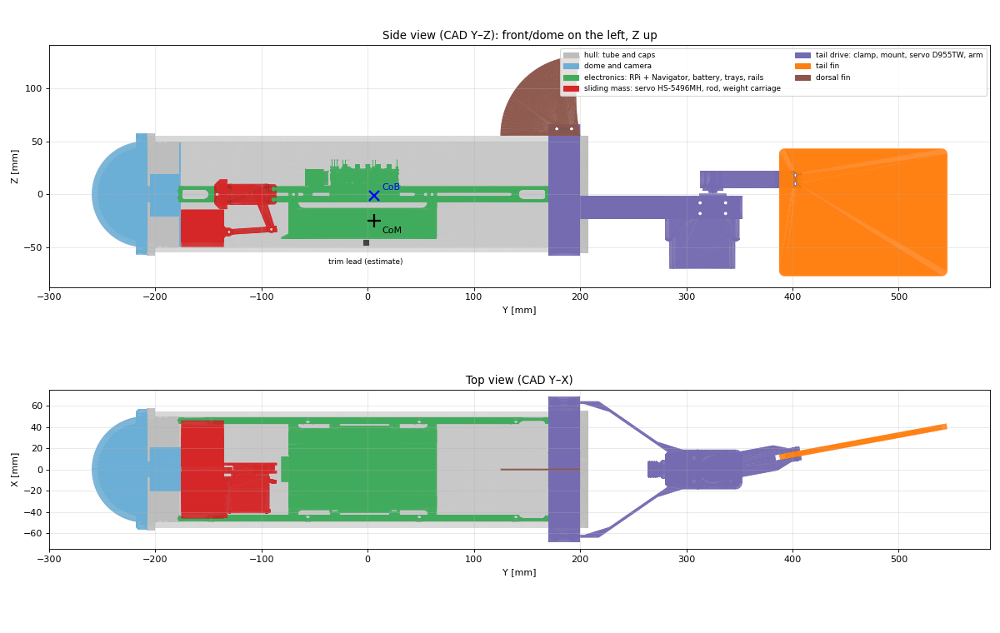

# Robot fish: properties estimated from the CAD

*Generated by `Tools/cad_analysis/cad_analysis.py` from the Onshape export and `Tools/cad_analysis/assumptions.yaml`. Do not edit by hand: change the assumptions and run the script again (see `Tools/cad_analysis/README.md`).*

Frames: CAD = (X lateral, Y long axis with the front at −Y, Z up); Unity = local axes of the `RobotFish` prefab (forward = −X, up = +Y, right = +Z), Unity = (CAD y, CAD z, −CAD x). Positions are relative to the tube center.

## Overall dimensions

| | Value |
| --- | --- |
| Total length (dome tip → tail fin tip) | 806 mm |
| Hull (dome tip → rear cap) | 468 mm |
| Tube | Ø110 mm outer, 400 mm long |
| Width (rear clamp) | 137 mm |
| Height (tail fin bottom → dorsal fin top) | 207 mm |

## Mass budget

| Part | Material / source | Status | CAD volume [cm³] | Mass [g] | Centroid CAD [mm] |
| --- | --- | --- | --- | --- | --- |
| `tube` | acrylic | estimate | 659.5 | 785 | (-0.0, 0.0, -0.0) |
| `cap_front` | PLA (3D printed) | estimate | 64.2 | 80 | (0.0, -195.7, 0.0) |
| `cap_rear` | PLA (3D printed) | estimate | 108.5 | 135 | (-0.0, 199.0, 0.0) |
| `dome_cercle` | acrylic | estimate | 107.7 | 128 | (-0.0, -228.2, 0.0) |
| `camera` | camera module | estimate | 8.1 | 15 | (0.0, -204.2, -0.0) |
| `camera_mount` | PLA | estimate | 11.3 | 14 | (-0.0, -185.8, -3.0) |
| `rail_400` | aluminium | estimate | 13.1 | 35 | (-46.1, -4.0, -0.0) |
| `rail_400_1` | aluminium | estimate | 13.1 | 35 | (46.1, -4.0, -0.0) |
| `tray_rpi` | PLA | estimate | 31.3 | 39 | (0.0, -2.9, -0.0) |
| `tray_battery` | PLA | estimate | 55.8 | 69 | (0.2, -2.8, -25.2) |
| `rpi_navigator` | Raspberry Pi 4 + Navigator board | estimate | 44.5 | 80 | (0.9, -13.8, 14.8) |
| `battery` | LiPo | estimate | 166.8 | 367 | (0.2, -5.1, -27.5) |
| `_hs_5496mh` | Hitec HS-5496MH servo | datasheet | 29.5 | 61 | (-22.4, -112.3, -0.0) |
| `conector_servo` | PLA | estimate | 5.2 | 7 | (-28.2, -136.3, -0.0) |
| `conector_servo_1` | PLA | estimate | 1.7 | 2 | (1.2, -97.1, -14.9) |
| `haste` | steel rod | estimate | 2.0 | 16 | (1.2, -110.6, -34.2) |
| `conector_pesos` | PLA | estimate | 40.1 | 50 | (0.0, -155.4, -31.8) |
| `clamp` | PLA | estimate | 47.0 | 58 | (0.0, 184.9, -5.3) |
| `servo_mount` | PLA | estimate | 31.5 | 39 | (0.0, 261.7, -11.4) |
| `underwater_servo` | Hitec D955TW + PLA housing | estimate | 142.2 | 150 | (-0.0, 314.6, -34.7) |
| `underwater_servo_hub` | aluminium | estimate | 1.5 | 4 | (-0.0, 325.0, 6.2) |
| `conector_calda` | PLA | estimate | 30.1 | 37 | (5.8, 356.3, 14.0) |
| `calda` | PLA | estimate | 95.8 | 119 | (26.2, 466.7, -17.0) |
| `calda_lateral` | PLA | estimate | 6.3 | 8 | (-0.0, 166.8, 87.0) |
| `sliding_weights` | not in the CAD | estimate | 0.0 | 400 | (0.0, -155.4, -31.8) |
| `cables_and_screws` | not in the CAD | estimate | 0.0 | 100 | (0.0, 0.0, 0.0) |
| `trim ballast (lead)` | computed | estimate | 0.0 | 1882 | (0.0, -2.0, -45.0) |
| **Total** | | | | **4714** | |

## Buoyancy and balance

| Quantity | Value |
| --- | --- |
| Displaced volume | 4.71 L (tube envelope 3.80, cap discs 0.17, dome 0.39, parts outside the hull 0.35) |
| Dry mass (without trim ballast) | 2.83 kg → buoyancy +66 % of the weight |
| Target buoyancy | +0 % |
| Trim ballast needed | **1882 g** at y = -2.0 mm, z = -45 mm (CAD) |
| Total mass | 4.71 kg |
| Center of buoyancy (CAD) | (0.6, 6.1, -1.3) mm |
| Center of mass (CAD) | (0.4, 6.1, -24.8) mm |
| CoM below CoB (BG) | 23.5 mm → righting moment 1.09 N·m/rad |

## Sliding mass (pitch)

| Quantity | Value |
| --- | --- |
| Moving weight | 400 g |
| Travel | ±24.0 mm (horn 34 mm × sin 45°) |
| Carriage speed | 0.25 m/s (HS-5496MH 0.14 s/60°) |
| CoM shift at full travel | ±2.04 mm |
| Maximum static pitch | ±5.0° |
| (with 800 g in the carriage) | ±9.9° |
| (with 1200 g in the carriage) | ±14.9° |

## Inertia

| Axis (Unity) | Rigid body [kg·m²] | Added (water) [kg·m²] | Total used [kg·m²] |
| --- | --- | --- | --- |
| roll (x, long axis) | 0.0059 | 0 | 0.0059 |
| yaw (y, vertical) | 0.0932 | 0.0507 | 0.1439 |
| pitch (z, lateral) | 0.0949 | 0.0507 | 0.1455 |

Hull added mass sideways and vertically: 3.80 kg (not used in the simulation, see `RobotFish_Model.md`).

## Fins

| | Tail fin (`calda`) | Dorsal fin (`calda_lateral`) |
| --- | --- | --- |
| Planform area | 191.5 cm² | 42.1 cm² |
| Chord × span | 160 × 120 mm | 75 × 75 mm (quarter disc) |
| Thickness | 5.2 mm | 1.6 mm |
| Aspect ratio | 0.75 | – |
| Moves | yes, servo axis at CAD y = 325 mm (vertical axis) | no (fixed) |
| Leading / trailing edge behind the axis | 64 / 224 mm | – |
| Center of pressure (¼ chord) | 104 mm behind the axis, height -17 mm | CAD (0.0, 170.0, 85.3) mm |
| Deflection in the exported CAD | 10.4° | – |

Tail servo: max angle ±30°, speed 500°/s, torque 2.84 N·m (D955TW at 7.4 V).

## Values for the Unity simulation (`RobotFishPhysics`)

| Field | Value |
| --- | --- |
| `displacedVolume` | 0.00471 m³ |
| `centerOfMass` (Unity) | (6.1, -24.8, -0.4) mm |
| `inertia` (Unity x, y, z) | (0.0059, 0.1439, 0.1455) kg·m² |
| `slidingMass`, `slidingTravel`, `slidingSpeed` | 0.40 kg, 0.024 m, 0.25 m/s |
| `tailHinge` (Unity) | (325.0, 6.2, 0.0) mm |
| tail fin center of pressure | 0.104 m behind the hinge, height -0.017 m |
| `tailFinArea`, `dorsalFinArea` | 0.0192 m², 0.0042 m² |
| `dorsalFinCenter` (Unity) | (170.0, 85.3, -0.0) mm |
| `tailServoSpeed`, `maxTailAngle` | 500°/s, 30° |
