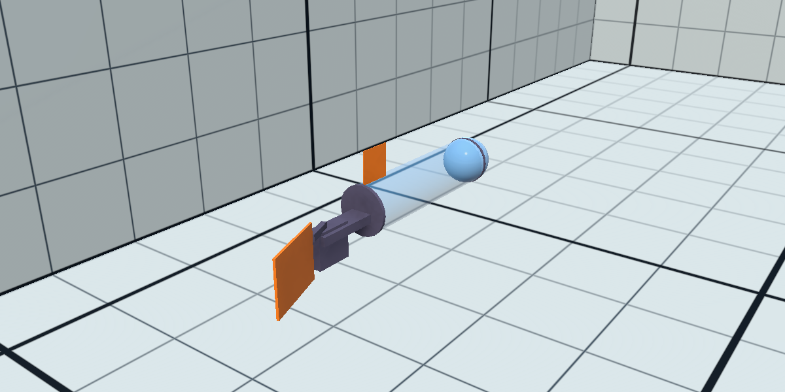

# Robot fish: physical model

The real robot is a **robot fish**: it has no propeller and no ballast. A single vertical tail fin, moved side to side by a waterproofed servo, gives both propulsion (by flapping) and steering; a sliding weight inside the hull tilts it nose up or down, and it changes depth by swimming forward with the nose tilted, like a glider.

This document describes the robot (from its CAD model) and how the Unity simulation represents it. The numbers come from [RobotFish_CAD_Report.md](RobotFish_CAD_Report.md) (generated by `Tools/cad_analysis`); every assumed value is listed in [RobotFish_Assumptions.md](RobotFish_Assumptions.md).



*`RobotFish` prefab in the basin, tail fin deflected 20°.*

## 1. The robot (CAD)


| Part | Description |
| --- | --- |
| Hull | acrylic tube Ø110/100 mm × 400 mm, closed by two caps |
| Front | transparent dome (hemisphere Ø114 mm) with the camera |
| Inside | two rails carrying the trays: Raspberry Pi 4 + Navigator board (IMU, magnetometer) on top, battery below |
| Pitch | Hitec HS-5496MH servo, horn and rod pushing a weight carriage at the front bottom of the tube (sliding mass) |
| Tail drive | clamp around the rear cap, V-shaped support, Hitec D955TW servo in a waterproof housing, vertical axis 325 mm behind the tube center, arm to the fin |
| Tail fin | vertical plate 160 × 120 mm (191.5 cm²), 5 mm thick |
| Dorsal fin | fixed quarter disc R 75 mm (42 cm²) on top of the rear cap, stabilizer |
| Size | 806 mm long (468 mm of hull), 110 mm wide (137 mm at the clamp), 207 mm high with the fins |

The pressure sensor and the GNSS antenna exist on the robot but are not in the CAD.

## 2. Main results of the CAD analysis

| Quantity | Value | Consequence |
| --- | --- | --- |
| Displaced volume | 4.71 L | a neutral robot weighs 4.71 kg |
| Estimated dry mass | 2.83 kg | the robot floats strongly (+66 %) unless lead is added: about **1.9 kg of trim lead** for neutral buoyancy |
| Center of mass below the center of buoyancy | 23.5 mm | the robot returns to level by itself (righting moment 1.09 N·m/rad) |
| Sliding mass (400 g, ±24 mm) | ±5° of pitch | at 0.3 m/s the robot climbs or dives at most about 2.6 cm/s; with more of the trim lead in the carriage the authority grows (800 g → ±10°) |

## 3. Simulation model

The robot is the prefab `Assets/AUV/Prefabs/RobotFish.prefab`:

```text
RobotFish            Rigidbody, CapsuleCollider, RobotFishPhysics, ActuatorCommandSubscriber
├── Visual           simple shapes with the CAD dimensions (tube, caps, dome, tail drive, fins)
│   └── TailFinPivot rotated by RobotFishPhysics with the fin angle
└── Sensors          RGBCamera, IMU, PressureSensor, GNSSAntenna (see AUV_Sensors.md)
```

Local axes: forward = −X, up = +Y, right = +Z; origin = tube center. The physics is in `Assets/AUV/Scripts/RobotFishPhysics.cs`; each physics step it applies:

### 3.1 Mass properties

- **Mass** = ρ · V / (1 + trim): the robot is assumed trimmed with lead to the buoyancy set by `buoyancyTrimPercent` (0 = neutral). 4.71 kg when neutral.
- **Center of mass** from the mass budget, 24.8 mm below the axis. With `levelTrim` (default), it is placed exactly under the computed center of buoyancy, as if the trim lead had been placed to make the robot rest level.
- **Inertia** set explicitly (Unity would compute it as if the robot were a uniform solid): roll 0.0059, yaw 0.144, pitch 0.146 kg·m², including the added inertia of the water in pitch and yaw.
- **Sliding mass**: the carriage moves toward `pitchCommand × slidingTravel` at `slidingSpeed`; the center of mass moves by `slidingMass / mass × carriage position` (±2 mm at full travel).

### 3.2 Buoyancy

The displaced volume is filled with points (1 cm grid inside the tube, caps and dome, plus one point per part outside the hull). Each point carries its share of the volume and pushes up with ρ·g·V when it is under water; near the surface a point goes from dry to wet over one grid step, so the robot emerges smoothly. This gives the correct center of buoyancy (it depends on the shape, not on the mesh vertices) and the correct floating height at the surface.

### 3.3 Hull drag

Quadratic drag F = −½·ρ·C·A·|v|·v, with the real water density (the previous model used a damping about 15 times too strong):

- **along the hull:** C = 0.6 on the frontal area (95 cm²);
- **across the hull:** C = 1.1, computed on 12 slices of the hull, each with its own sideways and vertical velocity. A rotating hull is therefore braked as well (the slices far from the center move faster), without a separate angular damping;
- **tail drive:** its own crossflow drag;
- a small linear damping keeps the robot from drifting forever at very low speed.

### 3.4 Fins

Both fins use the same quasi-steady flat-plate model: the water flowing over the plate gives a force along its normal,

F = −n · ½ · ρ · A · |v|² · C_N(α),   sin α = (v · n) / |v|,

with C_N = 1.2 · α below the stall angle (25°) and 1.2 · sin α beyond (flat plate). The velocity *v* is the velocity of the fin's center of pressure through the water: robot motion (including its rotation) plus, for the tail fin, the motion of the fin itself when the servo moves it.

- **Tail fin**: angle = `rudderCommand × maxTailAngle` (±30°), reached at the servo speed (500°/s). With the robot moving forward, a deflected fin pushes the stern sideways and the robot turns. With the fin centered, it resists any sideways slide of the stern, so the robot goes straight (passive stability, like the feathers of an arrow). Because the force comes from the water flow, a fin held still does not turn a robot that does not move; a fast fin stroke, however, pushes water like a paddle and turns the robot a little (that is how fish turn on the spot, and it is the basis of the flapping propulsion of step 1c).
- **Dorsal fin**: fixed, adds yaw and roll stability.

### 3.5 Temporary propulsion and test ballast

- Until the flapping model (step 1c), `/cmd/thrust` (or Space) applies a **temporary** forward force at the tail: 0.3 N gives about 0.3 m/s.
- The **test ballast** (Q/E, `/cmd/ballast`) changes the buoyancy by up to ±25 %. It exists **only in the simulation** (the real robot has no ballast) and is meant to set up tests, never to be used by the GNC.

### 3.6 Commands

| Command | Keyboard | ROS 2 topic | Range |
| --- | --- | --- | --- |
| Temporary thrust | Space | `/cmd/thrust` | −1 … 1 (× 0.3 N) |
| Tail fin angle | A / D | `/cmd/rudder` | −1 … 1 (× 30°), + = turn right |
| Sliding mass | W / S | `/cmd/pitch` | −1 … 1 (× 24 mm), + = mass forward, nose down |
| Test ballast (simulation only) | Q / E | `/cmd/ballast` | −1 … 1 (pump speed), + = heavier |

See [GNC.md](GNC.md#3-actuator-command-interface) for the ROS interface and its watchdog.

## 4. Verification

Scripted tests in `Basin_Grid`, commands published by a ROS 2 node at 20 Hz:

| Test | Result |
| --- | --- |
| At rest, trim 0 % | level (pitch and roll 0.0°), stays at its depth |
| Temporary thrust 1 (0.3 N) | 0.306 m/s after about 10 s, level (−0.2°) |
| Thrust 1, tail fin 30° | turns at 7.1°/s (radius ≈ 2.1 m), 0.5° of roll |
| Thrust 1, fin back to 0 | yaw rate back to 0, straight line |
| Fin stroke 0 → 30° with the robot stopped | turns about 20° from the stroke, then stops |
| Thrust 1, sliding mass forward (pitch 1) | pitch ≈ +5° nose down, dives at 0.023 m/s (= 0.307 × sin 4.6°) |
| Thrust 1, sliding mass aft (pitch −1) | pitch ≈ −5° nose up, climbs at 0.021 m/s |
| Thrust cut at 0.3 m/s | glides and slows down (0.30 → 0.10 m/s in 7.5 s) |
| Trim +2 %, no command | rises at 0.17 m/s, floats with 98 % of its volume under water, level; the GNSS antenna is 2 cm above the water |

The ±5° pitch matches the prediction of the CAD analysis.

## 5. How to test

**Keyboard** (no ROS needed): open the Unity Hub (on this computer through the NVIDIA GPU: `__NV_PRIME_RENDER_OFFLOAD=1 __GLX_VENDOR_LIBRARY_NAME=nvidia unityhub &`), open the project, open `Assets/TestBasin/Scenes/Basin_Grid.unity`, press Play and click the Game view.

1. Wait a few seconds: the robot stays level at its depth.
2. Hold **Space**: it accelerates slowly to about 0.3 m/s.
3. Keep Space and hold **D** (or **A**): it turns right (left). Release D: it goes straight.
4. Keep Space and hold **W**: the nose goes down a few degrees and the robot slowly dives; **S** makes it climb.
5. Release everything: it glides and stops.
6. **Buoyancy:** stop Play, select `RobotFish` in the Hierarchy, set `Buoyancy Trim Percent` to `2` in `Robot Fish Physics`, press Play: the robot rises to the surface and floats. Set it back to 0 (or do not save the scene).

The `Debug` section of `Robot Fish Physics` (Inspector) shows the mass, the submerged fraction, the forward speed, the fin angle and the carriage position.

**From ROS 2:**

**Terminal 1: ROS-TCP-Endpoint** (workspace with the endpoint, see [AUV_Sensors.md](AUV_Sensors.md#5-running-with-ros-2) to create it once):

```bash
source /opt/ros/jazzy/setup.bash
export ROS_AUTOMATIC_DISCOVERY_RANGE=LOCALHOST
cd ~/ros2_ws && source install/setup.bash
ros2 run ros_tcp_endpoint default_server_endpoint --ros-args -p ROS_IP:=127.0.0.1
```

**Unity:** open `Assets/TestBasin/Scenes/Basin_Grid.unity`, press Play and click the Game view (the ROS indicator turns blue).

**Terminal 2: swim forward** (keep it running):

```bash
source /opt/ros/jazzy/setup.bash
export ROS_AUTOMATIC_DISCOVERY_RANGE=LOCALHOST
ros2 topic pub -r 10 /cmd/thrust std_msgs/msg/Float64 "{data: 1.0}"
```

**Terminal 3: steer or tilt** (one command at a time, Ctrl+C between them):

```bash
source /opt/ros/jazzy/setup.bash
export ROS_AUTOMATIC_DISCOVERY_RANGE=LOCALHOST
ros2 topic pub -r 10 /cmd/rudder std_msgs/msg/Float64 "{data: 1.0}"   # turns right
ros2 topic pub -r 10 /cmd/pitch std_msgs/msg/Float64 "{data: 1.0}"    # nose down: dives slowly
ros2 topic pub -r 10 /cmd/pitch std_msgs/msg/Float64 "{data: -1.0}"   # nose up: climbs slowly
```

**Terminal 4: watch the depth and the yaw rate:**

```bash
source /opt/ros/jazzy/setup.bash
export ROS_AUTOMATIC_DISCOVERY_RANGE=LOCALHOST
ros2 topic echo /depth                                   # decreases while climbing; Ctrl+C
ros2 topic echo /imu/data --field angular_velocity.z     # negative while turning right (ROS convention)
```

After Ctrl+C on every `pub`, the actuators return to neutral within 0.5 s (watchdog) and the keyboard works again.

## 6. Limitations

- **Propulsion:** the tail flapping is not modeled yet; the temporary thrust replaces it (step 1c).
- **Added mass:** the water that moves with the hull sideways and vertically (≈ 3.8 kg) is not simulated, because Unity bodies have one mass for all directions; only the added inertia in pitch and yaw is included. Sideways and vertical accelerations are therefore faster than in reality.
- **Unsteady effects:** the fin force is quasi-steady (no wake, no delay in the build-up of lift).
- **Coefficients:** drag and lift coefficients are literature values for simple shapes, not measured on this robot.
- **Visual:** simple shapes with the CAD dimensions; the CAD meshes can replace them later.
