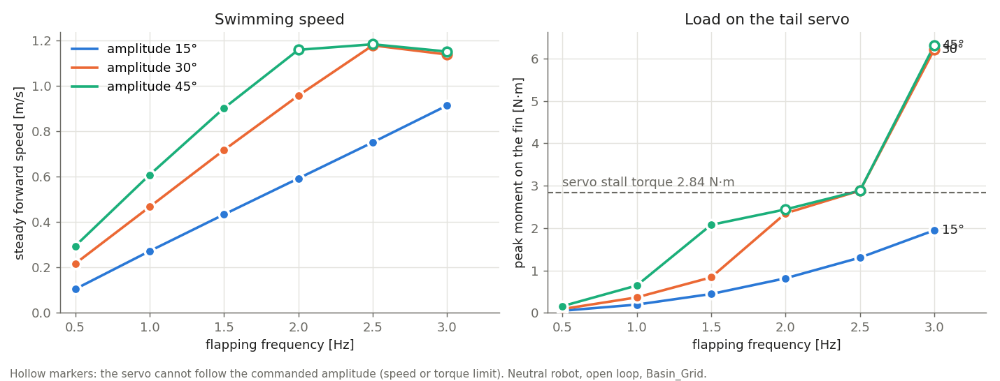
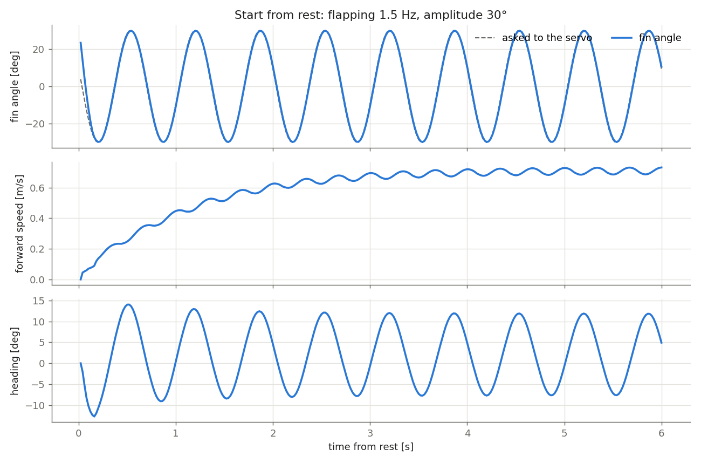

# Robot fish: physical model

The real robot is a **robot fish**: it has no propeller and no ballast. A single vertical tail fin, moved side to side by a waterproofed servo, gives both propulsion (by flapping) and steering; a **moving mass** that slides along the tube axis tilts it nose up or down, and it changes depth by swimming forward with the nose tilted, like a glider. The robot carries nothing else: its weight is its structure (hull, electronics, battery, servos, fins) plus the moving mass, whose weight is adjustable.

This document describes the robot (from its CAD model) and how the Unity simulation represents it. The numbers come from [RobotFish_CAD_Report.md](RobotFish_CAD_Report.md) (generated by `Tools/cad_analysis`); every assumed value is listed in [RobotFish_Assumptions.md](RobotFish_Assumptions.md).


*`RobotFishDetailed` prefab (CAD parts, transparent hull) seen from its left side.*

## 1. The robot (CAD)


| Part | Description |
| --- | --- |
| Hull | acrylic tube Ø110/100 mm × 400 mm, closed by two caps |
| Front | transparent dome (hemisphere Ø114 mm) with the camera |
| Inside | two rails carrying the trays: Raspberry Pi 4 + Navigator board (IMU, magnetometer) on top, battery below |
| Moving mass | a weight that slides along the tube axis (vertically and laterally centered) over 300 mm (the tube length minus 50 mm at each end). Its weight is adjustable; the simulation uses the weight that makes the robot neutral (714 g). How it is driven is not known; the CAD shows an HS-5496MH servo with a horn, a rod and a carriage at the front of the tube, kept in the simulation as a static visual |
| Tail drive | clamp around the rear cap, V-shaped support, Hitec D955TW servo in a waterproof housing, vertical axis 325 mm behind the tube center, arm to the fin |
| Tail fin | vertical plate 160 × 120 mm (191.5 cm²), 5 mm thick |
| Dorsal fin | fixed quarter disc R 75 mm (42 cm²) on top of the rear cap, stabilizer |
| Size | 806 mm long (468 mm of hull), 110 mm wide (137 mm at the clamp), 207 mm high with the fins |

The pressure sensor and the GNSS antenna exist on the robot but are not in the CAD.

## 2. Main results of the CAD analysis

| Quantity | Value | Consequence |
| --- | --- | --- |
| Displaced volume | 4.71 L | the water pushes the robot up with the weight of 4.71 kg |
| Structure mass | **4.0 kg** (team estimate). The parts of the CAD (volume × assumed material) explain 2.43 kg; the remaining 1.57 kg is placed at the tube center, on the axis (battery, electronics and cables are there) | – |
| Moving mass for neutral buoyancy | **714 g**: the simulation uses this weight | the robot is neutral (4.71 kg) and stays at its depth; **weighing the robot** remains the most useful measurement |
| Center of mass of the structure | 18 mm behind and 4 mm below the center of buoyancy (the tail servo is heavy and at the rear) | submerged, the robot tends to raise its nose; the moving mass rests 92 mm forward of the tube center to keep it level, which leaves 58 mm of travel forward and 242 mm backward |
| Moving-mass authority | with 714 g, about 11 mm of displacement tilts the robot by 30° at rest | a few centimetres of travel are enough to tilt the robot by tens of degrees; the depth controller will use only a small part of the travel |
| Center of mass below the center of buoyancy | 2.8 mm (neutral) | weak self-righting: the robot rolls and tilts easily |

## 3. Simulation model

Two prefabs share the same physics (`RobotFishPhysics`) and sensors; only their visual differs:

| Prefab | Visual | Use |
| --- | --- | --- |
| `Assets/AUV/Prefabs/RobotFishDetailed.prefab` | the 24 CAD parts, transparent hull, moving mass and tail that move (section 4) | **used in the basin scenes** |
| `Assets/AUV/Prefabs/RobotFish.prefab` | simple shapes with the CAD dimensions | lightweight alternative; holds the reference physics values |

```text
RobotFishDetailed     Rigidbody, CapsuleCollider, RobotFishPhysics, ActuatorCommandSubscriber, RobotFishVisual
├── Visual            (layer "Robot", not rendered by the robot's own camera)
│   ├── Hull          tube and dome (transparent acrylic), caps
│   ├── Camera        camera and its mount
│   ├── Electronics   rails, trays, Raspberry Pi + Navigator, battery
│   ├── PitchMechanism  MovingMass (square carriage + metal weight on the tube axis, moves); CAD servo, horn, rod, carriage (static)
│   ├── TailDrive     clamp, V support, servo D955TW; TailPivot (hub, arm, fin): moves
│   ├── DorsalFin
│   └── NotInCad      pressure sensor and GNSS antenna (estimated positions, yellow)
└── Sensors           RGBCamera, IMU, PressureSensor, GNSSAntenna (see AUV_Sensors.md)
```

Local axes: forward = −X, up = +Y, right = +Z; origin = tube center. The physics is in `Assets/AUV/Scripts/RobotFishPhysics.cs`; each physics step it applies:

### 3.1 Mass properties

- **Structure** (every part except the moving mass): `structureMass` = 4.0 kg, `structureCenterOfMass`, `structureInertia` (about its own center of mass, including the added inertia of the water in pitch and yaw), all from the CAD report.
- **Moving mass** on the tube axis: `movingMass` (default **0.714 kg**, the weight that makes the robot neutral), at `movingMassPosition` (+ = forward).
- Every step, the total mass, the center of mass and the inertia (parallel-axis theorem) are recomputed from both. The **buoyancy is a result**: `buoyancyPercent` (Debug) = water pushed up / weight − 1.
- **Rest position:** with `levelAtRest` (default), the rest position of the moving mass is computed at start so that the submerged robot rests level (moving mass placed so that the center of mass is under the center of buoyancy, clamped to the travel), as an operator would adjust it. With 714 g it is 92 mm forward of the tube center.
- **Command:** `pitchCommand` 0 = rest position, +1 = front end (nose down), −1 = back end (nose up); the mass moves at `movingMassSpeed` (50 mm/s, estimate).

### 3.2 Buoyancy

The displaced volume is filled with points (1 cm grid inside the tube, caps and dome, plus one point per part outside the hull). Each point carries its share of the volume and pushes up with ρ·g·V when it is under water; near the surface a point goes from dry to wet over one grid step, so the robot emerges smoothly. This gives the correct center of buoyancy (it depends on the shape, not on the mesh vertices) and the correct floating height at the surface.

### 3.3 Hull drag

Quadratic drag F = −½·ρ·C·A·|v|·v, with the real water density:

- **along the hull:** C = 0.6 on the frontal area (95 cm²);
- **across the hull:** C = 1.1, computed on 12 slices of the hull, each with its own sideways and vertical velocity. A rotating hull is therefore braked as well (the slices far from the center move faster), without a separate angular damping;
- **tail drive:** its own crossflow drag;
- a small linear damping keeps the robot from drifting forever at very low speed.

### 3.4 Fins

The **dorsal fin** (fixed) uses a quasi-steady flat-plate model: the water flowing over the plate gives a force along its normal,

F = −n · ½ · ρ · A · |v|² · C_N(α),   sin α = (v · n) / |v|,

with C_N = 1.2 · α below the stall angle (25°) and 1.2 · sin α beyond (flat plate), *v* being the velocity of its center of pressure through the water (robot motion including its rotation). It adds yaw and roll stability.

The **tail fin** is the propulsion and the steering of the robot (section 3.5). In the `SimpleThrust` test model it uses the same quasi-steady model as the dorsal fin, as a rudder.

### 3.5 Tail flapping propulsion

The real robot swims by swinging its tail fin side to side with the D955TW servo. The field `propulsion` of `RobotFishPhysics` selects the model:

| Model | Tail | Use |
| --- | --- | --- |
| `TailFlapping` (default) | the fin oscillates; the forces of the water on the moving fin push the robot forward and turn it | the real robot |
| `SimpleThrust` | the fin is a rudder held at a fixed angle, a forward force (0.3 N at full command, ≈ 0.3 m/s) replaces the flapping | tests; the model used before the flapping tail |

**Oscillator.** The angle asked to the servo is

θ_target = bias + amplitude · sin φ,   φ = ∫ 2π · frequency · dt,

clamped to the mechanical limit of the fin, ±60°. The phase is integrated, so a change of frequency does not make the fin jump.

**Servo.** A position loop limited by the D955TW datasheet: rated speed 500°/s, and torque 2.84 N·m, which has to accelerate the fin and the water it carries (≈ 0.03 kg·m² about the servo axis, much more than the fin itself). The servo therefore cannot follow a fast and wide oscillation: the fin lags and its real amplitude drops (hollow markers in the figure below), as on the real robot.

**Water forces (fin cut into 8 strips along the chord × 3 rows over its height).** The 160 × 120 mm fin is a rigid plate. Each element moves across the water with a normal velocity *w* (robot motion + fin swing), and the water it pushes acts as an added mass m' = C · ρ · π · span² / 4 per unit chord (flat plate moving across itself, C = 0.7 for the 3D effects of this low aspect ratio fin). Following Lighthill's elongated-body theory (reactive part), with a resistive drag:

1. **reactive, along the fin:** −d/dt(m' · w · n) on each element, for the acceleration given by the servo;
2. **reactive, trailing edge:** the water set in motion leaves the fin at its trailing edge and forms the wake. The momentum it takes away pushes the robot by F = m' · (w · u · n − ½ · w² · τ), where τ points along the fin toward the trailing edge, n across it, and u, w are the velocity components of the trailing edge. **This term gives the thrust:** with the robot at rest it is −½ · m' · w² · τ, forward. With the fin held deflected while the robot moves, it gives a side force (steering) and a drag;
3. **resistive:** crossflow drag of each element, −½ · ρ · C_D · area · |w| · w · n (C_D = 1.2).

The quasi-steady fin model is not used for the flapping tail: for a flapping fin it gives drag instead of thrust, because it misses the reactive (added-mass) forces that dominate on short fins. The rows over the height let the water resist the roll of the robot (the top and the bottom of the fin move sideways in opposite directions), which matters here: see section 5.

**Commands.**

| Command | Effect |
| --- | --- |
| `tailFrequencyCommand`, `tailAmplitudeCommand`, `tailBiasCommand` (ROS: `/cmd/tail_frequency`, `/cmd/tail_amplitude`, `/cmd/tail_bias`) | direct control: frequency × 3 Hz, amplitude × 60°, bias × 60° |
| `thrustCommand` (Space, `/cmd/thrust`) | shortcut: flapping at `cruiseFrequency` (1.5 Hz) with amplitude `thrust × cruiseAmplitude` (30°); negative values do nothing (a fish cannot swim backward) |
| `rudderCommand` (A / D, `/cmd/rudder`) | shortcut: bias `rudder × rudderAngle` (30°) |

The shortcuts are used only while the three direct commands are 0. To turn, the fin flaps around a bias: the side force then has a mean value and the robot turns while swimming.

**Debug values** (Inspector): `finTarget`, `finAngle`, `tailFrequency`, `tailAmplitude`, `tailBias`, `tailThrust` (forward force of the tail averaged over ~1 s), `tailHingeMoment` (peak moment of the water on the fin about the servo axis, to compare with the 2.84 N·m of the servo), `strouhal` (frequency × trailing-edge peak-to-peak / speed).

### 3.6 Test ballast

The **test ballast** (Q/E, `/cmd/ballast`) changes the buoyancy by up to ±25 % of the volume. It exists **only in the simulation** (the real robot has no ballast) and is meant to set up tests, never to be used by the GNC.

### 3.7 Commands

| Command | Keyboard | ROS 2 topic | Range |
| --- | --- | --- | --- |
| Swim (flapping at cruise) | Space | `/cmd/thrust` | 0 … 1 (× 30° amplitude at 1.5 Hz) |
| Turn (fin bias) | A / D | `/cmd/rudder` | −1 … 1 (× 30°), + = turn right |
| Flapping frequency | – | `/cmd/tail_frequency` | 0 … 1 (× 3 Hz) |
| Flapping amplitude | – | `/cmd/tail_amplitude` | 0 … 1 (× 60°) |
| Flapping bias | – | `/cmd/tail_bias` | −1 … 1 (× 60°), + = turn right |
| Moving mass | W / S | `/cmd/pitch` | 0 = rest position, +1 = front end (nose down), −1 = back end (nose up) |
| Test ballast (simulation only) | Q / E | `/cmd/ballast` | −1 … 1 (pump speed), + = heavier |

See [GNC.md](GNC.md#3-actuator-command-interface) for the ROS interface and its watchdog.

## 4. Detailed visual

The detailed prefab uses the CAD parts converted by `Tools/cad_analysis/cad_to_unity.py` (2.1 M → 255 k triangles, `Assets/AUV/Models/RobotFish/`) and assembled by `Assets/AUV/Editor/RobotFishPrefabBuilder.cs` (see [Tools/cad_analysis/README.md](../Tools/cad_analysis/README.md#2-cad--unity-cad_to_unitypy)). Colors are those of the CAD; the tube and the dome are transparent so that the inside can be seen.

`RobotFishVisual` (`Assets/AUV/Scripts/RobotFishVisual.cs`) moves two parts every frame from the state of `RobotFishPhysics` (it only moves visuals; the physics does not depend on it):

- **Moving mass**: a square carriage (50 × 50 mm, orange) with a metal weight on top (40 × 40 × 15 mm, steel), like on the real robot, on the tube axis. Its size is fixed: the weight set in `movingMass` only matters for the physics.
  - **Exaggerated display (default, `movingMassDisplay`).** Near neutral buoyancy, the center of mass is only a few millimetres below the center of buoyancy, so a few millimetres of moving mass already tilt the robot by tens of degrees (11 mm ≈ 30° with 714 g) and the real motion cannot be seen. The displayed offset from the rest position is therefore scaled up: the displayed mass reaches the end of the tube when the robot, at rest, would be pitched by `referencePitch` (45°). From the static balance about the center of buoyancy, tan θ = (m · Δx / M) / BG, so the real offset for 45° is Δx_ref = M · BG · tan 45° / m (about 18 mm with 714 g; the free travel ahead of the rest position is 58 mm, so the display scale is about 3). The mass moves first and the nose follows, as on the real robot. The scale is never below 1, and the Inspector shows it (`displayScale`). **Only the visual is scaled; the physics uses the real position.**
  - `Realistic` shows the real position.
- **Tail**: the servo hub, the arm and the fin turn together about the vertical servo axis with `finAngle`.

The sliding mechanism of the CAD (HS-5496MH servo, horn, rod and carriage at the front of the tube) is shown at its CAD pose but does not move, since the way the real moving mass is driven is not known.

| Moving mass at its front end (W: nose down) | Moving mass at its back end (S: nose up) |
| --- | --- |
|  |  |


*Tail seen from above, fin at +25° (trailing edge to the right: turns right).*

The pressure sensor and the GNSS antenna are not in the CAD: they are drawn as yellow shapes under `Visual/NotInCad`, at estimated positions.

All visuals are on the **`Robot` layer**, which the robot's camera (`Sensors/RGBCamera`) does not render: the camera is inside the dome, so it would otherwise see the dome and the parts around it. The image published on `/camera/compressed_image` is therefore the view of the basin only.


*Image of the robot camera (`Sensors/RGBCamera`): the dome and the robot parts are not visible.*

## 5. Verification

### 5.1 Tail flapping

Open-loop tests in `Basin_Grid` with `RobotFishDetailed`, neutral robot (structure 4.0 kg, moving mass 714 g), starting from rest at 2.5 m depth. For each frequency and amplitude, the speed is measured between 7 and 12 s (steady state).



| Frequency | Amplitude 15° | Amplitude 30° | Amplitude 45° |
| --- | --- | --- | --- |
| 0.5 Hz | 0.11 m/s | 0.22 m/s | 0.29 m/s |
| 1.0 Hz | 0.27 m/s | 0.47 m/s | 0.61 m/s |
| 1.5 Hz | 0.43 m/s | **0.72 m/s** (cruise) | 0.90 m/s |
| 2.0 Hz | 0.59 m/s | 0.96 m/s | 1.16 m/s (real amplitude 41°) |
| 2.5 Hz | 0.75 m/s | 1.18 m/s (28°) | 1.18 m/s (28°) |
| 3.0 Hz | 0.91 m/s | 1.14 m/s (25°) | 1.15 m/s (31°) |

- **Speed** grows with frequency and amplitude. The cruise flapping (1.5 Hz, 30°) gives 0.72 m/s, about 0.9 body length per second (the robot is 0.81 m long), in the usual range of robot fish.
- **Strouhal number** St = f · (trailing-edge peak-to-peak) / U between 0.37 and 0.55. Fish swim at 0.2–0.4; robot fish, less efficient, usually somewhat higher.
- **Servo limits:** above 2 Hz with 30° (1.5–2 Hz with 45°) the servo cannot follow, the real amplitude drops and the speed stops growing. Beyond 2.5 Hz the moment of the water on the fin exceeds the stall torque of the servo (2.84 N·m): the useful range is up to about **2 Hz at 30°**.
- **Recoil:** the reaction of the tail makes the whole robot swing in yaw (±6° at 15°, ±10° at 30°, ±14° at 45°), as real fish swimming with their tail do, and roll by about ±4–5°.
- **Depth:** without depth control the robot stays at its depth at low speed and climbs at high speed (up to 0.2 m/s at 2.5 Hz): the thrust acts below the center of mass and tilts the nose up by 3–5°. The depth controller (step 4) has to compensate it with the moving mass.



*Start from rest (1.5 Hz, 30°): the fin follows the servo command closely, the speed reaches 0.7 m/s after about 4 s, the heading oscillates with the flapping.*

**Turns** (1.5 Hz, 30°, fin bias):

| Bias | Yaw rate | Turning radius | Speed |
| --- | --- | --- | --- |
| 5° | 7°/s | 6.1 m | 0.71 m/s |
| 10° | 13°/s | 3.3 m | 0.72 m/s |
| 20° | 16°/s | 2.5 m | 0.69 m/s |

**Roll resonance (important for the real robot).** The roll of the robot has a natural frequency close to the flapping frequencies: when neutral, the righting moment in roll is only W · BG ≈ 0.13 N·m/rad (BG = 2.8 mm) and the roll inertia ≈ 0.0045 kg·m², which gives about 0.9 Hz. Flapping near this frequency makes the robot roll, and a rolled robot turns part of the side force of the fin into a vertical force: during the development of the model, before the fin was split in rows (no roll damping from the fin), the robot rolled by ±8–10° and dived by about 1 m in 5 s while swimming. On the real robot, a strong roll or a depth drift that depends on the flapping frequency would come from this; placing the moving mass or other heavy parts lower in the tube (larger BG) moves the resonance up.

### 5.2 Mass, buoyancy, moving mass (SimpleThrust model)

Scripted tests in `Basin_Grid` with `RobotFishDetailed`, commands published by a ROS 2 node at 20 Hz, made with the `SimpleThrust` model (fixed rudder + forward force) and the **previous mass estimate** (structure 2.43 kg from the CAD only). The robot now weighs 4.0 kg with a 714 g moving mass: the neutral case below has the same total mass and buoyancy, the moving mass simply rests further forward and needs about 3 times more travel for the same tilt.

**Moving mass 100 g (previous estimate), no command:**

| Test | Result |
| --- | --- |
| Released at 2.5 m depth | rises quickly (up to 0.5 m/s), gliding forward while rising (≈ 4 m), and floats with 54 % of its volume under water (+86 % buoyancy), level |

**Moving mass 2.28 kg (neutral buoyancy with the previous estimate):**

| Test | Result |
| --- | --- |
| At rest | level (pitch 0.0°, roll 0.8°), the moving mass at its rest position 3.2 cm forward, stays at its depth |
| Temporary thrust 1 (0.3 N) | 0.306 m/s, 2° nose up |
| Fin stroke 0 → 30° with the robot stopped | turns about 18° from the stroke, then stops |
| Moving mass to its front end (pitch 1) while swimming | the robot tilts to 88° nose down and dives vertically at 0.3 m/s |
| Moving mass to its back end (pitch −1) | the robot tilts to −88° nose up and climbs vertically |
| Moving mass back to rest (pitch 0) | the robot returns to level |
| Thrust 1, tail fin 30° | turns at 7°/s, ≈ 2.5° of roll |
| Visual | the moving mass follows W/S; the tail fin follows A/D; the robot camera image is not blocked by the robot |

The ±88° pitch matches the prediction of the CAD analysis: the full travel of the moving mass is far more than needed.

## 6. How to test

**Keyboard** (no ROS needed): open the Unity Hub (on this computer through the NVIDIA GPU: `__NV_PRIME_RENDER_OFFLOAD=1 __GLX_VENDOR_LIBRARY_NAME=nvidia unityhub &`), open the project, open `Assets/TestBasin/Scenes/Basin_Grid.unity`.

1. Press Play and click the Game view: the robot (neutral) stays level at its depth.
2. To see a floating robot, stop Play, select `RobotFishDetailed` in the Hierarchy, set `Moving Mass` to a smaller value (e.g. `0.1`) in `Robot Fish Physics` and press Play: it rises to the surface. Set it back to 0.714 afterwards (or do not save the scene).
3. Hold **Space**: the tail flaps (1.5 Hz, 30°) and the robot accelerates to about 0.7 m/s in a few seconds, swinging a little in yaw with each stroke.
4. Keep Space and hold **D** (or **A**): the fin flaps around a 30° bias and the robot turns right (left). Release: it goes straight.
5. Keep Space and tap **W** briefly: the moving mass goes forward, the nose goes down and the robot dives; **S** makes it climb. Holding W or S for long brings the mass to the end of its travel and the robot becomes vertical. Release: the mass goes back to its rest position and the robot levels. In the Scene view (or with the free camera, **C**) the moving mass (orange carriage with its metal weight) can be seen sliding inside the transparent hull (exaggerated display, section 4).
6. Release everything: it glides and stops.

The `Debug` section of `Robot Fish Physics` (Inspector) shows the mass, the buoyancy in %, the submerged fraction, the forward speed, the fin angle, the flapping state, the tail thrust, the moment on the servo, the Strouhal number and the moving-mass position. To compare with the previous model, set `Propulsion` to `SimpleThrust`.

**From ROS 2:**

**Terminal 1: ROS-TCP-Endpoint** (workspace with the endpoint, see [AUV_Sensors.md](AUV_Sensors.md#5-running-with-ros-2) to create it once):

```bash
source /opt/ros/jazzy/setup.bash
export ROS_AUTOMATIC_DISCOVERY_RANGE=LOCALHOST
cd ~/ros2_ws && source install/setup.bash
ros2 run ros_tcp_endpoint default_server_endpoint --ros-args -p ROS_IP:=127.0.0.1
```

**Unity:** open `Assets/TestBasin/Scenes/Basin_Grid.unity`, press Play and click the Game view (the ROS indicator turns blue).

**Terminal 2: swim forward** (keep it running; the first line is the cruise shortcut, the next three set the flapping directly, each in its own terminal):

```bash
source /opt/ros/jazzy/setup.bash
export ROS_AUTOMATIC_DISCOVERY_RANGE=LOCALHOST
ros2 topic pub -r 10 /cmd/thrust std_msgs/msg/Float64 "{data: 1.0}"             # cruise: 1.5 Hz, 30°
```

or, direct flapping commands (one terminal each, every terminal starts with the two first lines above):

```bash
source /opt/ros/jazzy/setup.bash
export ROS_AUTOMATIC_DISCOVERY_RANGE=LOCALHOST
ros2 topic pub -r 10 /cmd/tail_frequency std_msgs/msg/Float64 "{data: 0.667}"   # 2 Hz
```

```bash
source /opt/ros/jazzy/setup.bash
export ROS_AUTOMATIC_DISCOVERY_RANGE=LOCALHOST
ros2 topic pub -r 10 /cmd/tail_amplitude std_msgs/msg/Float64 "{data: 0.5}"     # 30°
```

```bash
source /opt/ros/jazzy/setup.bash
export ROS_AUTOMATIC_DISCOVERY_RANGE=LOCALHOST
ros2 topic pub -r 10 /cmd/tail_bias std_msgs/msg/Float64 "{data: 0.17}"         # 10° bias: turns right
```

**Terminal 3: steer or tilt** (one command at a time, Ctrl+C between them):

```bash
source /opt/ros/jazzy/setup.bash
export ROS_AUTOMATIC_DISCOVERY_RANGE=LOCALHOST
ros2 topic pub -r 10 /cmd/rudder std_msgs/msg/Float64 "{data: 1.0}"   # with /cmd/thrust: turns right
ros2 topic pub -r 10 /cmd/pitch std_msgs/msg/Float64 "{data: 0.1}"    # moving mass slightly forward: dives
ros2 topic pub -r 10 /cmd/pitch std_msgs/msg/Float64 "{data: -0.1}"   # moving mass slightly back: climbs
```

**Terminal 4: watch the depth and the yaw rate:**

```bash
source /opt/ros/jazzy/setup.bash
export ROS_AUTOMATIC_DISCOVERY_RANGE=LOCALHOST
ros2 topic echo /depth                                   # decreases while climbing; Ctrl+C
ros2 topic echo /imu/data --field angular_velocity.z     # negative while turning right (ROS convention)
```

After Ctrl+C on every `pub`, the actuators return to neutral within 0.5 s (watchdog) and the keyboard works again.

## 7. Limitations

- **Flapping tail:** reactive (Lighthill) + resistive model with literature coefficients (added mass 0.7 of the 2D value, crossflow drag 1.2), not calibrated: the speeds of section 5.1 should be compared with the real robot (speed for a few frequencies and amplitudes) and the coefficients adjusted. No wake, no interaction between the hull and the fin, no effect of the fin coming out of the water at the surface beyond the wet fraction.
- **Added inertia of the fin in yaw:** the water carried by the fin when the whole robot yaws is not included (`finAddedYawInertia`, off): with it, the model dives while swimming (the roll and yaw oscillations couple, see the roll resonance in section 5.1). The yaw recoil is therefore somewhat overestimated.
- **Servo:** speed and acceleration limits from the datasheet; the velocity-dependent part of the water moment is not taken into account by the servo model (the `tailHingeMoment` debug value shows it).
- **Masses:** the structure masses are estimates (CAD volume × assumed material); the buoyancy and the balance of the robot depend strongly on them.
- **Moving-mass drive:** unknown; modeled as a mass moving at constant speed along the axis.
- **Added mass:** the water that moves with the hull sideways and vertically (≈ 3.8 kg) is not simulated, because Unity bodies have one mass for all directions; only the added inertia in pitch and yaw is included.
- **Unsteady effects:** the dorsal fin force is quasi-steady (no wake, no delay in the build-up of lift).
- **Coefficients:** drag and lift coefficients are literature values for simple shapes, not measured on this robot.
- **Visual:** the CAD meshes are simplified (the electronics lose small details); the moving mass may cross the trays visually.
