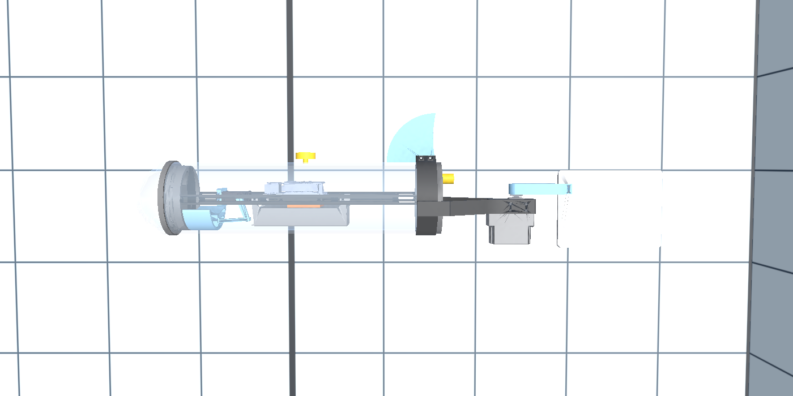
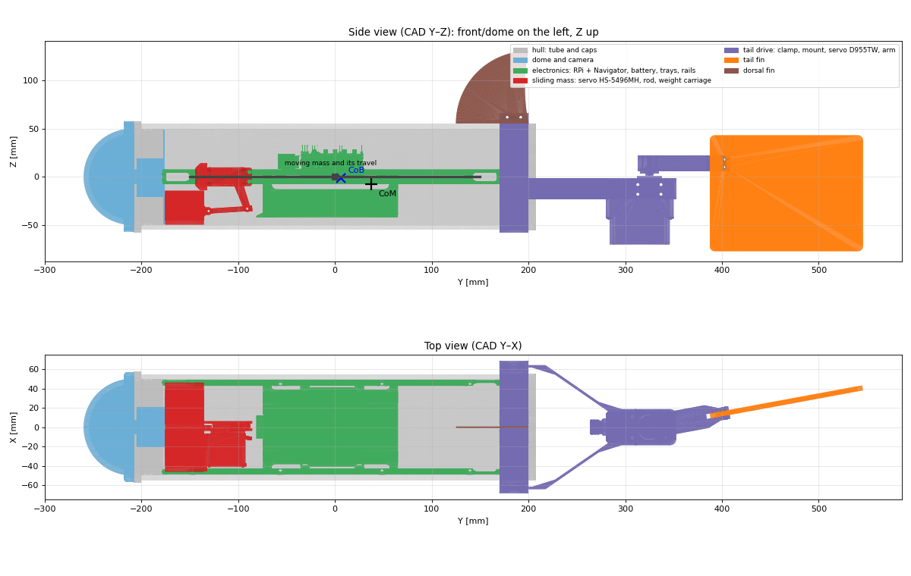
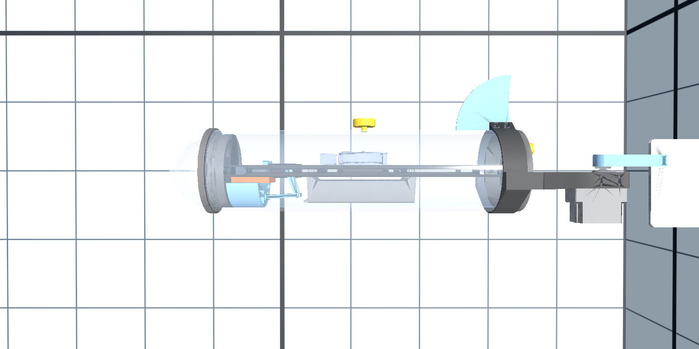
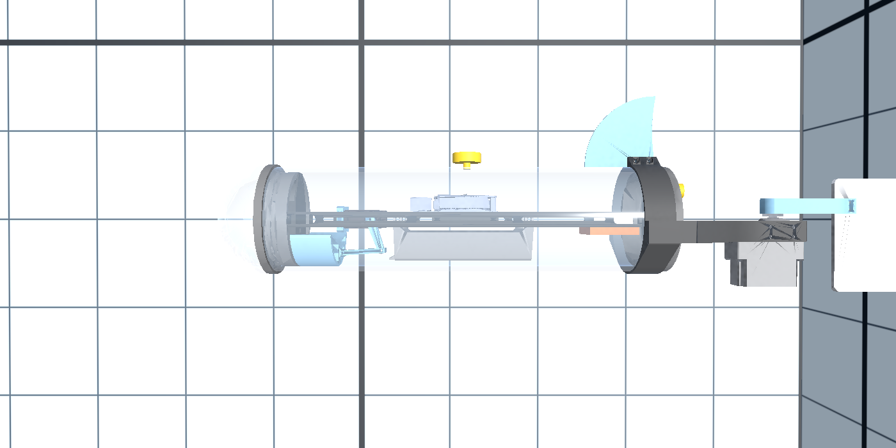
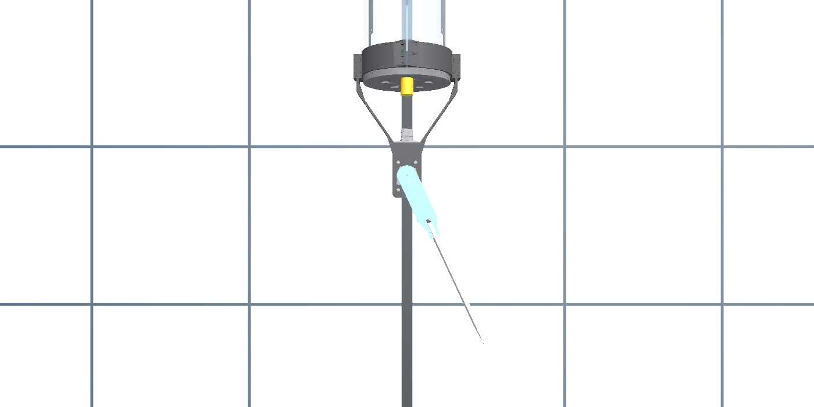
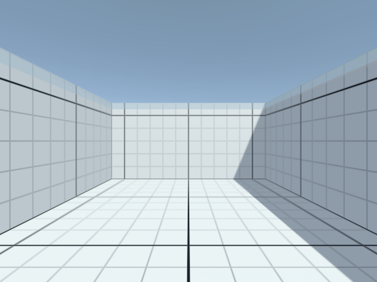

# Robot fish: physical model

The real robot is a **robot fish**: it has no propeller and no ballast. A single vertical tail fin, moved side to side by a waterproofed servo, gives both propulsion (by flapping) and steering; a **moving mass** that slides along the tube axis tilts it nose up or down, and it changes depth by swimming forward with the nose tilted, like a glider. The robot carries nothing else: its weight is its structure (hull, electronics, battery, servos, fins) plus the moving mass, whose weight is adjustable.

This document describes the robot (from its CAD model) and how the Unity simulation represents it. The numbers come from [RobotFish_CAD_Report.md](RobotFish_CAD_Report.md) (generated by `Tools/cad_analysis`); every assumed value is listed in [RobotFish_Assumptions.md](RobotFish_Assumptions.md).



*`RobotFishDetailed` prefab (CAD parts, transparent hull) seen from its left side.*

## 1. The robot (CAD)



| Part | Description |
| --- | --- |
| Hull | acrylic tube Ø110/100 mm × 400 mm, closed by two caps |
| Front | transparent dome (hemisphere Ø114 mm) with the camera |
| Inside | two rails carrying the trays: Raspberry Pi 4 + Navigator board (IMU, magnetometer) on top, battery below |
| Moving mass | a weight that slides along the tube axis (vertically and laterally centered) over 300 mm (the tube length minus 50 mm at each end). Its weight is adjustable: it starts at 100 g and the team adds weight as needed. How it is driven is not known; the CAD shows an HS-5496MH servo with a horn, a rod and a carriage at the front of the tube, kept in the simulation as a static visual |
| Tail drive | clamp around the rear cap, V-shaped support, Hitec D955TW servo in a waterproof housing, vertical axis 325 mm behind the tube center, arm to the fin |
| Tail fin | vertical plate 160 × 120 mm (191.5 cm²), 5 mm thick |
| Dorsal fin | fixed quarter disc R 75 mm (42 cm²) on top of the rear cap, stabilizer |
| Size | 806 mm long (468 mm of hull), 110 mm wide (137 mm at the clamp), 207 mm high with the fins |

The pressure sensor and the GNSS antenna exist on the robot but are not in the CAD.

## 2. Main results of the CAD analysis

| Quantity | Value | Consequence |
| --- | --- | --- |
| Displaced volume | 4.71 L | the water pushes the robot up with the weight of 4.71 kg |
| Estimated structure mass | 2.43 kg (CAD volume × assumed material, see the assumptions) | with the moving mass at 100 g (2.53 kg) the robot **floats strongly (+86 %)**: about half of the hull stays out of the water |
| Moving mass for neutral buoyancy | **≈ 2.28 kg** | the team will have to add weight to the moving mass to dive (or the real parts are heavier than estimated: **weighing the robot** is the most useful measurement) |
| Center of mass of the structure | 31 mm behind and 6 mm below the center of buoyancy (the tail servo is heavy and at the rear) | submerged, the robot tends to raise its nose; the moving mass must sit slightly forward to keep it level (≈ 3 cm forward with 2.28 kg) |
| Moving-mass authority | with 2.28 kg, moving it to an end of its travel (±150 mm) tilts the robot up to ±88° | a few centimetres of travel are enough to tilt the robot by tens of degrees; the depth controller will use only a small part of the travel |
| Center of mass below the center of buoyancy | 2.8 mm (2.28 kg) to 6.4 mm (100 g) | weak self-righting: the robot rolls and tilts easily |

## 3. Simulation model

Two prefabs share the same physics (`RobotFishPhysics`) and sensors; only their visual differs:

| Prefab | Visual | Use |
| --- | --- | --- |
| `Assets/AUV/Prefabs/RobotFishDetailed.prefab` | the 24 CAD parts, transparent hull, moving mass and tail that move (section 4) | **used in the basin scenes** |
| `Assets/AUV/Prefabs/RobotFish.prefab` | simple shapes with the CAD dimensions | lightweight alternative; holds the reference physics values |

```text
RobotFishDetailed     Rigidbody, CapsuleCollider, RobotFishPhysics, ActuatorCommandSubscriber, RobotFishVisual
├── Visual            (layer "Robot", not rendered by the robot's own camera)
│   ├── Hull          tube and dome (transparent acrylic), caps
│   ├── Camera        camera and its mount
│   ├── Electronics   rails, trays, Raspberry Pi + Navigator, battery
│   ├── PitchMechanism  MovingMass (square carriage + metal weight on the tube axis, moves); CAD servo, horn, rod, carriage (static)
│   ├── TailDrive     clamp, V support, servo D955TW; TailPivot (hub, arm, fin): moves
│   ├── DorsalFin
│   └── NotInCad      pressure sensor and GNSS antenna (estimated positions, yellow)
└── Sensors           RGBCamera, IMU, PressureSensor, GNSSAntenna (see AUV_Sensors.md)
```

Local axes: forward = −X, up = +Y, right = +Z; origin = tube center. The physics is in `Assets/AUV/Scripts/RobotFishPhysics.cs`; each physics step it applies:

### 3.1 Mass properties

- **Structure** (every part except the moving mass): `structureMass` = 2.43 kg, `structureCenterOfMass`, `structureInertia` (about its own center of mass, including the added inertia of the water in pitch and yaw), all from the CAD report.
- **Moving mass** on the tube axis: `movingMass` (default **0.1 kg**, adjustable like on the real robot), at `movingMassPosition` (+ = forward).
- Every step, the total mass, the center of mass and the inertia (parallel-axis theorem) are recomputed from both. The **buoyancy is a result**: `buoyancyPercent` (Debug) = water pushed up / weight − 1.
- **Rest position:** with `levelAtRest` (default), the rest position of the moving mass is computed at start so that the submerged robot rests level (moving mass placed so that the center of mass is under the center of buoyancy, clamped to the travel), as an operator would adjust it. With 2.28 kg it is 3.2 cm forward; with 100 g the robot would need the mass 79 cm forward, so it stays at the front end (this only matters if the robot is submerged).
- **Command:** `pitchCommand` 0 = rest position, +1 = front end (nose down), −1 = back end (nose up); the mass moves at `movingMassSpeed` (50 mm/s, estimate).

### 3.2 Buoyancy

The displaced volume is filled with points (1 cm grid inside the tube, caps and dome, plus one point per part outside the hull). Each point carries its share of the volume and pushes up with ρ·g·V when it is under water; near the surface a point goes from dry to wet over one grid step, so the robot emerges smoothly. This gives the correct center of buoyancy (it depends on the shape, not on the mesh vertices) and the correct floating height at the surface.

### 3.3 Hull drag

Quadratic drag F = −½·ρ·C·A·|v|·v, with the real water density:

- **along the hull:** C = 0.6 on the frontal area (95 cm²);
- **across the hull:** C = 1.1, computed on 12 slices of the hull, each with its own sideways and vertical velocity. A rotating hull is therefore braked as well (the slices far from the center move faster), without a separate angular damping;
- **tail drive:** its own crossflow drag;
- a small linear damping keeps the robot from drifting forever at very low speed.

### 3.4 Fins

Both fins use the same quasi-steady flat-plate model: the water flowing over the plate gives a force along its normal,

F = −n · ½ · ρ · A · |v|² · C_N(α),   sin α = (v · n) / |v|,

with C_N = 1.2 · α below the stall angle (25°) and 1.2 · sin α beyond (flat plate). The velocity *v* is the velocity of the fin's center of pressure through the water: robot motion (including its rotation) plus, for the tail fin, the motion of the fin itself when the servo moves it.

- **Tail fin**: angle = `rudderCommand × maxTailAngle` (±30°), reached at the servo speed (500°/s). With the robot moving forward, a deflected fin pushes the stern sideways and the robot turns. With the fin centered, it resists any sideways slide of the stern, so the robot goes straight (passive stability, like the feathers of an arrow). Because the force comes from the water flow, a fin held still does not turn a robot that does not move; a fast fin stroke, however, pushes water like a paddle and turns the robot a little (that is how fish turn on the spot, and it is the basis of the flapping propulsion of step 1c).
- **Dorsal fin**: fixed, adds yaw and roll stability.

### 3.5 Temporary propulsion and test ballast

- Until the flapping model (step 1c), `/cmd/thrust` (or Space) applies a **temporary** forward force at the tail: 0.3 N gives about 0.3 m/s.
- The **test ballast** (Q/E, `/cmd/ballast`) changes the buoyancy by up to ±25 % of the volume. It exists **only in the simulation** (the real robot has no ballast) and is meant to set up tests, never to be used by the GNC.

### 3.6 Commands

| Command | Keyboard | ROS 2 topic | Range |
| --- | --- | --- | --- |
| Temporary thrust | Space | `/cmd/thrust` | −1 … 1 (× 0.3 N) |
| Tail fin angle | A / D | `/cmd/rudder` | −1 … 1 (× 30°), + = turn right |
| Moving mass | W / S | `/cmd/pitch` | 0 = rest position, +1 = front end (nose down), −1 = back end (nose up) |
| Test ballast (simulation only) | Q / E | `/cmd/ballast` | −1 … 1 (pump speed), + = heavier |

See [GNC.md](GNC.md#3-actuator-command-interface) for the ROS interface and its watchdog.

## 4. Detailed visual

The detailed prefab uses the CAD parts converted by `Tools/cad_analysis/cad_to_unity.py` (2.1 M → 255 k triangles, `Assets/AUV/Models/RobotFish/`) and assembled by `Assets/AUV/Editor/RobotFishPrefabBuilder.cs` (see [Tools/cad_analysis/README.md](../Tools/cad_analysis/README.md#2-cad--unity-cad_to_unitypy)). Colors are those of the CAD; the tube and the dome are transparent so that the inside can be seen.

`RobotFishVisual` (`Assets/AUV/Scripts/RobotFishVisual.cs`) moves two parts every frame from the state of `RobotFishPhysics` (it only moves visuals; the physics does not depend on it):

- **Moving mass**: a square carriage (50 × 50 mm, orange) with a metal weight on top (40 × 40 × 15 mm, steel), like on the real robot, on the tube axis at `movingMassPosition`. Its size is fixed: the weight set in `movingMass` only matters for the physics.
- **Tail**: the servo hub, the arm and the fin turn together about the vertical servo axis with `finAngle`.

The sliding mechanism of the CAD (HS-5496MH servo, horn, rod and carriage at the front of the tube) is shown at its CAD pose but does not move, since the way the real moving mass is driven is not known.

| Moving mass at its front end (W: nose down) | Moving mass at its back end (S: nose up) |
| --- | --- |
|  |  |



*Tail seen from above, fin at +25° (trailing edge to the right: turns right).*

The pressure sensor and the GNSS antenna are not in the CAD: they are drawn as yellow shapes under `Visual/NotInCad`, at estimated positions.

All visuals are on the **`Robot` layer**, which the robot's camera (`Sensors/RGBCamera`) does not render: the camera is inside the dome, so it would otherwise see the dome and the parts around it. The image published on `/camera/compressed_image` is therefore the view of the basin only.



*Image of the robot camera (`Sensors/RGBCamera`): the dome and the robot parts are not visible.*

## 5. Verification

Scripted tests in `Basin_Grid` with `RobotFishDetailed`, commands published by a ROS 2 node at 20 Hz.

**Moving mass 100 g (default, as on the real robot today), no command:**

| Test | Result |
| --- | --- |
| Released at 2.5 m depth | rises quickly (up to 0.5 m/s), gliding forward while rising (≈ 4 m), and floats with 54 % of its volume under water (+86 % buoyancy), level |

**Moving mass 2.28 kg (neutral buoyancy):**

| Test | Result |
| --- | --- |
| At rest | level (pitch 0.0°, roll 0.8°), the moving mass at its rest position 3.2 cm forward, stays at its depth |
| Temporary thrust 1 (0.3 N) | 0.306 m/s, 2° nose up |
| Fin stroke 0 → 30° with the robot stopped | turns about 18° from the stroke, then stops |
| Moving mass to its front end (pitch 1) while swimming | the robot tilts to 88° nose down and dives vertically at 0.3 m/s |
| Moving mass to its back end (pitch −1) | the robot tilts to −88° nose up and climbs vertically |
| Moving mass back to rest (pitch 0) | the robot returns to level |
| Thrust 1, tail fin 30° | turns at 7°/s, ≈ 2.5° of roll |
| Visual | the moving mass follows W/S; the tail fin follows A/D; the robot camera image is not blocked by the robot |

The ±88° pitch matches the prediction of the CAD analysis: the full travel of the moving mass is far more than needed.

## 6. How to test

**Keyboard** (no ROS needed): open the Unity Hub (on this computer through the NVIDIA GPU: `__NV_PRIME_RENDER_OFFLOAD=1 __GLX_VENDOR_LIBRARY_NAME=nvidia unityhub &`), open the project, open `Assets/TestBasin/Scenes/Basin_Grid.unity`.

1. **As the robot is today (moving mass 100 g):** press Play and click the Game view: the robot rises to the surface and floats.
2. **Neutral robot:** stop Play, select `RobotFishDetailed` in the Hierarchy, set `Moving Mass` to `2.282` in `Robot Fish Physics`, press Play and click the Game view. The robot stays level at its depth.
3. Hold **Space**: it accelerates slowly to about 0.3 m/s.
4. Keep Space and hold **D** (or **A**): it turns right (left). Release: it goes straight.
5. Keep Space and tap **W** briefly: the moving mass goes forward, the nose goes down and the robot dives; **S** makes it climb. Holding W or S for long brings the mass to the end of its travel and the robot becomes vertical. Release: the mass goes back to its rest position and the robot levels. In the Scene view (or with the free camera, **C**) the moving mass (orange carriage with its metal weight) can be seen sliding inside the transparent hull; with 2.28 kg a few millimetres are enough to tilt the robot by tens of degrees, so short taps move it very little.
6. Release everything: it glides and stops.

Set `Moving Mass` back to 0.1 afterwards (or do not save the scene). The `Debug` section of `Robot Fish Physics` (Inspector) shows the mass, the buoyancy in %, the submerged fraction, the forward speed, the fin angle and the moving-mass position.

**From ROS 2** (with `Moving Mass` = 2.282, as in step 2):

**Terminal 1: ROS-TCP-Endpoint** (workspace with the endpoint, see [AUV_Sensors.md](AUV_Sensors.md#5-running-with-ros-2) to create it once):

```bash
source /opt/ros/jazzy/setup.bash
export ROS_AUTOMATIC_DISCOVERY_RANGE=LOCALHOST
cd ~/ros2_ws && source install/setup.bash
ros2 run ros_tcp_endpoint default_server_endpoint --ros-args -p ROS_IP:=127.0.0.1
```

**Unity:** open `Assets/TestBasin/Scenes/Basin_Grid.unity`, press Play and click the Game view (the ROS indicator turns blue).

**Terminal 2: swim forward** (keep it running):

```bash
source /opt/ros/jazzy/setup.bash
export ROS_AUTOMATIC_DISCOVERY_RANGE=LOCALHOST
ros2 topic pub -r 10 /cmd/thrust std_msgs/msg/Float64 "{data: 1.0}"
```

**Terminal 3: steer or tilt** (one command at a time, Ctrl+C between them):

```bash
source /opt/ros/jazzy/setup.bash
export ROS_AUTOMATIC_DISCOVERY_RANGE=LOCALHOST
ros2 topic pub -r 10 /cmd/rudder std_msgs/msg/Float64 "{data: 1.0}"   # turns right
ros2 topic pub -r 10 /cmd/pitch std_msgs/msg/Float64 "{data: 0.1}"    # moving mass slightly forward: dives
ros2 topic pub -r 10 /cmd/pitch std_msgs/msg/Float64 "{data: -0.1}"   # moving mass slightly back: climbs
```

**Terminal 4: watch the depth and the yaw rate:**

```bash
source /opt/ros/jazzy/setup.bash
export ROS_AUTOMATIC_DISCOVERY_RANGE=LOCALHOST
ros2 topic echo /depth                                   # decreases while climbing; Ctrl+C
ros2 topic echo /imu/data --field angular_velocity.z     # negative while turning right (ROS convention)
```

After Ctrl+C on every `pub`, the actuators return to neutral within 0.5 s (watchdog) and the keyboard works again.

## 7. Limitations

- **Propulsion:** the tail flapping is not modeled yet; the temporary thrust replaces it (step 1c).
- **Masses:** the structure masses are estimates (CAD volume × assumed material); the buoyancy and the balance of the robot depend strongly on them.
- **Moving-mass drive:** unknown; modeled as a mass moving at constant speed along the axis.
- **Added mass:** the water that moves with the hull sideways and vertically (≈ 3.8 kg) is not simulated, because Unity bodies have one mass for all directions; only the added inertia in pitch and yaw is included.
- **Unsteady effects:** the fin force is quasi-steady (no wake, no delay in the build-up of lift).
- **Coefficients:** drag and lift coefficients are literature values for simple shapes, not measured on this robot.
- **Visual:** the CAD meshes are simplified (the electronics lose small details); the moving mass may cross the trays visually.
