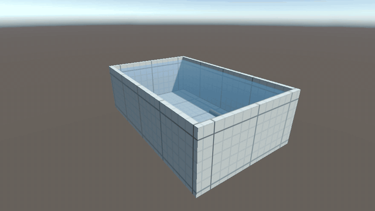
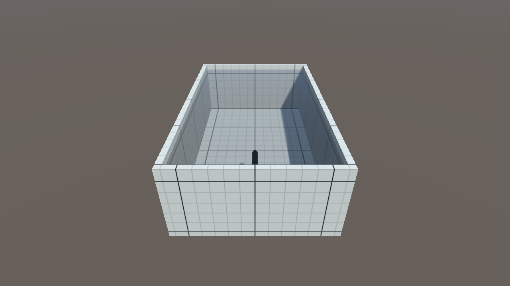
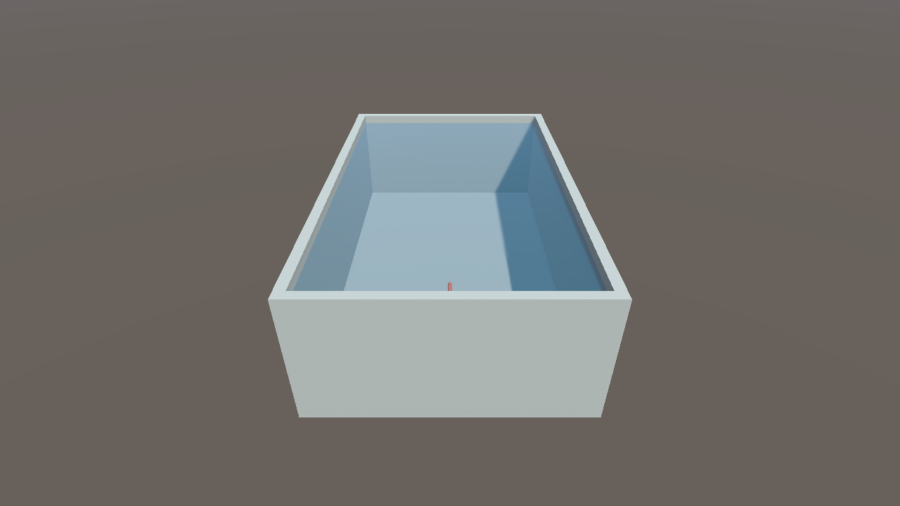
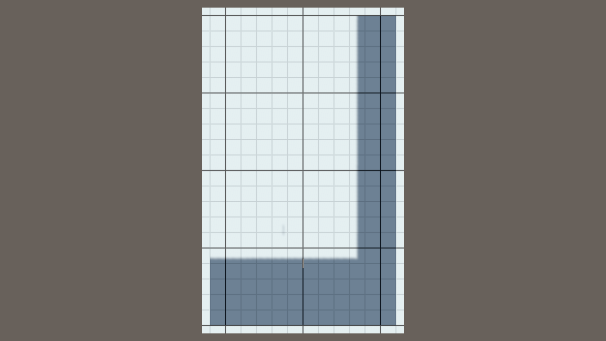
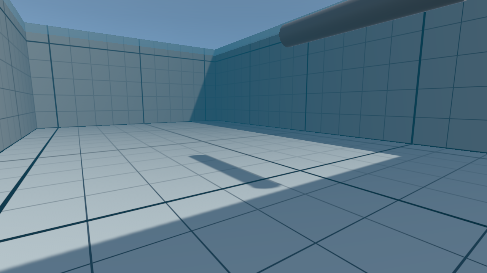
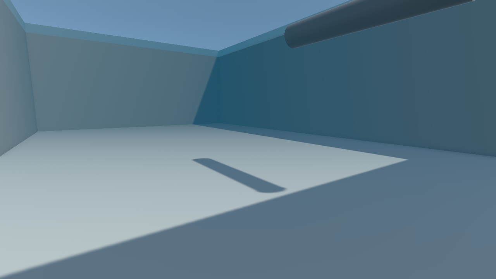

# Test Basin — micro-AUV test pool simulation

Unity implementation of the test basin used to validate the micro-AUV, for the Ingénierie Système 2026–2027 project (ENSTA).



## 1. Context

According to the project presentation (`educational_ressources/2026/261020_IS_project_presentation.pdf`), each team delivers a realistic Unity–ROS 2 simulator of a **micro-AUV**: a tube carrying an RGB camera, an INS (accelerometer, gyroscope, magnetometer), a pressure sensor, an optional GNSS, a propulsive fin and a sliding mass.

**Slide 16 ("3D environment")** defines the environment: a **20 m × 12 m tank, 6 m deep**. This work implements that tank with:

- water physics (buoyancy and drag), the basis for the model of slide 14 ("Physical Model");
- a metric grid for visual debugging;
- a version without the grid, so that vision algorithms (SLAM / visual odometry) are not misled by a repetitive pattern;
- ground-truth pose recording, to evaluate the robot's navigation.

## 2. Environment

| Item | Value |
| --- | --- |
| Unity | 6000.6.5f1 (Unity 6) |
| Render pipeline | **URP 17.6** (Forward+ rendering path) |
| Input | new Input System |
| Physics | Rigidbody with `linearDamping` / `angularDamping` (Unity 6 API) |

## 3. Implementation

### 3.1 Files

```text
Assets/TestBasin/
├── Scripts/
│   ├── TestBasin.cs            procedural basin + water generation
│   ├── SimpleBuoyancy.cs       Archimedes buoyancy + water drag
│   ├── GroundTruthLogger.cs    robot ground-truth pose to CSV
│   ├── UnderwaterEffect.cs     bluish fog when the camera is under water
│   └── FreeFlyCamera.cs        free camera to inspect the scene in Play mode
├── Shaders/BasinGrid.shader    procedural metric grid (URP)
├── Materials/                  Basin_Grid, Basin_Plain, Water_Surface, Water_Volume, Robot_Placeholder
├── Prefabs/TestBasin.prefab    basin + water (shared by both scenes)
└── Scenes/                     Basin_Grid.unity, Basin_NoGrid.unity
```

Every script and the shader are commented line by line, and every class and method has a short comment describing its purpose.

### 3.2 Basin geometry (`TestBasin.cs`)

The basin is generated **procedurally** (no CAD model), from cubes with separate `BoxCollider`s. No concave `MeshCollider` is used.

| Piece | Center (local) | Size |
| --- | --- | --- |
| Floor | (0, −t/2, 0) | (W + 2t, t, L + 2t) |
| Wall_Left (−X) | (−(W + t)/2, D/2, 0) | (t, D, L + 2t) |
| Wall_Right (+X) | (+(W + t)/2, D/2, 0) | (t, D, L + 2t) |
| Wall_Front (+Z) | (0, D/2, +(L + t)/2) | (W, D, t) |
| Wall_Back (−Z) | (0, D/2, −(L + t)/2) | (W, D, t) |

Legend: L = `length` = 20 (Z), W = `width` = 12 (X), D = `depth` = 6 (Y) and t = `wallThickness` = 0.5. The side walls cover the corners, so there are no gaps.

- **Convention:** 1 unit = 1 m, Y up. The cavity is centered on the origin in X/Z, with the top of the floor at **y = 0**. The inner edges are therefore at **x = ±6** and **z = ±10**.
- **Organization:** the pieces are marked **static** and grouped under the basin object.
- **Public parameters:** `length`, `width`, `depth`, `wallThickness`, `waterLevel` (5.5 m), `basinMaterial`, the water materials and `showWaterVolume`.
- **Works in the editor, not only in Play mode:**
  - context-menu item **Generate basin** on the component (`[ContextMenu]`);
  - automatic regeneration when a parameter changes (`OnValidate` + `delayCall`).
- **Piece reuse:** generation updates the existing pieces by name instead of destroying and recreating them, so it also works on prefab instances.

### 3.3 Water

**Physical volume:**
- the **`WaterVolume`** child has a `BoxCollider` with `isTrigger = true`, sized `width × waterLevel × length` (12 × 5.5 × 20 m), from the floor up to the surface;
- it is on the **Ignore Raycast** layer, so it does not block the rays of future sensors (LiDAR, camera).

**Buoyancy and drag (`SimpleBuoyancy.cs`, on the robot, requires a Rigidbody):**
- entering and leaving the water are detected with trigger events (`OnTriggerEnter/Exit`), compared against the basin's `WaterCollider`;
- buoyancy = **ρ · V · g · submerged fraction**, with ρ = 1000 kg/m³;
- the submerged fraction is `(surface − bottom of the body) / body height`, computed from the collider `bounds`;
- the force is applied at the approximate center of the submerged part (`AddForceAtPosition`);
- the surface height is **read from `TestBasin`** (`WaterSurfaceY`); no value is duplicated;
- inside the water, `linearDamping` and `angularDamping` take the `linearDrag` and `angularDrag` values; outside, the original values are restored;
- parameters: `volume`, `waterDensity`, `linearDrag`, `angularDrag`;
- the context-menu item **Estimate volume from collider** computes the volume of a capsule, box or sphere collider.

**Visuals:**
- **WaterSurface:** a Quad at `waterLevel` with a **double-sided** semi-transparent blue material, visible from below too;
- **WaterTint:** an optional very transparent blue volume, enabled with `showWaterVolume` (off by default);
- **UnderwaterEffect:** on the camera, enables an exponential bluish fog while the camera is inside the cavity and below the surface, and restores the original fog when leaving.

### 3.4 Metric grid (`BasinGrid.shader`)

HLSL shader for URP, with main light, received and cast shadows, fog, and `ShadowCaster` / `DepthOnly` passes. The material holds no texture: the grid is computed per pixel.

- **Grid space:** `TestBasin` publishes the global matrix `_BasinWorldToGrid` (world → basin local space). Because the grid is computed in that space, **it follows the basin if the basin is moved or rotated**. With odd width or length, the matrix includes an offset that keeps the inner edges on grid lines.
- **No UVs:** the grid is projected along the dominant axis of the normal (a "hard" triplanar mapping): XZ on the floor, ZY on the ±X walls, XY on the ±Z walls. It does not depend on the cube UVs, which would stretch the grid differently on 20×12, 20×6 and 12×6 faces.
- **Lines:**
  - thin lines every **1 m**, darker and thicker lines every **5 m**;
  - antialiasing with `fwidth`, with a minimum width of about one pixel;
  - lines thinner than a pixel fade out instead of flickering.
- **Parameters:** background color, 1 m line color, 5 m line color, 1 m line width, 5 m line width, offset (XYZ) and smoothness.

**Materials:**
- `Basin_Grid.mat` uses this shader;
- `Basin_Plain.mat` uses a smooth bluish-grey URP Lit (tile / concrete).

### 3.5 Prefab and scenes

**`TestBasin.prefab`** contains the basin and the water. The scenes **`Basin_Grid.unity`** and **`Basin_NoGrid.unity`** are identical except for `basinMaterial`, which is an override on the prefab instance.

Each scene contains:
- a **directional light** with soft shadows, the default sky and three-color ambient light (no lightmap baking needed);
- a **camera** at (0, 17, −24) looking at the center, with `UnderwaterEffect` and `FreeFlyCamera`;
- a **micro-AUV placeholder:** a capsule lying along Z, **1 m × Ø 0.2 m**, with a **28 kg** `Rigidbody`, `SimpleBuoyancy` (V = 0.0293 m³, neutral mass = 29.3 kg, so slightly positive) and `GroundTruthLogger`, starting at (0, 3, −6).

Both scenes are in the **Build Settings**, and any change to the prefab applies to both.

**Why two versions:**
- the **grid** scene is for visual debugging of distances;
- the **no-grid** scene is more realistic, since a repetitive pattern could cause false feature matches in SLAM or visual odometry.

### 3.6 Ground truth (`GroundTruthLogger.cs`)

- **CSV columns:** `time_s, pos_x, pos_y, pos_z, rot_x, rot_y, rot_z, rot_w, euler_x_deg, euler_y_deg, euler_z_deg, distance_xz_m`.
- **Travelled distance:** accumulated on the XZ plane at every physics step, which is more accurate than summing only between samples.
- **Rate (`sampleRate`, default 20 Hz):** configurable, but quantized to the 0.02 s *Fixed Timestep*. At 20 Hz the intervals alternate between 0.04 and 0.06 s, averaging 20 Hz.
- **File:** the folder is configurable (`outputFolder`; empty = `<project>/GroundTruthLogs` in the editor). The file name contains **the scene name** and the date/time, for example `groundtruth_Basin_Grid_20261023_111226.csv`.
- **Control:** context-menu items **Start logging / Stop logging** on the component.

## 4. Verification

Both scenes were checked by measuring the generated pieces and by running **15 s in Play mode**:

| Check | Basin_Grid | Basin_NoGrid |
| --- | --- | --- |
| Top of floor | y = 0.000 | y = 0.000 |
| Inner edges X | −6.000 / 6.000 | −6.000 / 6.000 |
| Inner edges Z | −10.000 / 10.000 | −10.000 / 10.000 |
| Walls | 0.000 to 6.000 | 0.000 to 6.000 |
| WaterVolume | y 0..5.5; 12 × 5.5 × 20; trigger | same |
| Basin material | Basin_Grid | Basin_Plain |
| BasinGrid shader | compiles without errors | — |

Play-mode test (Basin_Grid, 15 s):
- the robot started at y = 3.0 m, **rose and floats at y = 5.41 m**, with a residual velocity of 0.003 m/s;
- submerged fraction = **0.948** (expected ≈ 28 / 29.3 = 0.955); buoyancy = 272.6 N for a weight of 274.7 N, still converging;
- water damping: linear 2.0 and angular 1.0, as configured;
- CSV: 295 samples in 14.7 s.

All scripts compile **without errors or warnings** in Unity 6.

### Screenshots

| With grid | Without grid |
| --- | --- |
|  |  |
|  |  |
|  |  |

In the top view (orthographic, water hidden), the thick lines fall at x = −5, 0, 5 and z = −10, −5, 0, 5, 10, and the inner edges coincide with grid lines. In the underwater view, the fog also applies to the grid shader.

A video of the simulation is available in `media/basin_simulation.mp4`.

## 5. How to open and test

1. Open the project in Unity Hub with **Unity 6000.6.5f1** (*Add project from disk*). The first opening takes a few minutes while Unity rebuilds the `Library` folder.
2. In the Project window, open `Assets/TestBasin/Scenes/Basin_Grid` (with grid) or `Basin_NoGrid` (without grid).
3. Press **▶ Play**. The orange robot rises and floats almost fully submerged.
4. To move the camera, hold the **right mouse button** and use **WASD**, **Q/E** (down/up) and **Shift** (faster). Below 5.5 m inside the basin, the underwater fog turns on.
5. To test buoyancy and drag:
   - select `Robot_Placeholder` and look at the **Debug** section of `SimpleBuoyancy` (`inWater`, `submergedFraction`, `buoyancyForce`);
   - change the Rigidbody `Mass`: below 29.3 kg the robot floats, above it sinks.
6. When leaving Play mode, the Console prints the path of the CSV file, saved in `GroundTruthLogs/`.
7. To change the basin, edit the `TestBasin` parameters on the prefab; the pieces regenerate automatically.

### Checking that each square is 1 m (grid scene)

- **With the Transform:** select the robot and type integer positions in the Inspector, for example X = 0 → 1 → 2. Each unit moves it exactly one square, and the thick lines are at multiples of 5. When dragging with **Ctrl** in the Scene view, the default snap is 0.25 m (4 steps = 1 square); it can be set to 1 m in **Edit → Grid and Snap Settings**.
- **With a reference cube:** create **GameObject → 3D Object → Cube** (1 × 1 × 1 m) at (0.5, 0.5, 0.5). It covers exactly one floor square, with its corners on the lines.
- **By counting:** the basin is 12 squares wide (1 + 5 + 5 + 1 between the thick lines at x = −5, 0, 5) and 20 squares long (4 blocks of 5). The walls are 6 squares high, and the water reaches 5.5.
- **With the ground truth:** move the robot in a straight line over N squares and compare with `distance_xz_m` in the CSV.
- **With the orthographic view:** in `Basin_Grid_top.png`, each square is about 32.7 px (720 px for 22 m).

## 6. Limitations and next steps

- **Submerged fraction:** estimated with the world-axis-aligned bounding box, which is an approximation for a tilted body. Next step: sample points inside the hull volume, as in exercise 4 of the course handout ("Floating Cube").
- **AUV physics (slide 14):** the **fin lift and thrust** and the **sliding mass** remain to be added.
- **Sensors (slide 15):** RGB camera, INS, pressure and GNSS. The publishers from exercises 7–9 (`CameraPublisher`, `ImuPublisher`, `GnssPublisher`) can be reused, and the pressure sensor added as p = p_atm + ρ·g·(surface − y).
- **Real robot:** replace the placeholder with the CAD model (`Assembly.obj`), keeping a simple collider on top.
- **Water:** the surface is flat and static, which fits an indoor pool.
