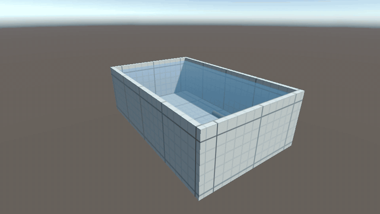

# BrazilianTeamRepository

## Test basin simulation

Unity simulation of the 20 m × 12 m × 6 m test basin used to validate the micro-AUV.



- **Unity:** 6000.6.5f1, URP.
- **Scenes:** `Assets/TestBasin/Scenes/Basin_Grid.unity` (1 m metric grid, for visual debugging) and `Assets/TestBasin/Scenes/Basin_NoGrid.unity` (plain walls, closer to reality for vision algorithms). Both use the same `TestBasin` prefab and differ only by the basin material.
- **Features:** procedural basin, water volume, underwater fog, metric grid shader, the AUV (`Assets/AUV/`) driving inside the basin, and a ground-truth logger that writes the AUV pose to CSV.
- **Controls:** Space = thrust, A/D = rudder, W/S = pitch (mass shifting), Q/E = ballast, C = free camera (right mouse + WASD).

Open the project with Unity Hub (*Add project from disk*), load one of the scenes and press Play. See [Docs/TestBasin.md](Docs/TestBasin.md) for details.

## AUV sensors and ROS 2

The AUV carries an RGB camera, an INS (gyroscope, accelerometer, magnetometer), a pressure sensor and a GNSS receiver (fix only at the surface). They publish through the ROS-TCP-Connector:

| Topic                        | Message                                             |
| ---------------------------- | --------------------------------------------------- |
| `/camera/compressed_image` | `sensor_msgs/CompressedImage` (JPEG)              |
| `/imu/data`, `/imu/mag`  | `sensor_msgs/Imu`, `sensor_msgs/MagneticField`  |
| `/pressure`, `/depth`    | `sensor_msgs/FluidPressure`, `std_msgs/Float64` |
| `/gnss/fix`                | `sensor_msgs/NavSatFix`                           |

Start the [ROS-TCP-Endpoint](https://github.com/Unity-Technologies/ROS-TCP-Endpoint/tree/main-ros2) (`ros2 run ros_tcp_endpoint default_server_endpoint --ros-args -p ROS_IP:=127.0.0.1`), then press Play. See [Docs/AUV_Sensors.md](Docs/AUV_Sensors.md).

## Navigation, guidance and control

The AUV actuators can be commanded from ROS 2 (`std_msgs/Float64`, normalized to [-1, 1]):

| Topic            | Actuator                                 |
| ---------------- | ---------------------------------------- |
| `/cmd/thrust`  | thruster (+ forward, - reverse)          |
| `/cmd/rudder`  | rudder (+ turn right)                    |
| `/cmd/pitch`   | sliding mass (+ nose down)               |
| `/cmd/ballast` | ballast pump (+ fill/sink, - empty/rise) |

Without commands for 0.5 s the actuators stop and the keyboard takes over again. See [Docs/GNC.md](Docs/GNC.md) for the architecture and the status of the GNC work.

## Project structure

Unity assets are grouped by feature:

```text
Assets/
├── TestBasin/   test basin simulation (scripts, grid shader, materials, prefab, scenes)
├── AUV/         micro-AUV (scripts, materials, scenes)
└── Settings/    URP render pipeline settings
```
