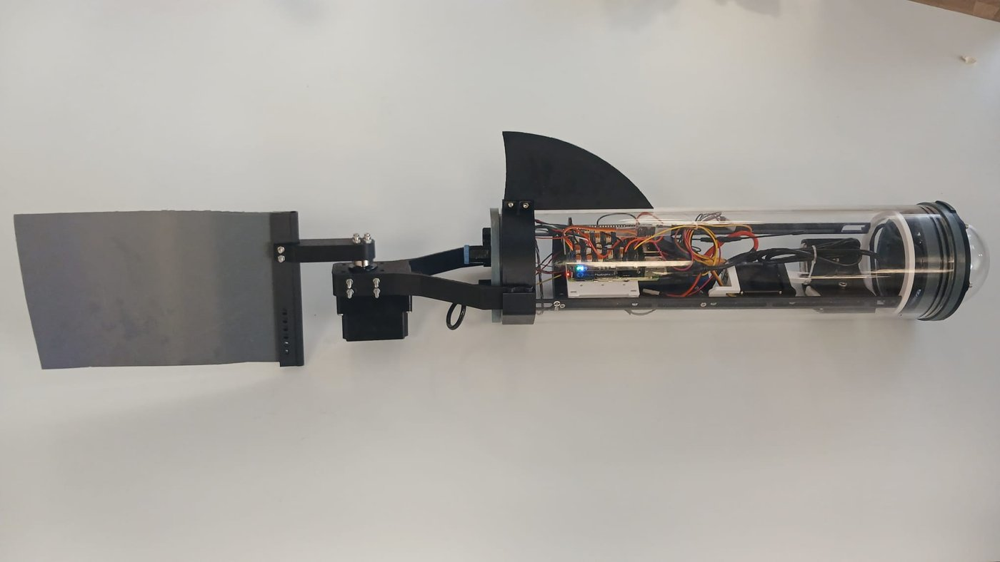
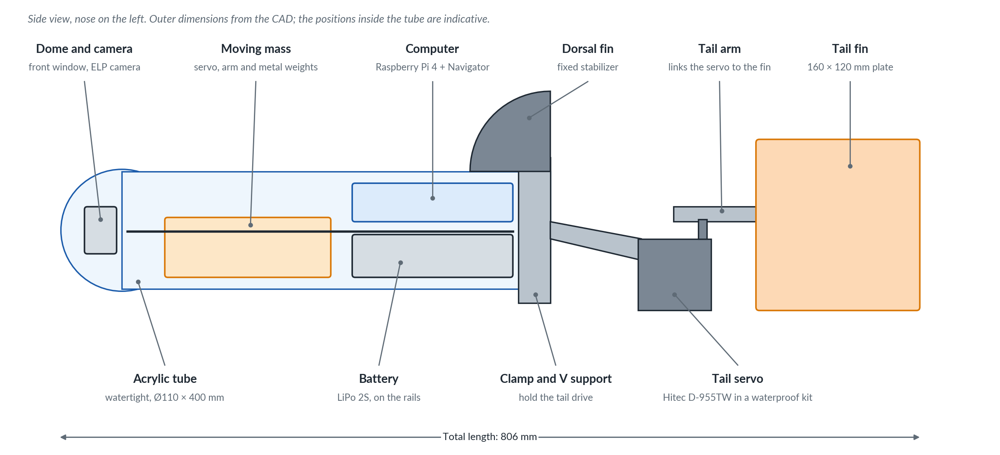
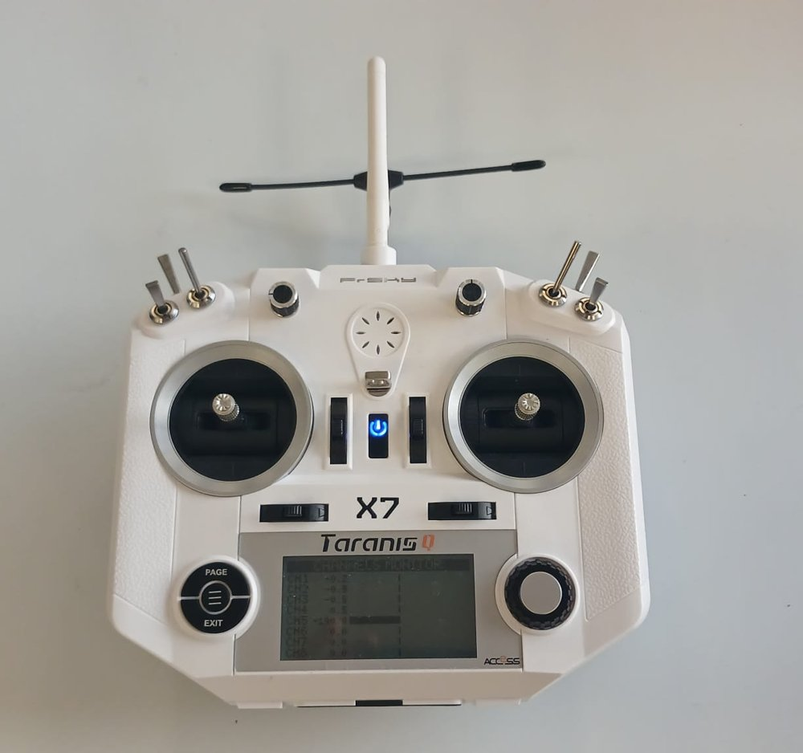
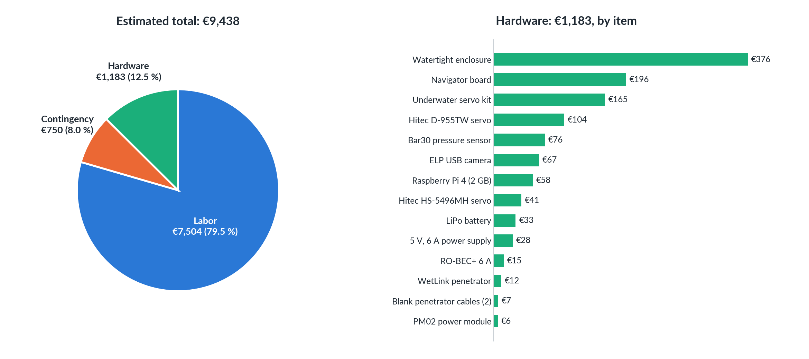
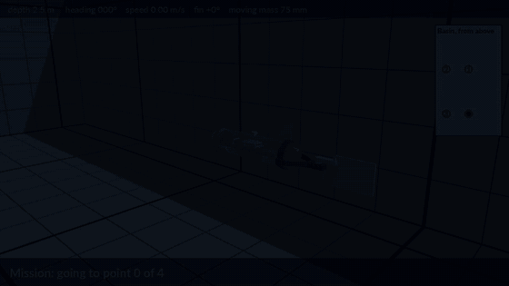
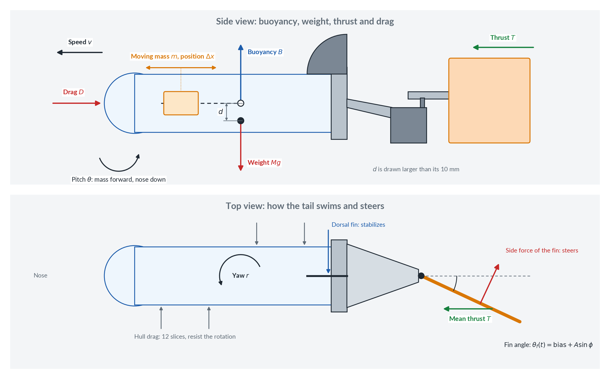
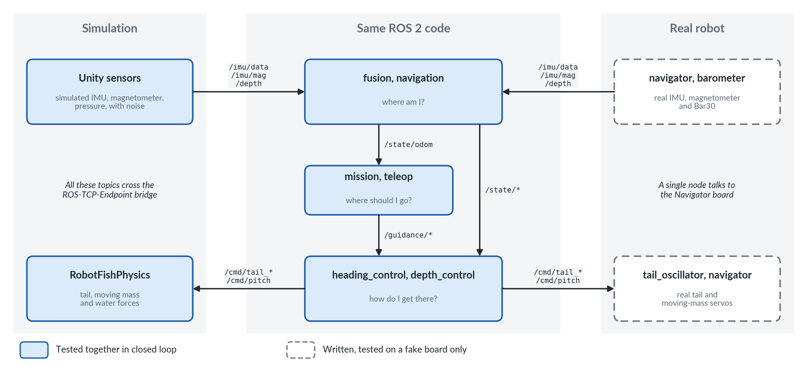

# Robot fish: a micro-AUV and its simulator

A small autonomous underwater robot that swims like a fish, and the 3D simulator used to develop its software before it goes into the water.

Project of the **Brazilian Team** for the *System Engineering* course 2026–2027 at ENSTA (Brest, France). In this course, four teams design, build and program a micro-AUV (Autonomous Underwater Vehicle) and its realistic Unity and ROS 2 simulation, in contact with a client through regular meetings.


*The simulated robot swimming, diving, climbing and turning (2× speed).*

<table>
  <tr>
    <td width="42%"></td>
    <td>
      <b>The real robot, fully assembled</b><br><br>
      A transparent tube holds the computer, the battery and a sliding weight. A dorsal fin keeps it stable, and a tail fin at the back makes it swim.<br><br>
      <b>In short</b>
      <ul>
        <li><b>No propeller:</b> one servo flaps the tail fin to swim and steer.</li>
        <li><b>No ballast:</b> a sliding weight tilts the robot, which then dives or climbs while it swims.</li>
        <li><b>Same software in simulation and on the robot:</b> only the lowest layer, which talks to the hardware, changes.</li>
      </ul>
    </td>
  </tr>
</table>

## Team

Pedro ALVES DE ARAUJO SILVA, Daniel FARLEI SILVA SOUZA, Matheus BENIGNO DA SILVA, Leticia Lie FURUTA, Pedro BARBOSA NORI and Luiz Felipe BARROS ALVES. Students of the *System Engineering* course at ENSTA, 2026–2027.

## Contents

- [Current status](#current-status)
- [How the robot works](#how-the-robot-works)
- [The physical robot](#the-physical-robot)
- [Electrical design](#electrical-design)
- [Project cost](#project-cost)
- [The simulator](#the-simulator)
- [The software](#the-software)
- [From simulation to reality](#from-simulation-to-reality)
- [Results so far](#results-so-far)
- [Try it](#try-it)
- [Run the real robot](#run-the-real-robot)
- [Repository layout](#repository-layout)
- [Documentation](#documentation)
- [Limitations and next steps](#limitations-and-next-steps)

## Current status

| Part | Status |
| --- | --- |
| Simulator: basin, campus scene, physics, sensors, actuators | Done, not yet calibrated against the real robot |
| Heading following | Done and tested in simulation |
| Orientation and depth estimation from the raw sensors | Done and tested in simulation |
| Depth regulation | Done and tested in simulation |
| Position estimation from the flapping commands | Done and tested in simulation, not calibrated on the robot |
| Missions by time and by waypoints, with safe end | Done and tested in simulation |
| Teleop that takes the robot at any moment | Done and tested in simulation |
| Robot drivers (ROS 2) | Written, tested only on a fake board |
| Electrical schematic and cost study | Done |
| Real robot | Assembled and ready; **no test in the water yet** |

## How the robot works

| Function | How it is done |
| --- | --- |
| **Swimming** | A servo flaps the tail fin from side to side. In the simulation, 1.5 Hz with an amplitude of 30° gives about 0.7 m/s |
| **Turning** | The flapping is shifted to one side (the *bias*). The robot only turns while it swims |
| **Changing depth** | A weight slides along the front half of the tube. Forward, the nose goes down and the robot dives; backward, it climbs. This also only works while swimming |
| **Staying upright** | The center of mass is below the center of buoyancy, so the robot returns to level by itself |
| **Doing a mission alone** | A file lists the headings, depths and points. At the end, or if something goes wrong, the robot swims up or stops. An operator can take it by keyboard at any moment, while the connection reaches it |
| **Knowing where it points** | A filter combines the gyroscope, accelerometer and magnetometer. A pressure sensor gives the depth |

## The physical robot

Built on the base design given in the course (tube, dome, rails and mounts), with the tail and the sliding-mass mechanism designed by the team in [Onshape](https://www.onshape.com/) and 3D printed.

### Mechanical architecture



- **Watertight hull:** the acrylic tube and its dome hold the camera, the computer, the battery and the moving mass, on two rails.
- **Depth:** a servo inside the tube slides the metal weights along the tube, which tilts the robot.
- **Propulsion and steering:** a clamp on the rear cap and a V-shaped support hold the waterproof tail servo outside the tube. An arm links this servo to the tail fin.
- **Stability:** the fixed dorsal fin resists sideways motion, and the center of mass below the center of buoyancy returns the robot to level.

### Photos


*The hull during the assembly, before the tail was added: transparent tube with the electronics, moving mass and dorsal fin.*

<table>
  <tr>
    <td width="50%"><br><sub>Side view: moving mass on the left, electronics and battery on the right, on two rails.</sub></td>
    <td width="50%"><br><sub>Moving mass: a servo pushes a carriage with metal weights through an arm and a link.</sub></td>
  </tr>
  <tr>
    <td><br><sub>Inner structure: rails, Raspberry Pi with the Navigator board, battery tray.</sub></td>
    <td><br><sub>Electronics tested on the bench before the assembly.</sub></td>
  </tr>
  <tr>
    <td><br><sub>Tail drive: waterproof servo on its printed support, with the cable going through the rear cap.</sub></td>
    <td><br><sub>3D printing of the dorsal fin and the tail support.</sub></td>
  </tr>
</table>




*FrSky Taranis Q X7 radio controller, for manual control of the robot. Its integration is still being tested: the software in this repository uses a keyboard teleop for now.*

| Component | Role |
| --- | --- |
| Raspberry Pi 4 (2 GB) | Onboard computer: Ubuntu 24.04, ROS 2 Jazzy |
| Blue Robotics Navigator | Board on the Raspberry Pi: IMU, magnetometer, servo outputs |
| Bar30 pressure sensor | Depth |
| ELP 16 MP USB camera | Front camera, behind the dome |
| Hitec D-955TW in a Blue Trail Engineering underwater servo kit | Tail servo, outside the tube |
| Hitec HS-5496MH | Moving-mass servo, inside the tube |
| LiPo battery 2S, 7.4 V, 5700 mAh | Power source |
| PM02 V3.2 power module and 5 V, 6 A supply | Power distribution for the electronics |
| Blue Robotics watertight enclosure (Ø110 × 400 mm tube and dome) | Waterproof hull |

Total length: about 0.81 m with the tail. The simulator assumes about 4.7 kg, which makes the robot neutral in water; the real mass still has to be measured.

## Electrical design

The battery feeds the power module, which supplies the servos directly at 7.4 V and the electronics through a 5 V supply. The Raspberry Pi commands the servos with PWM signals through the Navigator board, reads the pressure sensor over I2C and the camera over USB.


## Project cost

Estimated total: **about €9,440**, of which about 87 % is labor. The detail, sources and assumptions are in the [budget spreadsheet](Docs/AUV_Project_Budget.xlsx).

| Category | Details | Cost |
| --- | --- | --- |
| Hardware | 14 items, without shipping and taxes | €1,183 |
| Labor | 270 h planned (240 h in class, 30 h outside) at €27.79/h, based on a junior engineer | €7,504 |
| Contingency | 10 % of the labor | €750 |
| **Total** | | **€9,438** |



**Proposed new components, not included in the total:** GNSS receiver (€49) and Ping sonar altimeter (€383).

## The simulator

The simulator recreates the ENSTA Air-Sea Test Basin (20 × 12 × 6 m) in **Unity 6** and exchanges data with the software through **ROS 2**, so the code tested here is the code meant for the robot.

### A complete mission



*The robot goes through four points at different depths by itself, then swims up and stops (2× speed).*

### The test basin


*Camera tour from the campus to the robot (2× speed).*

| Simulated | Details |
| --- | --- |
| **Physics** | Weight, buoyancy over the real displaced volume, hull drag, lift of the dorsal fin, reaction of the water on the flapping tail, moving mass |
| **Sensors** | RGB camera, IMU, magnetometer, pressure, GNSS (only at the surface), with noise |
| **Actuators** | Tail servo limited by its speed and torque, moving mass |
| **Scenes** | Basin with a metric grid, plain basin, and the whole campus for presentations |
| **Model** | Geometry and masses taken from the CAD |

**About the videos:** the motion of the hull caused by the tail strokes is filtered on the screen, from ±6.4° of yaw in the physics to about ±1° displayed. This only changes the display: sensors, physics and control use the true values. The real motion will be known after the tests in the water. See [RobotFish_Model.md](Docs/RobotFish_Model.md#51-tail-flapping).

### 3D dynamics model



Unity integrates the motion of one rigid body from the sum of the forces and moments below, computed in `RobotFishPhysics.cs` at each physics step:

$$M\dot{\mathbf{v}} = M\mathbf{g} + \mathbf{B} + \mathbf{F}_{\text{hull}} + \mathbf{F}_{\text{dorsal}} + \mathbf{F}_{\text{tail}}, \qquad I\dot{\boldsymbol{\omega}} \approx \sum_i \mathbf{r}_i \times \mathbf{F}_i - c_\omega\boldsymbol{\omega}$$

The total mass $M$, the center of mass and the inertia $I$ are recomputed at each step, because the moving mass $m$ changes them.

**Buoyancy,** summed over points that fill the displaced volume (1 cm grid), counting only the points under water:

$$\mathbf{B} = \sum_i \rho g V_i \, \mathbf{e}_z$$

**Hull drag,** along the hull ($C_x = 0.6$ on the frontal area) and across it ($C_c = 1.1$ on each of 12 slices):

$$D_x = -\tfrac{1}{2}\rho C_x A_f \lvert v_x \rvert v_x, \qquad \mathbf{F}_{c,i} = -\tfrac{1}{2}\rho C_c A_i \lVert \mathbf{v}_{\perp,i} \rVert \mathbf{v}_{\perp,i}$$

**Dorsal fin,** a flat plate of normal $\mathbf{n}$ and area $A$, at an angle of attack $\alpha$:

$$\mathbf{F}_{\text{dorsal}} = -\mathbf{n}\, \tfrac{1}{2}\rho A \lVert\mathbf{v}\rVert^2 C_N(\alpha)$$

**Tail fin.** The servo follows $\theta_f = \text{bias} + A\sin\phi$, with $\dot\phi = 2\pi f$, limited by its speed and torque. The fin is cut into elements, each moving across the water at a normal speed $w$. Following Lighthill's elongated-body theory, the water it pushes acts as an added mass per unit chord $m' = C\rho\pi s^2/4$, where $s$ is the height of the fin and $C = 0.7$. Three forces result, with $\mathbf{n}$ across the fin and $\boldsymbol{\tau}$ along it, toward the trailing edge:

$$\mathbf{F}_{\text{reactive}} = -m'\Delta r\,(r\ddot\theta_f\,\mathbf{n} - w\dot\theta_f\,\boldsymbol{\tau}) \qquad \text{each element at a distance } r \text{ from the servo axis}$$

$$\mathbf{F}_{\text{edge}} = m'\left(w_e u_e\,\mathbf{n} - \tfrac{1}{2}w_e^2\,\boldsymbol{\tau}\right) \qquad \text{trailing edge, which gives the thrust}$$

$$\mathbf{F}_{\text{resistive}} = -\tfrac{1}{2}\rho C_D a\,\lvert w\rvert w\,\mathbf{n} \qquad \text{each element of area } a,\ C_D = 1.2$$

**What this means for depth.** With a vertical distance $d$ between the center of buoyancy and the center of mass, a displacement $\Delta x$ of the moving mass tilts the robot at rest by $\theta$, and the robot then changes depth while it swims at a speed $v$:

$$\tan\theta = \frac{m\,\Delta x}{M\,d}, \qquad v_z \approx v\sin\theta$$

The coefficients come from the literature and the rotational damping ($c_\omega = 0.3$ N·m·s) was tuned in the simulation: none has been measured on the robot yet. [RobotFish_Model.md](Docs/RobotFish_Model.md) has the complete model and its tests.

## The software

Everything runs as ROS 2 nodes written in Python. The architecture follows the classic split of **navigation** (where am I?), **guidance** (where should I go?) and **control** (how do I get there?), based on the `navigator` package given in the course.


- **In the simulation,** Unity replaces the sensors, the servos and `tail_oscillator`, with the same topics.
- **On the robot,** `navigator` is the only node that talks to the board. Without commands for 0.5 s, the servos return to the center.

| ROS 2 package | Content |
| --- | --- |
| [`gnc_control`](ros2_ws/src/gnc_control) | `fusion`, `navigation` (orientation, depth and position), `heading_control`, `depth_control`, `tail_oscillator`, `mission`, `teleop` |
| [`auv_hardware`](ros2_ws/src/auv_hardware) | `navigator`, `barometer`, launch file and parameters of the robot |

## From simulation to reality

The idea is to develop and test the software in the simulator, then run **the same navigation, guidance and control nodes** on the robot. The nodes only see ROS 2 topics, with the same names and values in both cases, so only the layer that reads the sensors and moves the servos changes.



- **Commands** are normalized (for example, `/cmd/tail_frequency` goes from 0 to 1), so the controllers do not depend on the size of the actuators.
- **The tail:** Unity computes the flapping by itself. The real servo only accepts the angle to reach at each instant, so `tail_oscillator` computes this angle on the robot.
- **What has to be measured:** the sensor calibration, the speed table, the masses and the travel of the moving mass come from the simulation or from estimates, and must be measured on the robot.

**Status:** the nodes of the real robot in this repository have only run on a fake board. The first tests on the physical robot use separate test code, kept in the branch `feature/hardware-ros-nodes`. Both codes still have to be combined.

## Results so far

All from the simulation, closed loop through ROS 2. Nothing has been measured on the real robot yet.

| Test (1.5 Hz, amplitude 30°) | Result |
| --- | --- |
| Swimming speed | 0.69 m/s |
| Heading error of the estimate, sensors with calibrated errors | 0.80° rms, 1.53° at most |
| Position error over a 21 m path | 1.06 m at most |
| 180° turn: within ±5° of the target after | 8.4–8.6 s, overshoot below 2° |
| Same, with uncalibrated sensors | The control fails, so calibration is required on the robot |
| Depth steps of ±1 m while turning | Within 0.1 m after 7–22 s, error at the end below 0.03 m |
| Mission through 4 points, 8 × 4 m | All reached in 32 s by the estimated position, in fact 1.6 to 2.4 m from each point |
| Failures: navigation lost, unreachable point, operator takes over | The robot stops or swims up as designed |

## Try it

You need Ubuntu 24.04, [ROS 2 Jazzy](https://docs.ros.org/en/jazzy/Installation.html) and Unity 6000.6.5f1.

**Just the simulator (no ROS 2 needed):** open the project with Unity Hub (*Add project from disk*), open `Assets/TestBasin/Scenes/Basin_Grid.unity`, press Play and click the Game view.

| Key | Action |
| --- | --- |
| Space | Swim |
| A / D | Turn (while swimming) |
| W / S | Move the mass forward / backward |
| C | Free camera (right mouse button + WASD) |

**With a complete mission.** Once, install the dependencies and build:

```bash
python3 -m pip install --user --break-system-packages imufusion
source /opt/ros/jazzy/setup.bash
mkdir -p ~/ros2_ws/src && cd ~/ros2_ws/src
git clone -b main-ros2 https://github.com/Unity-Technologies/ROS-TCP-Endpoint.git
cd ~/ros2_ws && colcon build
cd <path to>/brazilian-team-repo/ros2_ws
colcon build --symlink-install --packages-select gnc_control
```

Terminal 1, bridge between Unity and ROS 2 (then press Play in Unity):

```bash
source /opt/ros/jazzy/setup.bash
export ROS_AUTOMATIC_DISCOVERY_RANGE=LOCALHOST
cd ~/ros2_ws && source install/setup.bash
ros2 run ros_tcp_endpoint default_server_endpoint --ros-args -p ROS_IP:=127.0.0.1
```

Terminal 2, all the nodes and a mission (the robot starts swimming after a few seconds):

```bash
source /opt/ros/jazzy/setup.bash
export ROS_AUTOMATIC_DISCOVERY_RANGE=LOCALHOST
cd <path to>/brazilian-team-repo/ros2_ws && source install/setup.bash
ros2 launch gnc_control simulation.launch.py mission:=waypoints.yaml
```

Terminal 3, to take the robot with the keyboard at any moment (Space swims, A/D turn, W/S move the mass, X stops):

```bash
source /opt/ros/jazzy/setup.bash
export ROS_AUTOMATIC_DISCOVERY_RANGE=LOCALHOST
cd <path to>/brazilian-team-repo/ros2_ws && source install/setup.bash
ros2 run gnc_control teleop
```

[GNC.md](Docs/GNC.md#106-running-it) has the detailed commands.

## Run the real robot

**These commands have not run on the physical robot yet:** they will be confirmed when the codes are combined (see [From simulation to reality](#from-simulation-to-reality)). Before the first run, follow the installation, checks and calibration of [Robot_Setup.md](Docs/Robot_Setup.md), and tie a rope to the robot before any test in the water.

**Access to the Raspberry Pi:**

| Access | Value |
| --- | --- |
| Name on the network | `brazillian.local` |
| User | `ubuntu` |
| Password | `ubuntubr` |

**Add your Wi-Fi network, once.** The robot and your computer must be on the same network, so a new user must add a network from a terminal on the robot. On the Raspberry Pi, edit the network file:

```bash
sudo nano /etc/netplan/50-cloud-init.yaml
```

Add your network under `access-points`, keeping the networks already there:

```yaml
wifis:
  wlan0:
    optional: true
    access-points:
      "<name of your network>":
        password: "<password of your network>"
    dhcp4: true
```

Then apply it:

```bash
sudo netplan apply
```

**Connect from your computer,** once both are on the same network:

```bash
ssh ubuntu@brazillian.local
```

Start the robot at the surface, because this pressure is the zero of the depth. Each terminal is a new SSH connection. Run terminal 1 in `tmux` or `screen`, so that it keeps running if the connection is lost.

**Autonomous: a mission.** Terminal 1 (the tail starts flapping after the delay of the mission file):

```bash
source /opt/ros/jazzy/setup.bash
cd <path to>/brazilian-team-repo/ros2_ws && source install/setup.bash
ros2 launch auv_hardware robot.launch.py swim:=true mission:=timed.yaml
```

Terminal 2, to take the robot with the keyboard at any moment (X stops everything, R releases it; the mission does not resume):

```bash
source /opt/ros/jazzy/setup.bash
cd <path to>/brazilian-team-repo/ros2_ws && source install/setup.bash
ros2 run gnc_control teleop
```

**Manual: keyboard only.** Terminal 1 starts the sensors and the servos, with the tail stopped:

```bash
source /opt/ros/jazzy/setup.bash
cd <path to>/brazilian-team-repo/ros2_ws && source install/setup.bash
ros2 launch auv_hardware robot.launch.py
```

Terminal 2 (Space swims, A/D turn, W/S move the mass, X stops):

```bash
source /opt/ros/jazzy/setup.bash
cd <path to>/brazilian-team-repo/ros2_ws && source install/setup.bash
ros2 run gnc_control teleop
```

## Repository layout

```text
Assets/
├── AUV/          robot fish: physics, sensors, ROS 2 commands, CAD models, prefabs
├── TestBasin/    test basin: scenes, grid shader, ground-truth logger
├── Environment/  campus scene: building, surroundings, camera tour
└── Settings/     render pipeline settings
ros2_ws/src/
├── gnc_control/  navigation and control nodes
└── auv_hardware/ drivers and launch file of the real robot
Docs/             documentation, images and videos
Tools/
├── cad_analysis/  physical properties of the robot from its CAD, CAD to Unity conversion
└── scene_assets/  logo and sign textures of the campus scene
```

## Documentation

| Document | Content |
| --- | --- |
| [GNC.md](Docs/GNC.md) | Commands, heading control, navigation: design, tests and how to run them |
| [Robot_Setup.md](Docs/Robot_Setup.md) | Installation, calibration and first tests on the real robot |
| [RobotFish_Model.md](Docs/RobotFish_Model.md) | Physical model of the robot and its tests |
| [RobotFish_Assumptions.md](Docs/RobotFish_Assumptions.md) | Every estimated value, and what to measure on the real robot |
| [RobotFish_CAD_Report.md](Docs/RobotFish_CAD_Report.md) | Properties computed from the CAD |
| [AUV_Sensors.md](Docs/AUV_Sensors.md) | Simulated sensors, frames and ROS 2 topics |
| [TestBasin.md](Docs/TestBasin.md) | Test basin simulation |
| [Campus_Scene.md](Docs/Campus_Scene.md) | Campus scene |

## Limitations and next steps

**Limitations**

- The simulator is not calibrated yet: drag, water reaction on the tail and masses are estimates, listed in [RobotFish_Assumptions.md](Docs/RobotFish_Assumptions.md).
- The drivers have only run on a fake board.
- The simulation assumes a moving mass that slides from the tube center to the front. The real travel still has to be measured.

**Next steps**

1. Integrate software and robot: install, calibrate and run the [first tests](Docs/Robot_Setup.md).
2. Waterproofing, balancing and tests in the basin, with videos.
3. Compare the simulator with the real robot and adjust it.
