# Robot fish: a micro-AUV and its simulator

A small autonomous underwater robot that swims like a fish, and the 3D simulator used to develop its software before it goes into the water.

Project of the **Brazilian Team** for the *System Engineering* course 2026–2027 at ENSTA (Brest, France). In this course, four teams design, build and program a micro-AUV (Autonomous Underwater Vehicle) and its realistic Unity and ROS 2 simulation, in contact with a client through regular meetings.

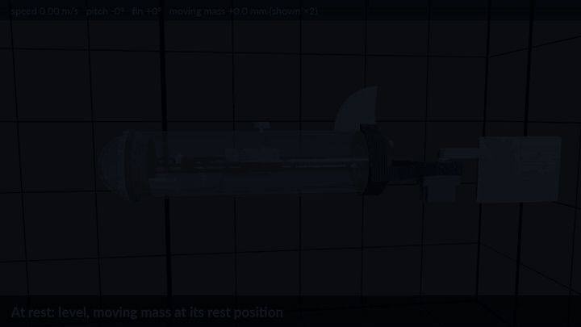

*The simulated robot swimming, diving, climbing and turning (2× speed).*

<table>
  <tr>
    <td width="42%">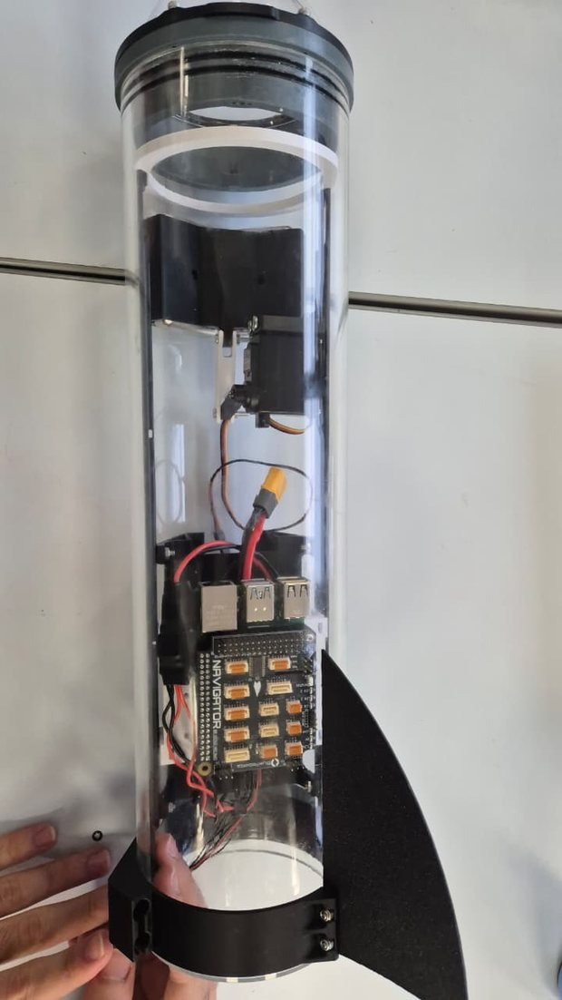</td>
    <td>
      <b>The real robot during assembly</b><br><br>
      A transparent tube holds the computer, the battery and a sliding weight. A dorsal fin keeps it stable, and a tail fin, added at the back, makes it swim.<br><br>
      <b>In short</b>
      <ul>
        <li><b>No propeller:</b> one servo flaps the tail fin to swim and steer.</li>
        <li><b>No ballast:</b> a sliding weight tilts the robot, which then dives or climbs while it swims.</li>
        <li><b>Same software in simulation and on the robot:</b> only the lowest layer, which talks to the hardware, changes.</li>
      </ul>
    </td>
  </tr>
</table>

## Team

Pedro ALVES DE ARAUJO SILVA, Daniel FARLEI SILVA SOUZA, Matheus BENIGNO DA SILVA, Leticia LIE FURUTA, Pedro BARBOSA NORI and Luiz Felipe BARROS ALVES.

## Contents

- [Current status](#current-status)
- [How the robot works](#how-the-robot-works)
- [The physical robot](#the-physical-robot)
- [Electrical design](#electrical-design)
- [Project cost](#project-cost)
- [The simulator](#the-simulator)
- [The software](#the-software)
- [Results so far](#results-so-far)
- [Try it](#try-it)
- [Repository layout](#repository-layout)
- [Documentation](#documentation)
- [Limitations and next steps](#limitations-and-next-steps)

## Current status

| Part | Status |
| --- | --- |
| Simulator: basin, campus scene, physics, sensors, actuators | Done, not yet calibrated against the real robot |
| Heading following | Done and tested in simulation |
| Orientation and depth estimation from the raw sensors | Done and tested in simulation |
| Depth regulation | Done and tested in simulation |
| Position estimation from the flapping commands | Done and tested in simulation, not calibrated on the robot |
| Waypoints and missions | Planned |
| Robot drivers (ROS 2) | Written, tested only on a fake board |
| Electrical schematic and cost study | Done |
| Real robot | In assembly; **no test in the water yet** |

## How the robot works

| Function | How it is done |
| --- | --- |
| **Swimming** | A servo flaps the tail fin from side to side. In the simulation, 1.5 Hz with an amplitude of 30° gives about 0.7 m/s |
| **Turning** | The flapping is shifted to one side (the *bias*). The robot only turns while it swims |
| **Changing depth** | A weight slides along the front half of the tube. Forward, the nose goes down and the robot dives; backward, it climbs. This also only works while swimming |
| **Staying upright** | The center of mass is below the center of buoyancy, so the robot returns to level by itself |
| **Knowing where it points** | A filter combines the gyroscope, accelerometer and magnetometer. A pressure sensor gives the depth |

## The physical robot

Built on the base design given in the course (tube, dome, rails and mounts), with the tail and the sliding-mass mechanism designed by the team in [Onshape](https://www.onshape.com/) and 3D printed.

<table>
  <tr>
    <td width="50%">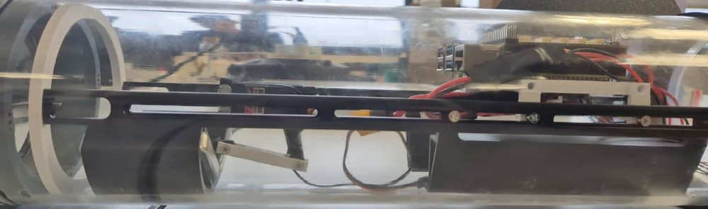<br><sub>Side view: moving mass on the left, electronics and battery on the right, on two rails.</sub></td>
    <td width="50%">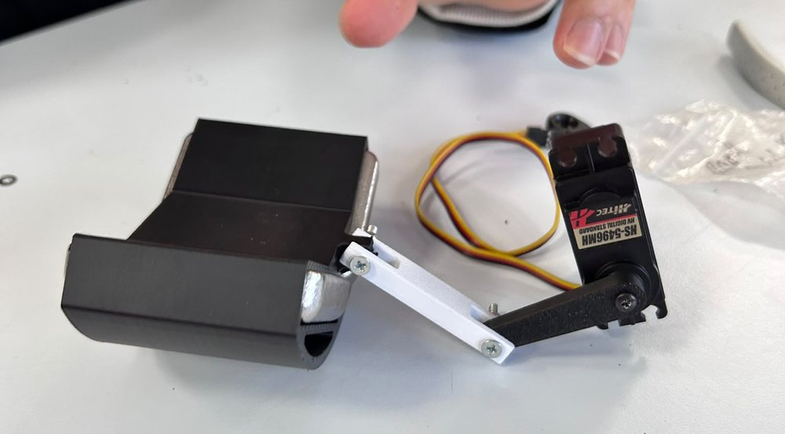<br><sub>Moving mass: a servo pushes a carriage with metal weights through an arm and a link.</sub></td>
  </tr>
  <tr>
    <td>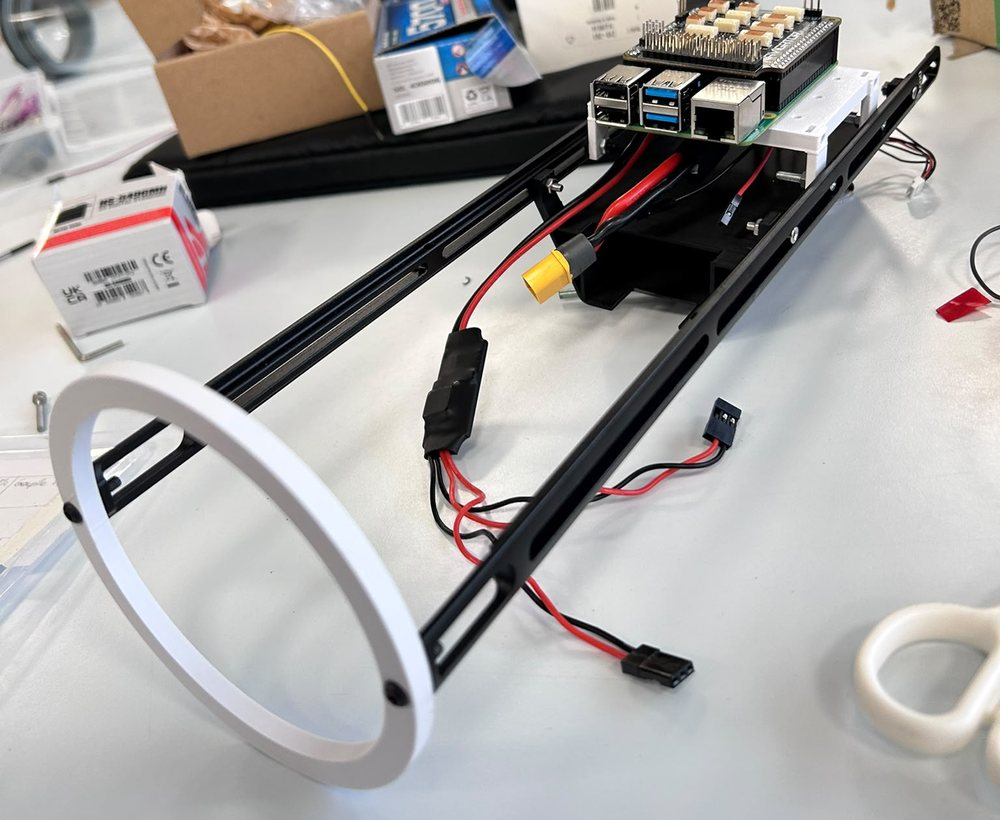<br><sub>Inner structure: rails, Raspberry Pi with the Navigator board, battery tray.</sub></td>
    <td>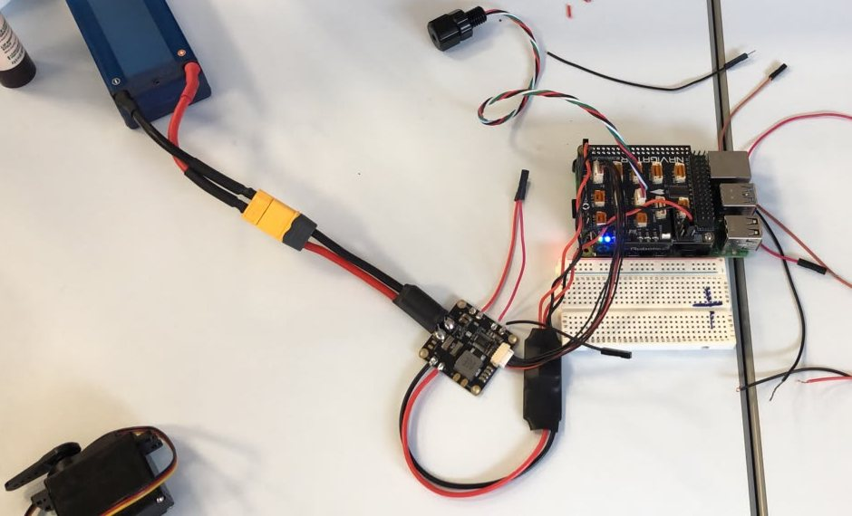<br><sub>Electronics tested on the bench before the assembly.</sub></td>
  </tr>
  <tr>
    <td>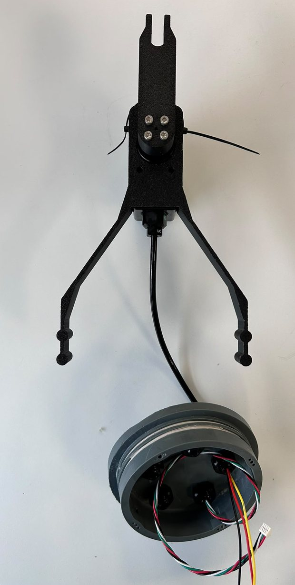<br><sub>Tail drive: waterproof servo on its printed support, with the cable going through the rear cap.</sub></td>
    <td>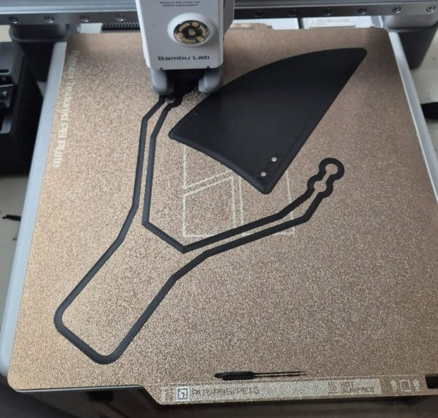<br><sub>3D printing of the dorsal fin and the tail support.</sub></td>
  </tr>
</table>

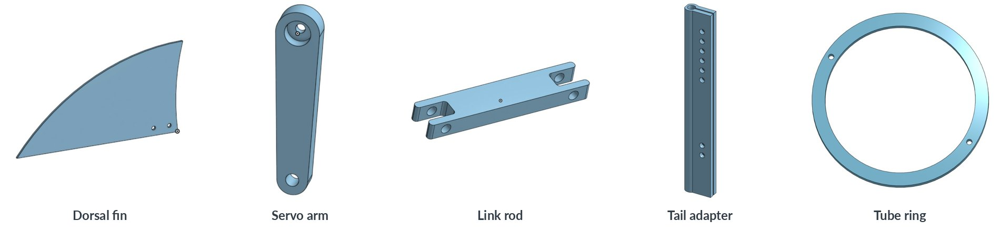

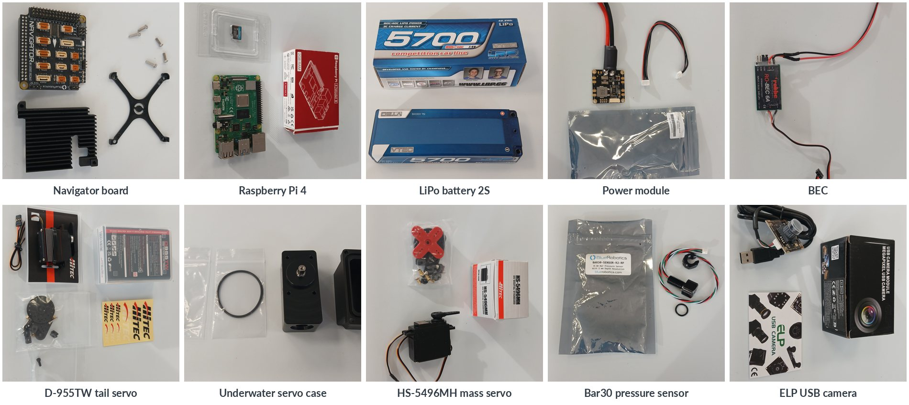

| Component | Role |
| --- | --- |
| Raspberry Pi 4 (2 GB) | Onboard computer: Ubuntu 24.04, ROS 2 Jazzy |
| Blue Robotics Navigator | Board on the Raspberry Pi: IMU, magnetometer, servo outputs |
| Bar30 pressure sensor | Depth |
| ELP 16 MP USB camera | Front camera, behind the dome |
| Hitec D-955TW in a Blue Trail Engineering underwater servo kit | Tail servo, outside the tube |
| Hitec HS-5496MH | Moving-mass servo, inside the tube |
| LiPo battery 2S, 7.4 V, 5700 mAh | Power source |
| PM02 V3.2 power module and 5 V, 6 A supply | Power distribution for the electronics |
| Blue Robotics watertight enclosure (Ø110 × 400 mm tube and dome) | Waterproof hull |

Total length: about 0.81 m with the tail. The simulator assumes about 4.7 kg, which makes the robot neutral in water; the real mass still has to be measured.

## Electrical design

The battery feeds the power module, which supplies the servos directly at 7.4 V and the electronics through a 5 V supply. The Raspberry Pi commands the servos with PWM signals through the Navigator board, reads the pressure sensor over I2C and the camera over USB.

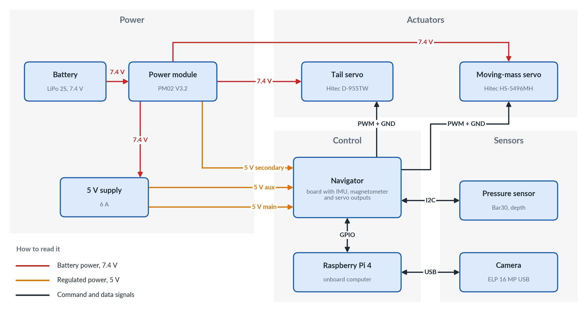

## Project cost

Estimated total: **about €9,440**, of which about 87 % is labor. The detail, sources and assumptions are in the [budget spreadsheet](Docs/AUV_Project_Budget.xlsx).

| Category | Details | Cost |
| --- | --- | --- |
| Hardware | 14 items, without shipping and taxes | €1,183 |
| Labor | 270 h planned (240 h in class, 30 h outside) at €27.79/h, based on a junior engineer | €7,504 |
| Contingency | 10 % of the labor | €750 |
| **Total** | | **€9,438** |

| Largest hardware items | Cost |
| --- | --- |
| Watertight enclosure | €376 |
| Navigator board | €196 |
| Underwater servo kit | €165 |
| Hitec D-955TW servo | €104 |

**Proposed new components, not included in the total:** GNSS receiver (€49) and Ping sonar altimeter (€383).

## The simulator

The simulator recreates the ENSTA Air-Sea Test Basin (20 × 12 × 6 m) in **Unity 6** and exchanges data with the software through **ROS 2**, so the code tested here is the code meant for the robot.

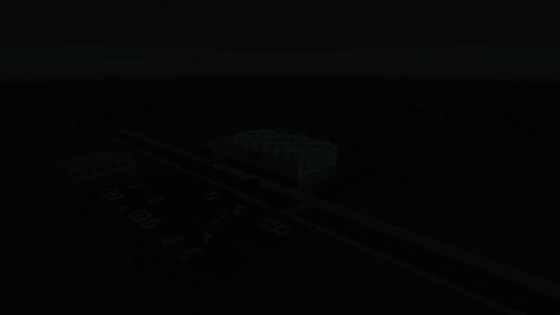

*Camera tour from the campus to the robot (2× speed).*

| Simulated | Details |
| --- | --- |
| **Physics** | Weight, buoyancy over the real displaced volume, hull drag, lift of the dorsal fin, reaction of the water on the flapping tail, moving mass |
| **Sensors** | RGB camera, IMU, magnetometer, pressure, GNSS (only at the surface), with noise |
| **Actuators** | Tail servo limited by its speed and torque, moving mass |
| **Scenes** | Basin with a metric grid, plain basin, and the whole campus for presentations |
| **Model** | Geometry and masses taken from the CAD |

**About the videos:** the motion of the hull caused by the tail strokes is filtered on the screen, from ±6.4° of yaw in the physics to about ±1° displayed. This only changes the display: sensors, physics and control use the true values. The real motion will be known after the tests in the water. See [RobotFish_Model.md](Docs/RobotFish_Model.md#51-tail-flapping).

## The software

Everything runs as ROS 2 nodes written in Python. The architecture follows the classic split of **navigation** (where am I?), **guidance** (where should I go?) and **control** (how do I get there?), based on the `navigator` package given in the course.

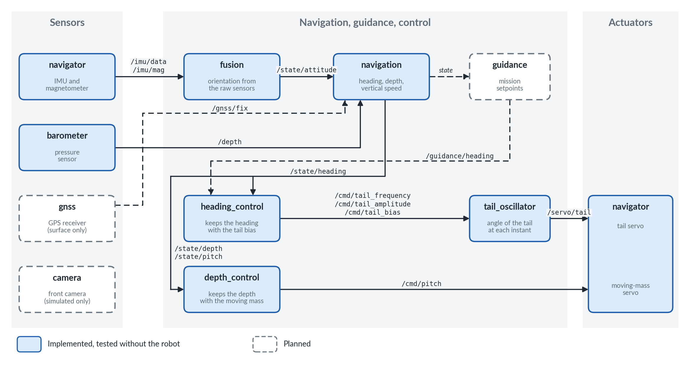

- **In the simulation,** Unity replaces the sensors, the servos and `tail_oscillator`, with the same topics.
- **On the robot,** `navigator` is the only node that talks to the board. Without commands for 0.5 s, the servos return to the center.

| ROS 2 package | Content |
| --- | --- |
| [`gnc_control`](ros2_ws/src/gnc_control) | `fusion`, `navigation` (orientation, depth and position), `heading_control`, `depth_control`, `tail_oscillator` |
| [`auv_hardware`](ros2_ws/src/auv_hardware) | `navigator`, `barometer`, launch file and parameters of the robot |

## Results so far

All from the simulation, closed loop through ROS 2. Nothing has been measured on the real robot yet.

| Test (1.5 Hz, amplitude 30°) | Result |
| --- | --- |
| Swimming speed | 0.69 m/s |
| Heading error of the estimate, sensors with calibrated errors | 0.80° rms, 1.53° at most |
| Position error over a 21 m path | 1.06 m at most |
| 180° turn: within ±5° of the target after | 8.4–8.6 s, overshoot below 2° |
| Same, with uncalibrated sensors | The control fails, so calibration is required on the robot |
| Depth steps of ±1 m while turning | Within 0.1 m after 7–22 s, error at the end below 0.03 m |

## Try it

You need Ubuntu 24.04, [ROS 2 Jazzy](https://docs.ros.org/en/jazzy/Installation.html) and Unity 6000.6.5f1.

**Just the simulator (no ROS 2 needed):** open the project with Unity Hub (*Add project from disk*), open `Assets/TestBasin/Scenes/Basin_Grid.unity`, press Play and click the Game view.

| Key | Action |
| --- | --- |
| Space | Swim |
| A / D | Turn (while swimming) |
| W / S | Move the mass forward / backward |
| C | Free camera (right mouse button + WASD) |

**With the heading control.** Once, install the dependencies and build:

```bash
python3 -m pip install --user --break-system-packages imufusion
source /opt/ros/jazzy/setup.bash
mkdir -p ~/ros2_ws/src && cd ~/ros2_ws/src
git clone -b main-ros2 https://github.com/Unity-Technologies/ROS-TCP-Endpoint.git
cd ~/ros2_ws && colcon build
cd <path to>/brazilian-team-repo/ros2_ws
colcon build --symlink-install --packages-select gnc_control
```

Terminal 1, bridge between Unity and ROS 2 (then press Play in Unity):

```bash
source /opt/ros/jazzy/setup.bash
export ROS_AUTOMATIC_DISCOVERY_RANGE=LOCALHOST
cd ~/ros2_ws && source install/setup.bash
ros2 run ros_tcp_endpoint default_server_endpoint --ros-args -p ROS_IP:=127.0.0.1
```

Terminal 2, navigation:

```bash
source /opt/ros/jazzy/setup.bash
export ROS_AUTOMATIC_DISCOVERY_RANGE=LOCALHOST
cd <path to>/brazilian-team-repo/ros2_ws && source install/setup.bash
ros2 launch gnc_control navigation.launch.py
```

Terminal 3, heading control (the robot starts swimming after about 3 s):

```bash
source /opt/ros/jazzy/setup.bash
export ROS_AUTOMATIC_DISCOVERY_RANGE=LOCALHOST
cd <path to>/brazilian-team-repo/ros2_ws && source install/setup.bash
ros2 launch gnc_control heading_control.launch.py
```

Terminal 4, ask for a heading in degrees, clockwise from north (Ctrl+C to change it; the basin is small, so watch the walls):

```bash
source /opt/ros/jazzy/setup.bash
export ROS_AUTOMATIC_DISCOVERY_RANGE=LOCALHOST
ros2 topic pub -r 2 /guidance/heading std_msgs/msg/Float64 "{data: 180.0}"
```

To run the code on the real robot, follow [Robot_Setup.md](Docs/Robot_Setup.md).

## Repository layout

```text
Assets/
├── AUV/          robot fish: physics, sensors, ROS 2 commands, CAD models, prefabs
├── TestBasin/    test basin: scenes, grid shader, ground-truth logger
├── Environment/  campus scene: building, surroundings, camera tour
└── Settings/     render pipeline settings
ros2_ws/src/
├── gnc_control/  navigation and control nodes
└── auv_hardware/ drivers and launch file of the real robot
Docs/             documentation, images and videos
Tools/
├── cad_analysis/  physical properties of the robot from its CAD, CAD to Unity conversion
└── scene_assets/  logo and sign textures of the campus scene
```

## Documentation

| Document | Content |
| --- | --- |
| [GNC.md](Docs/GNC.md) | Commands, heading control, navigation: design, tests and how to run them |
| [Robot_Setup.md](Docs/Robot_Setup.md) | Installation, calibration and first tests on the real robot |
| [RobotFish_Model.md](Docs/RobotFish_Model.md) | Physical model of the robot and its tests |
| [RobotFish_Assumptions.md](Docs/RobotFish_Assumptions.md) | Every estimated value, and what to measure on the real robot |
| [RobotFish_CAD_Report.md](Docs/RobotFish_CAD_Report.md) | Properties computed from the CAD |
| [AUV_Sensors.md](Docs/AUV_Sensors.md) | Simulated sensors, frames and ROS 2 topics |
| [TestBasin.md](Docs/TestBasin.md) | Test basin simulation |
| [Campus_Scene.md](Docs/Campus_Scene.md) | Campus scene |

## Limitations and next steps

**Limitations**

- The simulator is not calibrated yet: drag, water reaction on the tail and masses are estimates, listed in [RobotFish_Assumptions.md](Docs/RobotFish_Assumptions.md).
- The drivers have only run on a fake board.
- The simulation uses the moving mass of the target design (from the tube center to the front). The mechanism assembled today moves less, and the team expects to change it.

**Next steps**

1. Integrate software and robot: install, calibrate and run the [first tests](Docs/Robot_Setup.md).
2. Waterproofing, balancing and tests in the basin, with videos.
3. Compare the simulator with the real robot and adjust it.
4. Waypoints and missions.
